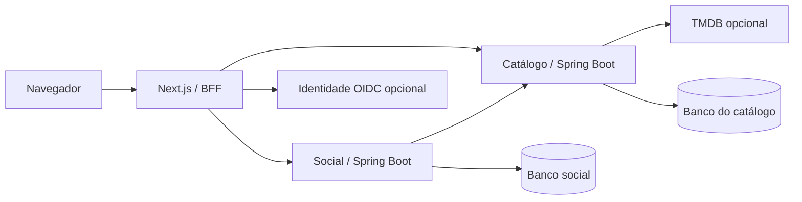

# Cena Aberta

Diário audiovisual em português para descobrir, registrar e avaliar filmes, séries e animes. Anime é uma categoria compartilhada por filmes e séries. Projeto em versão alpha, com frontend Next.js e serviços Java independentes.

A aplicação inclui busca, filtros, perfil, **Vou ver**, notas de meia a cinco estrelas, resenhas, diário, ranking, amizades, importação do Letterboxd e salas para escolher filmes em grupo. O catálogo fictício funciona sem credenciais externas.

Cada obra tem uma página própria. No perfil, “Vou ver” e “Já vistos e avaliações” exibem cards. O ranking pessoal separa filmes, séries e animes e permite organizar até 100 obras assistidas entre cinco categorias: Obra-prima, Muito bom, Bom, Regular e Não gostei. As posições são salvas automaticamente. No celular, seletores e setas permitem mover e reordenar os cards; em caso de falha, **Salvar ranking** repete a tentativa sem descartar a organização local.

Séries e animes seriados recebem notas por episódio: a média da temporada considera apenas episódios avaliados, e a média da obra considera as temporadas com notas. Novas avaliações são públicas e sem spoiler por padrão. O usuário pode mudar a visibilidade e marcar spoilers por obra. Preferências existentes e avaliações importadas são preservadas. A comunidade mostra avatar, nota e resenha conforme essa visibilidade.

Marcar **Já vi** registra a primeira sessão no **Diário**, remove a obra do **Vou ver** e libera nota, ranking e resenha. A resenha é a última área do card e usa **Salvar resenha**; nota, ranking e visibilidade são controles independentes. Para registrar uma revisualização, marque **Vi novamente**, clique em **Registrar sessão** e confirme. A revisualização guarda a data e a hora do clique.

## Executar localmente

Requisitos: Java 21, Maven e Node.js 24. Na raiz deste projeto, `sdk env` (usa `.sdkmanrc`) e `nvm use` (usa `.nvmrc`) selecionam as versões certas:

```shell
mvn -B package
npm --prefix apps/web ci
npm --prefix apps/web run build
node scripts/local.mjs
```

Abra [http://localhost:3000](http://localhost:3000) e clique em **Criar conta** ou **Entrar**. A página inicial apresenta o projeto. O catálogo e as funções pessoais exigem uma conta. Os dados locais e a chave de sessão gerada pelo inicializador ficam em `data/`. Você pode configurar outra chave com `NEXTAUTH_SECRET` no ambiente ou no `.env`. Os três processos escutam apenas no computador local. Encerre com Ctrl+C.

No login por e-mail, **Manter conectado** guarda a sessão no navegador por até 30 dias. Com a opção desmarcada, a sessão expira em até oito horas e o navegador recebe um cookie de sessão.

### Docker Compose e PostgreSQL

Copie `.env.example` para `.env` e preencha os segredos e as senhas com valores distintos. Os segredos internos exigem pelo menos 24 caracteres. Execute `docker compose up --build` e abra a mesma URL. O Compose configura dois bancos PostgreSQL persistentes. Somente a interface web é publicada no host.

### Cadastro e recuperação por e-mail

Em **Criar conta**, informe o e-mail. Abra o link recebido, defina a senha e complete o perfil com nome e nome de usuário. A foto é opcional; também há avatares prontos. CPF não é solicitado. O mesmo padrão de link vale para **Esqueci a senha**, que envia somente para contas existentes e tem intervalo de dois minutos entre reenvios, aplicado no servidor e indicado na interface. Os links expiram em uma hora e só podem ser usados uma vez.

O inicializador local habilita o cadastro com `EMAIL_MODE=log` por padrão. Nesse modo, use um endereço fictício e abra o link exibido no terminal do serviço social. Para enviar via Brevo, configure `EMAIL_ACCOUNTS=true`, `EMAIL_MODE=smtp`, `SMTP_HOST=smtp-relay.brevo.com`, `SMTP_PORT=587`, `SMTP_USERNAME`, `SMTP_PASSWORD`, `SMTP_STARTTLS=true` e `MAIL_FROM` com um remetente verificado no `.env` deste projeto. Defina `FRONTEND_URL` com o endereço que o destinatário consegue abrir. Em ambiente hospedado, use HTTPS. [SMTP da Brevo](https://help.brevo.com/hc/en-us/articles/7924908994450-Send-transactional-emails-using-Brevo-SMTP)

As senhas são armazenadas como hash BCrypt. A recuperação invalida sessões anteriores. A escolha de OIDC substitui o cadastro por e-mail neste ambiente. Em cada instalação, valide a entrega SMTP com um remetente autorizado antes de convidar usuários.

### Ativar filmes e séries reais com TMDB

1. Na seção API das configurações da sua conta TMDB, solicite acesso e copie o **API Read Access Token**.
2. Na raiz do projeto, copie `.env.example` para `.env` caso ele ainda não exista. Preencha a linha `TMDB_TOKEN=` com o token. O arquivo local é ignorado pelo Git.
3. Reinicie `node scripts/local.mjs` ou execute `docker compose up -d catalog` se já estiver usando Compose. Entre com sua conta e busque um título, como *Cidade de Deus*.

O catálogo consulta a API em PT-BR e carrega detalhes sob demanda. O filtro de anime usa animação em japonês como heurística. Com o token vazio, o catálogo exibe obras fictícias. A tela de créditos exibe a atribuição ao TMDB. [Autenticação da API](https://developer.themoviedb.org/docs/authentication-application) · [Atribuição e condições de uso](https://developer.themoviedb.org/docs/faq)

## Arquitetura



O BFF verifica a sessão e autoriza os caminhos de API expostos ao navegador. Os serviços recebem a identidade derivada da sessão pelo canal interno autenticado. Cada serviço tem credencial e migrações próprias. O catálogo usa identificadores estáveis com o tipo de mídia do provedor. O social é responsável pela propriedade dos registros e aplica as mudanças de biblioteca e avaliações em transações locais. Criações de sessões aceitam `Idempotency-Key` e reusam o resultado para a mesma requisição por 24 horas.

## Verificação

Com os builds prontos, execute `node scripts/smoke.mjs`. O teste sobe servidores temporários em loopback e, por padrão, bancos H2 em memória. Ele verifica autenticação interna, busca, categorias, regras de nota e interesse, conflito de edição, idempotência, propriedade de registros, sessão web e proteção de origem. O workflow do GitHub executa os mesmos builds e testes.

O mesmo teste passou com PostgreSQL 16 em bancos descartáveis. Para repetir, forneça dois bancos vazios com `SMOKE_CATALOG_JDBC` e `SMOKE_SOCIAL_JDBC`, além de `SMOKE_DB_USER` e `SMOKE_DB_PASSWORD`. O teste cria registros, então use apenas bancos de teste.

## Comunidade e escolha em grupo

- **Amigos:** busca, pedido, aceite, recusa e cancelamento. O perfil visitado mostra o estado da amizade e uma lista paginada de amigos, com foto, nome e acesso aos respectivos perfis. Apenas amizades aceitas e perfis ativos aparecem; pedidos pendentes permanecem privados.
- **Privacidade do perfil:** visibilidade independente de **Vou ver**, **Meu ranking**, **Já vistos e avaliações** e **Diário**, filtrada também na API. As avaliações das obras têm controle separado.
- **Salas:** de 2 a 8 participantes, filmes do Vou ver e sugestões do catálogo, seleção de vários gêneros, votos persistidos e escolha por unanimidade. A maioria pode abrir uma reconsideração para quem passou. Convites internos ficam em Minhas salas e exigem confirmação de entrada. [Regras das salas](deploy/MOVIE_ROOMS.md).
- **Importação:** ZIP do Letterboxd com revisão de correspondências antes de importar. Repetições não duplicam registros nem sobrescrevem avaliações existentes. [Limites e funcionamento](deploy/LETTERBOXD_IMPORT.md).
- **Feedback:** envio privado de sugestões e problemas, com painel restrito à administração.

## Limites desta entrega

A alpha pode rodar no PC com Docker Desktop e Tailscale Funnel. Disponibilidade depende do computador ligado, conexão de rede e serviços ativos. iPhone e PWA ainda não foram validados. Algumas áreas sociais usam limites de consulta; amigos e convites têm paginação.

OIDC permanece opcional. Configure `OIDC_ISSUER`, `OIDC_CLIENT_ID`, `OIDC_CLIENT_SECRET` e `INVITED_SUBJECTS`, com retorno em `/api/auth/callback/keycloak`. [Documentação OIDC do Keycloak](https://www.keycloak.org/securing-apps/oidc-layers).

O catálogo de demonstração e a identidade visual são próprios. O projeto se inspira na ideia de diário audiovisual do Letterboxd.


## Desenvolvimento mobile e próximas entregas

O [plano mobile](PLANO_MOBILE.md) registra as etapas, verificações e limitações. A rodada em aparelho real cobriu Chrome no Galaxy S24, teclado virtual, seleção de avatar e reordenação do ranking. iPhone e PWA permanecem fora da validação atual.

Os procedimentos para Windows com Docker Desktop ou servidor Linux, publicação pelo Tailscale Funnel, backup e restauração isolada estão em `deploy/`. Cada instalação deve validar SMTP, HTTPS e restauração com sua própria configuração.

## Configuração privada

O repositório contém apenas o modelo `.env.example`, sem credenciais. Crie seu `.env` localmente e mantenha tokens do TMDB, credenciais SMTP, segredos de sessão e senhas de bancos fora do controle de versão. Bancos, uploads de usuários, certificados, logs e capturas locais não fazem parte da distribuição. O teste de integração utiliza contas fictícias e serviços simulados; não precisa de credenciais do TMDB ou SMTP.

## Cadastro por convite

Para o alpha restrito, configure no `.env` privado:

```dotenv
INVITE_ONLY=true
INVITED_EMAILS=convidado@example.test,outro@example.test
```

Substitua os endereços fictícios pelos convidados reais, sem versionar a lista. Separe os endereços por vírgulas; espaços nas extremidades e diferenças entre maiúsculas e minúsculas são normalizados. Com o modo ativo e a lista vazia, nenhum novo cadastro é permitido. Uma entrada inválida impede a inicialização do serviço social, sem registrar o endereço no erro.

Reinicie `node scripts/local.mjs` ou recrie o serviço com `docker compose up -d social` após alterar a lista. No ambiente alpha, use os mesmos arquivos Compose e `--env-file deploy/.env` da implantação. `docker restart` sozinho não recarrega variáveis de ambiente. A autorização é verificada tanto ao solicitar o link quanto ao confirmar a conta. Remover um endereço e reiniciar o serviço bloqueia inclusive links de cadastro já emitidos. Os links expiram em uma hora e só podem ser utilizados uma vez; nenhuma conta é criada antes da confirmação.

A mensagem de cadastro não revela se um endereço foi convidado ou já tem conta; nesses casos, uma resposta de sucesso não garante envio. A recuperação também mostra a mesma mensagem para endereços com ou sem conta; endereços sem conta não recebem e-mail. A lista controla **novos cadastros**: remover um convidado não revoga uma conta existente, suas sessões ou a recuperação de senha. `INVITE_ONLY=false` mantém o cadastro aberto por e-mail verificado. O modo OIDC continua usando `INVITED_SUBJECTS` de forma independente.

Os testes do serviço social usam banco em memória e remetente simulado para verificar convite válido, endereço não autorizado, lista vazia, link expirado ou removido, uso único e recuperação de uma conta existente. Execute `mvn -B package` e depois `node scripts/smoke.mjs` para validar também os fluxos completos.

## Implantação do alpha

Consulte [Implantação, Funnel e recuperação](deploy/README.md) para configurar o Compose restrito, publicar HTTPS e executar backup e restauração isolada. Use `deploy/.env` privado no servidor; o GitHub recebe somente o modelo sem credenciais.

## Parceiros do projeto

- [Vinícius Araújo (@viiveki)](https://github.com/viiveki)
- Luiz

### Conta e aparência

Em **Meu perfil > Minha conta**, o usuário pode pausar, reativar ou excluir a conta mediante confirmação da senha. Pausar oculta o perfil e bloqueia interações; novo login permite reativar. Excluir é uma exclusão lógica: marca a conta como deletada, oculta o perfil e bloqueia login, sem apagar registros. As operações invalidam sessões e links de e-mail anteriores.

O seletor **Aparência** oferece Escuro, Claro e Sistema. A preferência fica salva no navegador; Sistema acompanha a aparência do dispositivo.

### Anexos de feedback

Relatos aceitam até quatro imagens JPG, PNG ou WebP (entrada de até 15 MB cada), convertidas no navegador para JPEG de até 1 MB. O servidor valida dimensões e conteúdo e regrava a imagem sem metadados. Anexos e previews só ficam disponíveis ao autor antes do envio e aos administradores depois dele.

A cota global é de 4.000.000.000 bytes de imagens armazenadas no banco. Ao receber novos anexos, os mais antigos são removidos até liberar espaço, preservando o texto dos relatos. Uma trava transacional mantém a cota mesmo com uploads simultâneos. Resolver um relato remove seus anexos; resolver um bug também agenda um agradecimento por e-mail, uma vez por relato. A fila tenta novamente em falhas SMTP e ignora contas deletadas ou sem e-mail. Em uma interrupção entre a aceitação SMTP e a confirmação no banco, uma retentativa pode duplicar o agradecimento.

A cota mede conteúdo de imagens, não o tamanho físico de PostgreSQL, WAL ou backups. Exclusões permitem reaproveitar espaço no banco, mas não garantem redução imediata do arquivo no disco. Backups existentes podem conter anexos já removidos. Não há limpeza retroativa de backups por esta funcionalidade.
