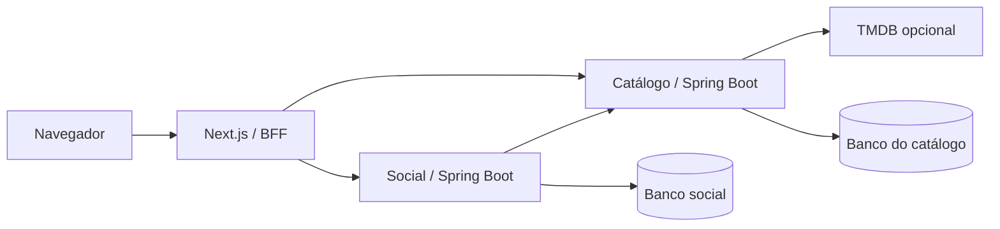

# Decisões da refatoração do Cena Aberta

> Branch `refactor/melhoria-servicos` · versão reconciliada: 10 commits sobre o alpha (`referencia/alpha-2026-11-23`, `8d10d1e`) · 23/11/2026
>
> **Leia primeiro o capítulo [Reconciliação com o alpha](#reconciliação-com-o-alpha).** Os capítulos por commit descrevem a primeira versão do PR, e cada um avisa no topo o que mudou.
>
> Este documento explica **o que** foi feito em cada commit, **como** foi feito, **por que** foi feito assim, **quais eram as outras opções** e **por que elas foram descartadas**.

---

## Como ler este documento

Cada commit tem seu próprio capítulo. Dentro de cada capítulo, as mudanças estão separadas em dois níveis:

- **Pontos A (muito importantes):** mudanças que alteram a estrutura do projeto, a segurança ou a forma como o time trabalha. Se você só tiver tempo para ler uma parte, leia estas.
- **Pontos B (menos importantes, mas ainda importantes):** detalhes de implementação, testes de apoio, ajustes de configuração e decisões menores que sustentam os Pontos A.

Cada ponto segue o mesmo roteiro:

1. **Em 1 linha:** a resposta direta.
2. **A analogia:** a mesma ideia com algo do dia a dia.
3. **O contexto:** o que você precisa saber do projeto para entender o ponto.
4. **Como era antes:** com trecho real do código antigo.
5. **Como ficou:** com trecho real do código novo.
6. **Quais eram as outras opções:** em tabela, com o motivo de cada uma não ter sido escolhida.
7. **Por que essa foi a melhor forma.**
8. **O que ficou pendente.**

Quando alguma afirmação for uma suposição (e não algo verificado no código), ela aparece marcada como **hipótese**.

---

## Índice

0. [Reconciliação com o alpha](#reconciliação-com-o-alpha)
1. [Visão geral do projeto antes da refatoração](#visão-geral-do-projeto-antes-da-refatoração)
2. [O plano por trás dos commits](#o-plano-por-trás-dos-commits)
3. [Commit 91fc663 — build: exigir Java 21 e fixar versões das ferramentas locais](#commit-91fc663--build-exigir-java-21-e-fixar-versões-das-ferramentas-locais)
4. [Commit 2d3c70b — test(catalog): extrair TmdbMapper e criar testes do catálogo](#commit-2d3c70b--testcatalog-extrair-tmdbmapper-e-criar-testes-do-catálogo)
5. [Commit 351d5e4 — refactor(social): centralizar a verificação da chave interna em um filtro](#commit-351d5e4--refactorsocial-centralizar-a-verificação-da-chave-interna-em-um-filtro)
6. [Commit 2be0189 — refactor(social): dividir Social em controllers por domínio](#commit-2be0189--refactorsocial-dividir-social-em-controllers-por-domínio)
7. [Commit 18afa47 — refactor(web): extrair a lista de rotas do BFF para um módulo testado](#commit-18afa47--refactorweb-extrair-a-lista-de-rotas-do-bff-para-um-módulo-testado)
8. [Commit ad64633 — ci: verificar se toda rota Spring passa pelo BFF ou está marcada como interna](#commit-ad64633--ci-verificar-se-toda-rota-spring-passa-pelo-bff-ou-está-marcada-como-interna)
9. [Commit e3f793f — chore(web): adicionar ESLint e Prettier e formatar o código](#commit-e3f793f--choreweb-adicionar-eslint-e-prettier-e-formatar-o-código)
10. [Commit eda18ad — refactor(web): tirar componentes de apresentação do app.tsx](#commit-eda18ad--refactorweb-tirar-componentes-de-apresentação-do-apptsx)
11. [Commit 2fbb540 — chore: ignorar o estado local da ferramenta .omc](#commit-2fbb540--chore-ignorar-o-estado-local-da-ferramenta-omc)
12. [Verificação: como sabemos que nada quebrou](#verificação-como-sabemos-que-nada-quebrou)
13. [Pendências e próximos passos](#pendências-e-próximos-passos)
14. [Glossário](#glossário)

> Os capítulos dos commits estão agrupados por tema: backend primeiro, depois o contrato BFF ↔ serviços e por fim o frontend. A ordem cronológica real está na tabela da seção 2.

---

## Reconciliação com o alpha

> Este capítulo foi escrito depois de todos os outros. Os capítulos por commit descrevem a **primeira versão** do PR, feita sobre o `main` (`703b632`). Cada um deles abre com um aviso **"Atualização (reconciliação)"** quando algo mudou. Tudo que vale hoje está resumido aqui.

### Em 1 linha
O dono do projeto pediu que a refatoração fosse refeita **sobre o código que está publicado no alpha**, e não sobre o `main` antigo. A série foi reaplicada commit a commit em cima da branch `referencia/alpha-2026-11-23` (`8d10d1e`), adaptando cada passo às funcionalidades novas.

### A analogia
Você reformou a planta de uma casa, mas nesse meio tempo o dono construiu três cômodos novos e derrubou um. A reconciliação é refazer a sua reforma na casa **como ela está hoje**: os cômodos novos entram na fiação nova, e o cômodo derrubado (as Listas) some da planta.

### O contexto
- O PR #1 foi feito a partir do `703b632`. Enquanto isso, o alpha (a versão publicada que os usuários usam) ganhou: voto de spoiler nas resenhas, paginação do diário, notificações, um serviço de backup em Python, filtros nas salas (Sélete), reserva e reconciliação do feedback e a **remoção do recurso de Listas**.
- Esse código só existia no ambiente do dono. Ele publicou tudo num único commit, `8d10d1e`, na branch `referencia/alpha-2026-11-23`.
- Um merge direto do alpha com a branch antiga dava **conflito em 23 arquivos**. O mais grave era o `Social.java`: o alpha mudou código que, na refatoração, tinha sido movido para outras classes, e o Git não acompanha código que muda de arquivo.

### Como foi feito
Foi criada a branch `refactor/reconciliacao-alpha` a partir do alpha, e os commits foram reaplicados um por um, com os testes rodando a cada passo:

| PR original | Série reconciliada | O que mudou na reaplicação |
|---|---|---|
| `91fc663` build: Java 21 | `5e22872` | Nada |
| `2d3c70b` test(catalog): TmdbMapper | `3dae503` | O alpha mudou as sugestões e o cache de gêneros (`genre_ids`). A extração foi feita sobre a versão nova, e o `CatalogTest` passou a carregar a migração `V3` |
| `351d5e4` refactor(social): filtro da chave | `36b0269` | Conflito no `LetterboxdImport`: ficou a versão do alpha (sem listas na importação), só sem o parâmetro `secret` |
| `2be0189` refactor(social): dividir Social | `ba84025` | **O `Lists` não é mais criado.** A limpeza dos votos de spoiler foi levada para o `Library`, com teste novo. Os endpoints novos do alpha ficaram no `Social` |
| `18afa47` refactor(web): rotas do BFF | `cf4d3fc` | Refeito à mão: **33 regras** do alpha (eram 26) e **três destinos** (`catalog`, `social`, `backup`). O script `test` entra junto com o primeiro teste |
| `e3f793f` chore(web): ESLint + Prettier + formatação | `01cc184` + `c64fe86` | **Dividido em dois**: um commit só com a configuração e outro só com a formatação. Inclui uma correção de lint em código do alpha |
| `eda18ad` refactor(web): componentes do app.tsx | `f60758d` | A extração aparece como **+2/−38 linhas**, porque a formatação não está mais misturada |
| `2fbb540` chore: ignorar .omc | `76661d2` | Nada |
| `ad64633` ci: rotas | `69cc69e` | O `check-routes.mjs` ganhou **quatro verificações novas** (destino, rota interna com o método real, regra sem endpoint e backup) |
| `8e7464a` docs | último commit | Este capítulo e os avisos de atualização |

### Pontos A (muito importantes)

#### A1. Reaplicar commit a commit em vez de fazer merge

**Em 1 linha:** cada commit foi reaplicado sobre o alpha (cherry-pick, que copia um commit para outra branch) ou refeito à mão, em vez de um merge único com 23 conflitos.

**Por que assim:** num merge, os 23 conflitos aparecem de uma vez, misturados, e o resultado vira um "commit de merge" enorme que ninguém consegue revisar. Commit a commit, cada conflito aparece no contexto do assunto dele (catálogo, filtro, divisão, front), e os testes rodam a cada passo.

| Opção | Por que não |
|---|---|
| Merge do alpha na branch antiga | 23 conflitos de uma vez. O código do alpha em métodos movidos ficaria no `Social` antigo e se perderia sem aviso |
| Rebase da branch antiga sobre o alpha | É o mesmo que o cherry-pick, só que automático. Mas três commits precisavam ser **refeitos** (rotas do BFF, lint/formatação, CI), não apenas reaplicados |
| Recomeçar a refatoração do zero | Jogaria fora testes e decisões que continuavam válidos. O alpha não tocou em ranking, episódios nem sessões do diário |

#### A2. O código movido que o alpha alterou

**Em 1 linha:** o alpha mudou **uma** regra dentro do código que a divisão moveu: ao editar o texto de uma resenha, os votos de spoiler daquela resenha são apagados. Ela foi levada para o `Library.java`.

**Como foi garantido:** comparei, linha a linha, o trecho do alpha (`/me/library/{id}/{action}` e as sessões do diário) com `Library.java` e `Diary.java`. Fora essa regra, as únicas diferenças eram os nomes dos helpers (`lockActive` → `actors.lockActive` etc.). Um teste novo, `LibraryTest.reviewTextChangeClearsSpoilerVotesButSameTextKeepsThem`, cobre os dois lados: o mesmo texto mantém os votos e um texto diferente os apaga. Removi a regra de propósito, o teste falhou, e então restaurei a regra.

**Por que importa:** é o tipo de mudança que um merge perderia sem nenhum erro. O código compilaria, os testes antigos passariam, e a regra simplesmente sumiria.

#### A3. Onde ficaram os endpoints novos do alpha

**Em 1 linha:** `/diary`, `/library-page`, `/notifications`, `/notifications/rooms/{id}/read` e `/titles/{id}/spoiler-vote` ficaram no `Social`, exatamente com o código do alpha.

| Opção | Por que não |
|---|---|
| Mover `/diary` para `Diary` e `/library-page` para `Library` | Os dois dependem de `profileVisibility` e `diaryPage`, que o `dashboard` do `Social` também usa. Mover exigiria transformar a visibilidade do perfil numa peça compartilhada, ou seja, uma refatoração nova em código que acabou de chegar |
| Criar um controller `Notifications` | Possível e simples, mas não foi pedido. Fica registrado como próximo passo |
| **Deixar no `Social` (escolhida)** | O comportamento do alpha fica intocado, que era o pedido principal do autor ("preservar"). O `Social` continua menor que antes (359 linhas, contra 892 no alpha) |

#### A4. Listas removidas

**Em 1 linha:** o alpha removeu o recurso de Listas, então o controller `Lists`, o `ListsTest` e as rotas `me/lists` não existem na série nova.

O `api-routes.test.ts` agora tem um caso explícito, `resolveRoute("POST", "me/lists") === null`, para garantir que a rota não volte por engano.

#### A5. Contrato do proxy: três destinos e checagem mais rígida

**Em 1 linha:** o proxy do alpha manda chamadas para um terceiro serviço (`backup`, em Python). O módulo de rotas e o `check-routes.mjs` passaram a tratar isso, e o script agora valida o que o autor pediu.

O `check-routes.mjs` falha quando:
1. um endpoint Spring não passa pelo BFF e não está marcado como interno (já existia);
2. **o BFF manda um endpoint para o serviço errado** (novo);
3. **uma rota marcada como interna fica acessível pelo proxy**, testando o método HTTP real dela e **todas** as amostras de cada `{variável}` (novo);
4. **uma regra do BFF não leva a nenhum endpoint do serviço de destino** (novo);
5. **o `deploy/backup_service.py` não tem mais um endpoint listado** (novo; como o script não lê Python, a lista é conferida contra trechos do código-fonte).

Cada uma das 5 falhas foi provocada de propósito numa cópia descartável do projeto, e o script detectou todas.

| Opção | Por que não |
|---|---|
| Ler as rotas do backup direto do Python | O serviço usa `if self.path == ...` e regex, e não anotações. Um parser seria frágil. A lista explícita, conferida contra o fonte, falha alto quando o código muda |
| Testar a rota interna só com uma amostra | Era o limite da versão anterior. Para uma rota interna, o lado seguro é exigir que **nenhuma** combinação passe |

### Pontos B (menos importantes, mas ainda importantes)

#### B1. Erro de lint em código do alpha
O alpha trouxe `useCallback(..., [pageTitle, tab==="ranking"])`, e a regra `react-hooks/use-memo` exige nomes simples na lista de dependências. A correção guarda `tab==="ranking"` numa variável `rankingTab`. A função é recriada exatamente nas mesmas situações, porque a dependência continua sendo o mesmo valor booleano.

#### B2. Formatação isolada
O problema de histórico apontado na primeira versão (o `app.tsx` formatado junto com a extração) foi resolvido: a formatação agora é o commit `style(web)`, gerado só por `npm run format`.

#### B3. Um arquivo que entrou no commit errado, e foi corrigido
Durante a reaplicação, o `ci.yml` ficou no índice do Git e entrou no commit de formatação. Isso foi corrigido antes de publicar: ele está no commit de CI, que é o lugar dele.

### Verificação da série reconciliada
Na ponta da série, com Java 21.0.3 e Node 22, todos os passos do CI passaram:

| Verificação | Resultado |
|---|---|
| `mvn -B clean package` | **105 testes, 0 falhas**: 14 do catálogo e 91 do social (o alpha tinha 0 e 42) |
| `npm run lint` | 0 erros, 59 avisos |
| `npm run format:check` | ok |
| `npx next typegen` + `npm run check` | ok |
| `npm test` | 3 de 3 |
| `npm run build` | ok |
| `node scripts/check-routes.mjs` | OK: 67 endpoints (55 pelo BFF, 12 internos), 33 regras com destino conferido |
| `node scripts/smoke.mjs` | ok (integrado, bancos H2) |
| **Commit a commit** | `mvn test`, `tsc` e `npm test` verdes nos 10 commits da série |

### O que ainda depende de decisão
1. **Base do PR:** a série parte do alpha, mas o PR aponta para o `main`. Ou a base muda para `referencia/alpha-2026-11-23`, ou o alpha entra no `main` antes.
2. **Endpoints novos no `Social`:** extrair `Notifications` e mover a paginação para `Diary` e `Library` num PR seguinte.
3. **Filtro no catálogo:** o catálogo ainda confere a chave interna no próprio controller.
4. **59 avisos de lint:** tratar uma regra por vez.

---

## Visão geral do projeto antes da refatoração

### Em 1 linha
O Cena Aberta funcionava bem, mas cresceu rápido e ficou com quase toda a regra de negócio do serviço `social` num arquivo só, com segurança repetida em cada controller, um frontend sem lint nem testes e um catálogo sem nenhum teste automatizado.

### A analogia
Pensa numa cozinha de restaurante que começou como cozinha de casa. A comida sai boa, mas tudo fica numa bancada só, cada cozinheiro tem sua própria faca e seu jeito de lavar as mãos, e ninguém confere se a geladeira está na temperatura certa. Enquanto são dois cozinheiros, dá certo. Quando entra um terceiro, começa a dar problema.

A refatoração não mudou o cardápio. Ela separou as bancadas por tipo de prato, colocou uma pia na entrada que todo mundo é obrigado a usar, e pendurou um termômetro na geladeira.

### O que é o produto
**Cena Aberta** é um diário audiovisual em português. O usuário:

- busca filmes, séries e animes (o catálogo vem do **TMDB**, The Movie Database, uma base pública de filmes e séries);
- marca obras como **Vou ver** (lista de interesse) ou **Já vi**;
- dá notas de meia a cinco estrelas, inclusive por episódio, no caso de séries;
- escreve resenhas, com controle de spoiler e de visibilidade;
- registra cada sessão em que assistiu algo no **Diário**;
- monta **listas** e um **ranking pessoal** com até 100 obras em cinco categorias;
- adiciona amigos e cria **salas** para escolher um filme em grupo, por votação;
- importa o histórico do **Letterboxd** (outra rede social de filmes).

### A arquitetura



São três peças:

| Peça | Tecnologia | Responsabilidade |
|---|---|---|
| `apps/web` | Next.js 16 + React 19 + TypeScript | Telas e **BFF** (Backend For Frontend: a camada que confere o login e repassa os pedidos do navegador aos serviços) |
| `services/catalog` | Spring Boot (Java) | Buscar e guardar dados das obras (do TMDB ou de um catálogo fictício de demonstração) |
| `services/social` | Spring Boot (Java) | Tudo o que é do usuário: biblioteca, notas, resenhas, diário, listas, ranking, amigos, salas, contas por e-mail, importação e feedback |

O navegador **nunca** fala direto com os serviços Java. Ele fala com o BFF, que confere a sessão e repassa o pedido com dois headers:

- `X-Internal-Key`: um segredo que só o BFF e os serviços conhecem. É o "crachá" que prova que o pedido veio do BFF.
- `X-Actor`: o identificador do usuário logado, derivado da sessão.

### Os problemas que existiam

| # | Problema | Onde | Risco |
|---|---|---|---|
| 1 | Versão do Java não era verificada. Qualquer JDK (Java Development Kit) instalado era aceito | `pom.xml` | O build quebra com erro confuso, ou compila com uma versão diferente da usada em produção |
| 2 | O catálogo não tinha nenhum teste automatizado, e o mapeamento do TMDB estava misturado com o controller | `Catalog.java` (557 linhas) | Qualquer mudança no catálogo era feita "no escuro" |
| 3 | Cada controller do `social` conferia a chave interna sozinho, copiando o mesmo código | 6+ controllers | Uma rota nova podia nascer sem proteção |
| 4 | `Social.java` concentrava biblioteca, notas, episódios, diário, listas e ranking | `Social.java` (857 linhas) | Difícil de ler, de testar e de mexer sem medo |
| 5 | A lista de rotas liberadas pelo BFF ficava dentro do handler, sem teste | `app/api/v1/[...path]/route.ts` | Uma mudança na ordem ou no padrão podia liberar ou bloquear rotas sem ninguém perceber |
| 6 | Frontend sem lint e sem formatador, com código "minificado à mão" (linhas de até 1.171 caracteres) | `apps/web` | Revisão de código quase impossível, e erros de React passavam despercebidos |
| 7 | `app.tsx` concentrava componentes de apresentação e tipos | `app/app.tsx` | Arquivo grande demais para entender |
| 8 | Nada garantia que uma rota Spring nova estivesse liberada no BFF ou marcada como interna | — | Rota "esquecida": existe no backend, mas ninguém consegue chamar, ou ninguém sabe que existe |

Cada commit desta branch ataca um ou mais desses problemas. A tabela abaixo liga cada problema ao commit que o resolve.

---

## O plano por trás dos commits

Os commits seguem um plano escrito antes da implementação, em `docs/superpowers/plans/2026-11-23-melhoria-cena-aberta.md`. O plano tem **6 fases e 14 tarefas**. Esses números importam por dois motivos:

1. **Cada commit corresponde a uma ou mais tarefas fechadas.** Nenhum commit faz "um pouco de tudo".
2. **A ordem não é aleatória.** Primeiro vem a rede de proteção (testes e ambiente reprodutível), depois as mudanças estruturais.

### As fases

| Fase | Objetivo | Tarefas | Commit |
|---|---|---|---|
| A — Ambiente | Todo mundo compila com a mesma versão de Java e Node | 1 | `91fc663` |
| B — Rede de proteção no catálogo | Criar testes antes de mexer | 2, 3 | `2d3c70b` |
| C — Segurança centralizada | Um só ponto de verificação da chave | 4 | `351d5e4` |
| D — Quebrar o `Social.java` | Um controller por domínio | 5 a 10 | `2be0189` |
| E — Contrato BFF ↔ serviços | Rotas testadas e verificadas no CI | 11, 12 | `18afa47`, `ad64633` |
| F — Frontend | Lint, formatação e componentes extraídos | 13, 14 | `e3f793f`, `eda18ad` |

O commit `2fbb540` (ignorar `.omc`) não está no plano. É uma limpeza de ferramenta local.

### Ordem cronológica real

| # | Hash | Mensagem | Problema resolvido |
|---|---|---|---|
| 1 | `91fc663` | build: exigir Java 21 e fixar versões das ferramentas locais | 1 |
| 2 | `2d3c70b` | test(catalog): extrair TmdbMapper e criar testes do catálogo | 2 |
| 3 | `351d5e4` | refactor(social): centralizar a verificação da chave interna em um filtro | 3 |
| 4 | `2be0189` | refactor(social): dividir Social em controllers por domínio | 4 |
| 5 | `18afa47` | refactor(web): extrair a lista de rotas do BFF para um módulo testado | 5 |
| 6 | `e3f793f` | chore(web): adicionar ESLint e Prettier e formatar o código | 6 |
| 7 | `eda18ad` | refactor(web): tirar componentes de apresentação do app.tsx | 7 |
| 8 | `ad64633` | ci: verificar se toda rota Spring passa pelo BFF ou está marcada como interna | 8 |
| 9 | `2fbb540` | chore: ignorar o estado local da ferramenta .omc | — |

### Por que essa ordem (e não outra)

**Em 1 linha:** primeiro a rede de segurança, depois o trapézio.

A regra que guiou a ordem é: **nunca mexer na estrutura de um código que não tem teste**. Por isso:

- **O ambiente vem primeiro (fase A).** Se cada pessoa compila com um Java diferente, um teste pode passar numa máquina e falhar em outra, e ninguém sabe se a culpa é da refatoração ou do ambiente.
- **Os testes do catálogo vêm antes de qualquer mudança grande (fase B).** É o mesmo princípio aplicado ao serviço que não tinha nenhum teste.
- **O filtro de segurança vem antes da divisão do `Social` (fase C antes da D).** Se o `Social` fosse dividido primeiro, cada controller novo precisaria copiar a verificação da chave, e o problema 3 seria multiplicado em vez de resolvido. Com o filtro pronto, os controllers novos já nascem protegidos.
- **A divisão do `Social` é feita em passos pequenos (tarefas 5 a 10).** Primeiro as peças compartilhadas (`Guards`, `IdempotencyReceipts`, `ActiveActors`), depois um domínio por vez, com testes de caracterização a cada passo.
- **No frontend, o módulo de rotas vem antes do lint (fase E antes da F).** O CI passa a rodar `npm test`, que precisa do teste do módulo de rotas.
- **A verificação de rotas no CI vem por último (`ad64633`).** Ela depende do módulo de rotas (`api-routes.ts`) já existir e dos controllers novos do `social` já estarem no lugar.

### Outras ordens possíveis

| Ordem alternativa | Por que não |
|---|---|
| Dividir o `Social` primeiro, porque é o problema mais visível | Sem testes e sem o filtro, cada controller novo teria que repetir a verificação da chave, e um erro na divisão só seria descoberto em produção |
| Fazer tudo num commit só ("grande refatoração") | Impossível de revisar e de reverter em partes. Se algo quebrar, não dá para saber qual mudança foi a culpada |
| Começar pelo frontend (lint e formatação) | O frontend não depende do backend para essas mudanças, mas o ganho de segurança do backend (filtro) era mais urgente |
| Uma branch por fase | Seria até mais organizado, mas as fases D e E dependem das anteriores. Muitas branches encadeadas viram um trem de merges, e cada uma precisaria ser rebaseada quando a anterior mudasse |

### Restrições que o plano impôs a todos os commits

Valem para todos os capítulos a seguir (copiadas da seção "Restrições globais" do plano):

1. **Contrato HTTP (HyperText Transfer Protocol) inalterado:** mesmos caminhos, métodos, status, campos JSON (JavaScript Object Notation, o formato de dados trocado entre o front e os serviços) e mensagens em português. Ao mover código, as mensagens foram copiadas literalmente.
2. **Nenhuma migração Flyway nova** (Flyway é a ferramenta que cria e altera as tabelas do banco por scripts numerados) e nenhuma alteração nas existentes (`V1` a `V21`). Ou seja: o banco de dados não mudou.
3. **Nenhuma dependência nova de runtime nos serviços Java.** No web, só dependências de desenvolvimento (Prettier e ESLint).
4. **Testes no mesmo estilo dos que já existiam** (`FriendsTest.java`): banco H2 em memória (um banco Java que roda dentro do teste) em modo compatível com PostgreSQL, migrações reais carregadas, e a classe instanciada com `new`, sem subir o Spring inteiro.
5. **Verificação a cada tarefa:** `mvn -B test` com Java 21. Nas fases D e E, também build do backend e do front e o teste de fumaça (`scripts/smoke.mjs`).

### O "foco de revisão" do plano

O plano também listou os cinco comportamentos mais arriscados, que precisavam de um teste específico. Eles aparecem de novo nos capítulos correspondentes:

| # | Comportamento | Teste que garante |
|---|---|---|
| 1 | Repetir o salvamento do ranking depois de perder a rede: `PUT /me/ranking` com `version == atual-1` e os mesmos itens devolve 200, não 409 (conflito) | `RankingTest` |
| 2 | `Idempotency-Key` reaproveitada com corpo diferente devolve 409 "Chave já usada com outros dados." e volta a valer depois de 24 h | `IdempotencyReceiptsTest` |
| 3 | Qualquer rota do social, exceto `/health`, sem a chave interna correta devolve 401, inclusive em controllers futuros | `InternalKeyFilterTest` |
| 4 | TMDB fora do ar ou limitando: o catálogo responde 503 com mensagem em português, nunca 500 | `CatalogTest` |
| 5 | Conta suspensa (`profile.active=false`): rotas de escrita extraídas continuam respondendo 403 "Acesso suspenso." | `RankingTest`, `DiaryTest` |

---

## Commit 91fc663 — build: exigir Java 21 e fixar versões das ferramentas locais

> **Atualização (reconciliação):** O hash na série reconciliada é `5e22872`. Nada mudou.

### Em 1 linha

O projeto passou a **avisar e parar** quando alguém tenta compilar com o Java errado, e ganhou dois arquivinhos que dizem qual versão de Java e de Node usar.

### A analogia

Pensa numa receita de bolo que diz "forno a 180 °C", mas o forno de casa marca 150 °C e ninguém confere. O bolo sai, mas sai solado, e você só percebe na hora de servir.

Esse commit fez duas coisas:
- colou na porta do forno um adesivo dizendo "use 180 °C" (os arquivos `.sdkmanrc` e `.nvmrc`);
- instalou um sensor que **não deixa o forno ligar** se a temperatura estiver errada (o `maven-enforcer-plugin`).

### Contexto do projeto (o que você precisa saber)

- O Cena Aberta tem duas partes de backend em Java (`services/catalog` e `services/social`) e um front em Node.js/Next.js (`apps/web`).
- O `pom.xml` da raiz é o **pom pai**. Os dois serviços herdam dele, então uma regra colocada ali vale para os dois de uma vez.
- O pom pai já declarava `<java.version>21</java.version>`, o CI (Integração Contínua, o robô do GitHub que compila e testa a cada push) já usava `java-version: '21'` e `node-version: '24'`, e o Docker dos serviços já usava `eclipse-temurin:21`.
- **Só a máquina do desenvolvedor não tinha controle nenhum.** Na sua, o Java padrão é o 17 (conferido com `java -version`).

O commit fecha esse buraco: todos os lugares onde o código roda passam a concordar sobre a versão.

---

### Pontos A (muito importantes)

#### A1. Regra do `maven-enforcer-plugin` exigindo Java 21

**Em 1 linha:** o Maven agora se recusa a compilar se o Java da máquina for menor que o 21.

**Como era antes:** o `pom.xml` da raiz só tinha dependências, sem nenhuma seção `<build>`:

```xml
    <dependency><groupId>com.h2database</groupId><artifactId>h2</artifactId><scope>runtime</scope></dependency>
  </dependencies>
</project>
```

O `<java.version>21</java.version>` existia, mas ele só diz ao compilador **para qual versão gerar o bytecode**. Ele não confere qual Java está rodando o Maven. Com Java 17 o que acontece, em geral, é um erro confuso tipo `release version 21 not supported`, ou algo pior lá na frente. (**Hipótese**: não reproduzi o erro exato no `main`, mas é o comportamento padrão do `maven-compiler-plugin` quando o JDK é mais antigo que o `release` pedido.)

**Como ficou:** foi adicionada uma linha ao `pom.xml` da raiz (está numa linha só, no mesmo estilo compacto do resto do arquivo). Formatada para leitura:

```xml
<build><plugins>
  <plugin>
    <groupId>org.apache.maven.plugins</groupId>
    <artifactId>maven-enforcer-plugin</artifactId>
    <executions><execution>
      <id>exigir-java-21</id>
      <goals><goal>enforce</goal></goals>
      <phase>validate</phase>
      <configuration><rules>
        <requireJavaVersion>
          <version>[21,)</version>
          <message>Use Java 21: sdk env (veja .sdkmanrc)</message>
        </requireJavaVersion>
      </rules></configuration>
    </execution></executions>
  </plugin>
</plugins></build>
```

O que cada pedaço faz:
- **`<phase>validate</phase>`**: `validate` é a **primeira** fase do ciclo do Maven, antes de compilar, testar ou empacotar. A checagem acontece antes de qualquer trabalho, e o erro aparece em segundos, não depois de 2 minutos de compilação.
- **`[21,)`**: notação de intervalo do Maven. O colchete inclui o 21, e o `)` sem número quer dizer "sem limite superior". Ou seja, "21 ou mais". Java 22, 23 e 25 continuam passando.
- **`<message>`**: a mensagem já diz **o que fazer** (`sdk env`), não só o que deu errado. É a diferença entre "erro" e "erro com instrução".
- **`<id>exigir-java-21</id>`**: o nome aparece no log, então quem lê o erro sabe qual regra falhou.

**Prova de que funciona:** na análise que fiz antes, rodei `mvn -q test` com o Java 17 padrão da sua máquina, e o build parou assim:

```
[ERROR] Failed to execute goal org.apache.maven.plugins:maven-enforcer-plugin:3.4.1:enforce (exigir-java-21) on project cena-aberta:
[ERROR] Rule 0: org.apache.maven.enforcer.rules.version.RequireJavaVersion failed with message:
[ERROR] Use Java 21: sdk env (veja .sdkmanrc)
```

Com `JAVA_HOME` apontando para o 21.0.3, os 106 testes passaram (14 do catálogo e 92 do social).

Repara que o log mostra a versão `3.4.1` do plugin, mas o commit não declara versão nenhuma. Ela vem do `spring-boot-starter-parent` 3.3.13, o pom pai do pom pai, que já fixa versões dos plugins mais comuns. Por isso o commit não precisou escrever `<version>`.

**Outras opções:**

| Opção | Como seria | Por que não foi a escolhida |
|---|---|---|
| **Não fazer nada** | Confiar que todo mundo lê o README | O README já dizia "Java 21" e mesmo assim sua máquina estava no 17. Documentação sozinha não segura ninguém |
| **Maven Toolchains** | Arquivo `toolchains.xml` em cada máquina dizendo onde está cada JDK, e o Maven escolhe o certo sozinho | Mais poderoso, mas exige configurar um arquivo **fora do repositório** (`~/.m2/toolchains.xml`) em cada máquina. Pesado demais para um projeto alpha de uma pessoa |
| **Maven Wrapper (`mvnw`)** | Script que baixa a versão certa do **Maven** | Resolve a versão do Maven, não a do Java. Seria um complemento, não um substituto |
| **Script de shell próprio** (`check-java.sh`) | Conferir `java -version` antes de buildar | Fica fora do Maven. Quem rodar `mvn package` direto pula a checagem. O enforcer roda sempre, porque faz parte do build |
| **Só o `<release>` do compilador** | Já existia | Não confere o Java em execução e gera erro confuso |

**Por que foi a melhor forma:** é a ferramenta **oficial** do Maven para esse problema. Não precisa declarar versão (vem do Spring Boot), roda em toda execução do Maven, inclusive no CI, e falha **cedo e com instrução**. Custo: uma linha no `pom.xml`.

#### A2. `.sdkmanrc` fixando a versão exata do JDK

**Em 1 linha:** um arquivo de uma linha que diz ao SDKMAN qual Java usar nesta pasta.

**O que é SDKMAN:** um gerenciador de versões de SDK (Software Development Kit, o pacote de ferramentas de uma linguagem) para Linux e Mac. Ele permite ter vários Javas instalados lado a lado. A sua máquina tem 11, 17 e 21 em `~/.sdkman/candidates/java/`.

**Como ficou:**

```
java=21.0.3-librca
```

- `21.0.3` é a versão exata.
- `librca` é o **distribuidor**: Liberica, da BellSoft, uma das várias distribuições gratuitas do OpenJDK, como Temurin, Corretto e Zulu.

Com esse arquivo, ao entrar na pasta e rodar `sdk env`, o SDKMAN troca o Java **só naquele terminal** para o 21.0.3. Com `sdk env install`, ele baixa a versão se ainda não estiver instalada.

**A ligação com o A1:** a mensagem de erro do enforcer diz `sdk env (veja .sdkmanrc)`. As duas peças foram feitas para funcionar juntas. O enforcer barra, e o `.sdkmanrc` dá a solução em um comando.

**Por que a versão exata (`21.0.3-librca`) e não só `21`:** o SDKMAN pede o identificador completo da versão, então não dá para escrever só "21". A escolha de Liberica bate com o que já estava instalado na sua máquina (`21.0.3-librca` aparece na listagem). Detalhe: o Docker usa `eclipse-temurin:21-jre`, outra distribuição. Na prática não faz diferença de comportamento, porque as duas são builds do mesmo OpenJDK 21.

**Outras opções:**

| Opção | Por que não |
|---|---|
| **asdf / mise com `.tool-versions`** | Também funcionaria, e um arquivo só cobriria Java e Node. Mas exigiria instalar outra ferramenta. SDKMAN e nvm já estavam na máquina |
| **Devcontainer / Nix** | Ambiente 100% reproduzível, mas muito mais pesado. Exagero para o momento do projeto |
| **Só documentar no README** | Já estava documentado e não bastou |

---

### Pontos B (menos importantes, mas ainda importantes)

#### B1. `.nvmrc` fixando o Node 24

**Em 1 linha:** a mesma ideia do `.sdkmanrc`, só que para o Node.js do front.

```
24
```

O **nvm** (Node Version Manager) lê esse arquivo quando você roda `nvm use` na pasta. Aqui foi fixado só o número maior (`24`), não a versão completa. O nvm aceita isso e pega o 24.x mais novo instalado.

**Por que só "24" e não "24.x.y":** no Node, as versões menores e de correção de uma mesma linha LTS (Long Term Support, a versão com suporte estendido) quase nunca quebram nada. O CI (`node-version: '24'`) e o Docker (`node:24-alpine`) também fixam só o 24. Fixar mais fundo no `.nvmrc` criaria divergência com eles.

**Diferença importante em relação ao Java:** para o Node, **não existe** um "enforcer". Ninguém barra quem rodar com o Node errado. Na sua máquina o Node é o `v22.21.0`, e mesmo assim lint, testes e checagem de tipos passaram. Funciona hoje, mas o projeto declara 24.

**Ponto de atenção:** o `npm test` usa `node --test lib/*.test.ts`, ou seja, roda TypeScript direto, sem compilar. Isso depende do recurso de "type stripping" (o Node apaga as anotações de tipo e roda o resto como JavaScript), que só existe em versões recentes do Node. Funciona no 22.21 e no 24, mas quebraria num Node 20.

**Opção que ficou de fora:** o campo `"engines": { "node": ">=24" }` no `package.json`, junto com `engine-strict=true` num `.npmrc`. Isso faria o `npm ci` recusar Node errado, igual ao enforcer. Seria o par natural do A1 no lado do front.

#### B2. README atualizado

A única mudança no README foi uma frase:

```diff
-Requisitos: Java 21, Maven e Node.js 24. Na raiz deste projeto:
+Requisitos: Java 21, Maven e Node.js 24. Na raiz deste projeto, `sdk env` (usa `.sdkmanrc`) e `nvm use` (usa `.nvmrc`) selecionam as versões certas:
```

Pequeno, mas fecha o ciclo: quem lê o README descobre os dois comandos, e quem pula o README é pego pelo enforcer com a mesma instrução. **As duas portas de entrada levam ao mesmo lugar.**

#### B3. O escopo foi mínimo de propósito

O commit mexeu em 4 arquivos, com 4 linhas adicionadas e 1 removida. Não mudou nada no código Java nem no front. O plano (`docs/superpowers/plans/2026-11-23-melhoria-cena-aberta.md`) chama isso de **Fase A — Ambiente** e põe como pré-requisito de quase todas as outras fases.

O motivo da ordem: antes de refatorar e escrever testes, todo mundo (você, o CI e o Docker) precisa estar rodando o mesmo Java. Senão, um teste que passa aqui e falha lá vira uma caça ao fantasma.

---

### Por que, no conjunto, foi a melhor forma

A combinação **enforcer + arquivo de versão + frase no README** cobre os três jeitos de alguém errar a versão:

1. **Não sabia qual usar:** o README e os arquivos `.sdkmanrc`/`.nvmrc` dizem.
2. **Sabia, mas esqueceu de trocar:** `sdk env` e `nvm use` resolvem com um comando.
3. **Nem leu nada:** o enforcer barra e diz o comando.

Tudo isso sem dependência nova e com 5 linhas de mudança.

### Como conferir na sua máquina

Dá para ver as duas peças funcionando em menos de um minuto:

```shell
# 1. Ver o enforcer barrando (com o Java 17 padrão da sua máquina)
java -version          # deve mostrar 17.0.10
mvn -q validate        # falha com "Use Java 21: sdk env (veja .sdkmanrc)"

# 2. Trocar para a versão do projeto
sdk env                # lê o .sdkmanrc e ativa 21.0.3-librca neste terminal
java -version          # agora 21.0.3
mvn -q validate        # passa sem dizer nada

# 3. O mesmo para o Node
nvm use                # lê o .nvmrc; se o 24 não estiver instalado: nvm install
node -v                # v24.x
```

Repara no passo 1: `mvn validate` é a fase mais barata possível. Ela não compila nada e mesmo assim já barra. É isso que o `<phase>validate</phase>` garante.

Se não quiser rodar `sdk env` toda vez, dá para apontar o `JAVA_HOME` só para um comando, que foi o que eu fiz na análise:

```shell
JAVA_HOME=~/.sdkman/candidates/java/21.0.3-librca mvn -B test
```

### O que ficou pendente

- **Node sem trava:** não há equivalente do enforcer para o front (veja B1). Sugestão: `"engines"` no `package.json`.
- **Troca automática:** o `sdk env` precisa ser rodado à mão em cada terminal novo. O SDKMAN tem a opção `sdkman_auto_env=true` no `~/.sdkman/etc/config`, que troca sozinho ao entrar na pasta. É configuração da máquina, não do repositório, então não cabia no commit. Fica como dica.
- **Distribuições diferentes:** a máquina local usa Liberica e o Docker usa Temurin. Hoje é irrelevante, mas vale saber se um dia aparecer um bug que "só acontece no Docker".

---

## Commit 2d3c70b — test(catalog): extrair TmdbMapper e criar testes do catálogo

> **Atualização (reconciliação):** O hash na série reconciliada é `3dae503`. O alpha mudou as sugestões e passou a guardar `genre_ids` (migração `V3`). A extração do `TmdbMapper` foi refeita sobre essa versão, e o `CatalogTest` carrega a `V3`. Os 14 testes do catálogo continuam iguais.

### Em 1 linha

O código que traduz as respostas do TMDB para os objetos do Cena Aberta saiu de dentro do controller gigante e foi para uma classe própria, e o serviço de catálogo, que não tinha **nenhum** teste, ganhou 14.

### A analogia

Imagina um restaurante onde o garçom anota o pedido, cozinha, lava a louça e fecha o caixa. Para saber se o prato está bom, você precisa abrir o restaurante inteiro, sentar e pedir.

O commit tirou a cozinha de dentro do garçom. Agora dá para provar o prato direto na cozinha, sem abrir o salão (isso é o `TmdbMapperTest`). E, para testar o garçom, colocaram um **fornecedor de mentira** que entrega o que você mandar, inclusive "acabou o estoque" ou "fornecedor fechado" (isso é o servidor TMDB falso do `CatalogTest`).

### Contexto do projeto (o que você precisa saber)

- **TMDB** (The Movie Database) é uma base pública de filmes e séries com uma API (Application Programming Interface, a porta que programas usam para conversar). O Cena Aberta busca títulos, pôsteres, elenco etc. lá.
- O serviço **`catalog`** é a parte do backend que conversa com o TMDB. Ele guarda um resumo de cada título no banco próprio e responde ao BFF (Backend For Frontend, a camada Next.js entre o navegador e os serviços).
- **Modo demonstração:** se a variável `TMDB_TOKEN` estiver vazia, o catálogo não chama o TMDB e devolve uma lista fixa de obras fictícias (os `fixtures`, por exemplo `demo-ultimo-rolo`). Assim o projeto roda sem credencial externa.
- Todo o serviço vivia **numa classe só**, `Catalog.java`, que no `main` tinha 557 linhas e fazia de tudo: rotas HTTP, chamada ao TMDB, conversão de JSON, banco, fixtures e conferência da chave interna.
- **Antes deste commit, `services/catalog/src/test` não existia.** Conferi com `git ls-tree` no `main`: zero arquivos.

---

### Pontos A (muito importantes)

#### A1. Extração do `TmdbMapper` (lógica pura separada do controller)

**Em 1 linha:** quatro métodos privados de conversão saíram do `Catalog` e foram para uma classe nova, **sem mudar uma vírgula da lógica**.

**Como era antes:** dentro de `Catalog.java` existiam estes métodos `private static`:

```java
private static Title mapped(String format, JsonNode item) { ... }
private static Details details(String format, JsonNode item) { ... }
private static Integer positive(JsonNode value) { ... }
private static List<String> names(JsonNode items,String job,int limit) { ... }
private static String normalize(String input) { ... }
```

O problema: sendo `private`, **nenhum teste conseguia chamá-los direto**. Para testar se o ano do filme sai certo, você teria que subir o controller, simular o TMDB e chamar uma rota HTTP inteira só para conferir um `substring(0,4)`.

**Como ficou:** a classe nova `TmdbMapper.java` (84 linhas):

```java
/** Converte respostas do TMDB em registros do catálogo (lógica pura, sem I/O). */
final class TmdbMapper {
    private TmdbMapper() {}

    static Catalog.Title title(String format, JsonNode item) { ... }   // era mapped()
    static String normalize(String input) { ... }
    static Catalog.Details details(String format, JsonNode item) { ... }

    private static Integer positive(JsonNode value) { ... }
    private static List<String> names(JsonNode items,String job,int limit) { ... }
}
```

E no `Catalog`, as chamadas trocaram de nome:

```diff
-                Title title = mapped(format,item);
+                Title title = TmdbMapper.title(format,item);
...
-            title=mapped(parts[1],item).withDetails(details(parts[1],item));
+            title=TmdbMapper.title(parts[1],item).withDetails(TmdbMapper.details(parts[1],item));
```

O `Catalog.java` caiu de 557 para 484 linhas, e o `import java.text.Normalizer` saiu de lá, porque só o mapper usa.

Detalhes de desenho que importam:
- **`final class` + construtor `private`:** ninguém herda nem instancia. É uma "caixa de funções", o padrão clássico de classe utilitária em Java.
- **Sem `public`:** a classe e os métodos são *package-private* (visíveis só dentro do pacote `br.com.cenaaberta`). Os testes estão no mesmo pacote e enxergam. Fora dele ninguém enxerga, então a API pública do serviço não cresceu.
- **`positive` e `names` continuam `private`:** são detalhes internos de `details()`. Ficam testados **através** de `details()`, sem expor mais do que o necessário.
- **"Lógica pura, sem I/O":** I/O (Input/Output, entrada e saída: rede, disco, banco) é o que deixa teste lento e frágil. O mapper recebe um `JsonNode` e devolve um `record`, sem chamar rede nem banco. Por isso o teste dele roda em milissegundos.
- **Nome `title()` em vez de `mapped()`:** `TmdbMapper.title(...)` se lê como "o título do TMDB". O nome antigo só fazia sentido dentro do `Catalog`.

**Como dá para saber que a lógica não mudou:** comparando o diff linha a linha, o corpo dos métodos foi copiado igual, inclusive as linhas em branco entre cada instrução, que são o estilo pré-existente do `Catalog.java`. As únicas diferenças são o nome (`mapped` → `title`), a visibilidade e o prefixo `Catalog.` nos records `Title` e `Details`, que continuam morando dentro do `Catalog`.

**Outras opções:**

| Opção | Como seria | Por que não foi a escolhida |
|---|---|---|
| **Testar pelo controller, sem extrair** | Deixar tudo `private` e testar só via `catalog.titles(...)` | Possível (e o `CatalogTest` faz isso para o fluxo). Mas para cobrir cada regrinha (fallback do nome, pôster inseguro, anime) você precisaria de um TMDB falso por caso. Lento e verboso |
| **Mudar `private` para package-private dentro do `Catalog`** | Só tirar o `private` | Resolve o teste, mas a classe de 557 linhas continua misturando tudo. Não ajuda quem lê |
| **Usar reflection no teste** | `setAccessible(true)` para chamar método privado | Gambiarra conhecida: o teste quebra ao renomear e esconde um problema de desenho |
| **MapStruct ou outra lib de mapeamento** | Gerar o mapeamento por anotação | A conversão tem regras de negócio (anime = gênero 16 + japonês, validação de pôster, fallback de nome) que não são cópia campo a campo. Dependência nova sem ganho real |
| **`@Component TmdbMapper` injetável** | Um bean do Spring | Não tem estado nem dependência, então não precisa de Spring. Métodos `static` são mais simples e o teste nem sobe o contexto |
| **Desserializar direto com Jackson** (`@JsonProperty` nos records) | Jackson converte sozinho | Filme usa `title`/`release_date` e série usa `name`/`first_air_date`, e a regra de anime olha dois campos diferentes (`genre_ids` e `genres`). Ia precisar de deserializador customizado, que é mais complexo do que o código atual |

**Por que foi a melhor forma:** é a refatoração **mais conservadora possível**: recortar e colar métodos estáticos para outra classe. O risco de mudar comportamento é praticamente zero, e destrava o teste rápido de toda a regra de conversão.

#### A2. Testes de caracterização do `Catalog` com um TMDB falso

**Em 1 linha:** `CatalogTest` (7 testes) chama o controller de verdade, com banco H2 em memória e um servidor HTTP falso no lugar do TMDB, e fixa como o serviço se comporta hoje.

**O que é "teste de caracterização":** um teste que **não pergunta se o comportamento está certo**, só registra **como ele é hoje**. É uma foto. Se alguém mudar algo sem querer numa refatoração futura, a foto não bate e o teste avisa. O comentário da classe diz isso: *"Testes de caracterização do Catalog: fixam o comportamento atual"*.

**Como ficou (a montagem):**

```java
@BeforeEach void setup() throws Exception {
  var source=new DriverManagerDataSource("jdbc:h2:mem:"+UUID.randomUUID()+";MODE=PostgreSQL;...","sa","");
  new ResourceDatabasePopulator(
      new ClassPathResource("db/migration/V1__catalog.sql"),
      new ClassPathResource("db/migration/V2__title_details.sql")).execute(source);
  db=new JdbcTemplate(source);
  status=200;body="{}";
  tmdb=HttpServer.create(new InetSocketAddress("127.0.0.1",0),0);
  tmdb.createContext("/",exchange->{ /* responde com `status` e `body` */ });
  tmdb.start();
  catalog=demo();
}
```

Peça por peça:
- **H2 em memória com `MODE=PostgreSQL`:** H2 é um banco Java que vive só na memória. O modo PostgreSQL faz ele imitar o SQL do Postgres, que é o banco de produção. O `UUID.randomUUID()` no nome dá **um banco novo por teste**, então um teste não suja o outro.
- **As migrações reais (`V1__catalog.sql`, `V2__title_details.sql`):** o banco do teste é criado com **os mesmos scripts** da produção. Se alguém mudar uma tabela, o teste pega.
- **`HttpServer` do próprio JDK (`com.sun.net.httpserver`):** um servidor HTTP mínimo que já vem no Java. Porta `0` = "o sistema escolhe uma livre", então não há conflito se rodar em paralelo. Só escuta em `127.0.0.1`, sem expor nada na rede.
- **`status` e `body` como `volatile`:** cada teste troca a resposta do servidor falso mudando essas duas variáveis. O `volatile` garante que a thread do servidor enxergue a mudança feita pela thread do teste.
- **`new Catalog(...)` direto, sem Spring:** o teste instancia o controller como um objeto comum. O construtor já aceitava `apiBase` (`@Value("${tmdb.api-base:https://api.themoviedb.org/3}")`), e o teste passa `"http://127.0.0.1:"+porta`. **Nenhuma linha do código de produção precisou mudar para permitir o teste.** Isso só funciona porque a URL base já era configurável.

Os dois "modos" do construtor:

```java
Catalog demo()  {return new Catalog(db,new ObjectMapper(),SECRET,"",    url);}   // token vazio = modo demonstração
Catalog remote(){return new Catalog(db,new ObjectMapper(),SECRET,"fake",url);}   // token qualquer = chama o "TMDB"
```

**O que os 7 testes cobrem:**

| Teste | O que fixa |
|---|---|
| `rejectsInvalidSearchParameters` | Página 0, página 501, busca com 101 caracteres e tipo `"x"` → **400** (requisição inválida) |
| `constructorRejectsShortSecret` | Segredo interno com 23 caracteres → o serviço nem sobe |
| `demoSearchIgnoresAccentsAndPagesBeyondOneAreEmpty` | Buscar "ultimo" acha "Último Rolo", e a página 2 do demo vem vazia |
| `demoAnimeFilterReturnsOnlyAnime` | Filtro `anime` no demo só devolve anime |
| `demoDetailIncludesDetails` | Detalhe de obra demo vem com gêneros, elenco etc. |
| `remoteSearchStoresSummary` | Busca real devolve `tmdb-movie-603` **e grava o resumo no banco** (confere com `select count(*)`) |
| `remoteFailuresBecome503WithPortugueseMessage` | TMDB respondendo 401, 429 e 500 → o catálogo responde **503** com mensagem em português. 404 continua 404 |

**O teste mais valioso é o último.** Ele fixa este trecho do `Catalog.remote()`:

```java
if (response.statusCode() == 404) throw new ResponseStatusException(HttpStatus.NOT_FOUND);
if (response.statusCode() == 401 || response.statusCode() == 403)
    throw new ResponseStatusException(HttpStatus.SERVICE_UNAVAILABLE,"O acesso ao TMDB precisa ser configurado.");
if (response.statusCode() == 429)
    throw new ResponseStatusException(HttpStatus.SERVICE_UNAVAILABLE,"O TMDB limitou as consultas. Tente novamente em instantes.");
if (response.statusCode() != 200) throw new ResponseStatusException(HttpStatus.SERVICE_UNAVAILABLE,"Catálogo externo indisponível.");
```

**Por que 401/429/500 viram 503:** 503 (Service Unavailable) quer dizer "o problema é temporário e não é culpa sua". Se o catálogo repassasse o 401 do TMDB, o BFF podia achar que **o usuário** não está logado, e o problema na verdade é o token do TMDB. Converter para 503 com mensagem clara evita essa confusão. O teste trava essa decisão para ninguém "simplificar" sem querer.

**Outras opções:**

| Opção | Como seria | Por que não foi a escolhida |
|---|---|---|
| **`@SpringBootTest` + `MockMvc`** | Subir o contexto Spring inteiro e chamar via HTTP simulado | Mais "realista", mas bem mais lento (sobe o Spring a cada classe) e testa coisas que não são o foco (configuração, filtros). O construtor direto é suficiente |
| **WireMock / MockWebServer** | Biblioteca pronta de servidor HTTP falso | Faria o mesmo com menos código, mas é **dependência nova**. O `HttpServer` do JDK resolve em ~10 linhas e a regra da equipe pede evitar dependência desnecessária |
| **Mockito no `HttpClient`** | Mockar o cliente HTTP | O `HttpClient` é criado **dentro** do `Catalog` (`private final ... http`), então mockar exigiria mudar o código de produção para injetá-lo. O servidor falso testa sem tocar em produção |
| **Testcontainers com Postgres real** | Subir um Postgres em Docker no teste | Fidelidade máxima ao banco, mas exige Docker na máquina e no CI e deixa o teste lento. O `smoke.mjs` já cobre o Postgres de verdade quando necessário (README, seção Verificação) |
| **Chamar o TMDB real** | Teste com token de verdade | Lento, depende de rede e de credencial, sujeito a limite (o próprio 429) e não deixa simular falhas. Inviável no CI |

**Por que foi a melhor forma:** testa o **controller real**, com o **banco real (em formato H2)** e **as migrações reais**, trocando só a peça externa que não dá para controlar, o TMDB. Sem dependência nova e sem alterar código de produção. E roda rápido o suficiente para entrar no `mvn test` de todo dia.

---

### Pontos B (menos importantes, mas ainda importantes)

#### B1. `TmdbMapperTest`: as regrinhas de conversão documentadas em teste

**Em 1 linha:** 7 testes rápidos que funcionam como **documentação viva** das regras de conversão.

Cada teste conta uma regra de negócio que antes só existia escondida num `private static`:

| Teste | Regra que ele documenta |
|---|---|
| `mapsMovieIdYearAndPoster` | O id vira `tmdb-movie-603`, o ano é só os 4 primeiros caracteres da data e o pôster ganha o prefixo `https://image.tmdb.org/t/p/w500` |
| `animeNeedsAnimationGenreAndJapanese` | **Anime = gênero 16 (Animação) E idioma original `ja`.** Animação em inglês não é anime, e japonês sem ser animação também não. Vale tanto para `genre_ids` (vem da busca) quanto para `genres` (vem do detalhe) |
| `nameFallsBackToOriginalThenPlaceholder` | Sem título em português usa o original. Sem nenhum dos dois, aparece `"Título indisponível"` |
| `rejectsUnsafePosterPath` | Pôster `../x.jpg`, com espaço ou ausente → `null` |
| `tvUsesNameAndFirstAirDate` | Série lê `name`/`first_air_date` e **ignora** `title`/`release_date`, mesmo se vierem no JSON |
| `detailsForMovieAndTv` | Filme tem duração e diretor, mas não temporadas. Série é o contrário. Espaços nos nomes são removidos (`" Drama "` → `"Drama"`) |
| `normalizeRemovesAccentsAndCase` | `"AÇÃO"` → `"acao"`, base da busca sem acento |

**O teste de segurança (`rejectsUnsafePosterPath`) merece destaque.** O código valida o pôster com a regex `"/[A-Za-z0-9._-]+"`: precisa começar com `/` e ter só letras, números, ponto, sublinhado e hífen. Isso impede que um valor estranho vindo de fora vire uma URL arbitrária na tela do usuário, como um path traversal com `../` ou injeção de caracteres. A regra já existia. O que o commit fez foi **trancá-la num teste**, para que ninguém a remova achando que é burocracia.

**Detalhe útil:** o teste da regra de anime cobre as **quatro combinações** (animação+ja, animação+en, `genres`+ja, ação+ja). É o tipo de regra que alguém "simplifica" sem perceber que existem dois formatos de gênero no TMDB.

#### B2. Dependência de teste adicionada ao `pom.xml` do catálogo

```diff
-<artifactId>catalog</artifactId><build>...
+<artifactId>catalog</artifactId><dependencies><dependency><groupId>org.springframework.boot</groupId><artifactId>spring-boot-starter-test</artifactId><scope>test</scope></dependency></dependencies><build>...
```

O `catalog` não tinha **nenhuma** dependência de teste, porque não tinha teste. O `spring-boot-starter-test` traz JUnit 5, AssertJ, Mockito e companhia. O `social` já usava a mesma dependência, então é **o padrão do projeto**, não uma escolha nova.

**`<scope>test</scope>`** quer dizer que a dependência só existe na hora de compilar e rodar os testes. Ela **não vai para o `.jar` de produção**, então a imagem Docker não fica maior.

Repara que o próprio teste usa pouco do pacote: só JUnit e as classes de JDBC do Spring, que já vinham pelo starter principal. Mockito, por exemplo, não foi usado.

#### B3. O que esse commit **não** fez (escopo controlado)

- **Não mudou comportamento:** nenhum teste existente foi alterado, porque não havia nenhum. Os métodos foram movidos sem mudança, e os testes novos descrevem o comportamento de antes.
- **Não mexeu na verificação da chave interna do catálogo** (`@ModelAttribute void verify(...)`). Isso ficou para depois, de propósito, e o `social` ganhou o filtro em outro commit (`351d5e4`).
- **Não testou tudo:** `/releases`, `/suggestions` e `/titles/{id}/seasons/{season}` não têm teste direto neste commit. O foco foi a **busca**, o **detalhe** e o **tratamento de falha do TMDB**, que são os caminhos mais usados e mais sensíveis.
- **Não formatou o `Catalog.java`:** as linhas em branco entre cada instrução continuam lá, porque são o estilo pré-existente do arquivo. Reformatar junto teria transformado um diff de ~80 linhas num de 500, impossível de revisar.

O plano dividia isso em duas tarefas: **Tarefa 2** (extrair o `TmdbMapper` e testar) e **Tarefa 3** (caracterização do `Catalog`). As duas saíram num commit só. É aceitável, porque são o mesmo assunto ("rede de proteção no catálogo", Fase B do plano) e o diff continua pequeno: 5 arquivos, +228/−80.

---

### Por que, no conjunto, foi a melhor forma

A ordem foi a clássica para mexer em código sem teste, que é a técnica de **"rede de proteção antes da cirurgia"**:

1. **Primeiro uma extração que não muda nada** (recortar e colar métodos estáticos), de risco mínimo.
2. **Depois os testes que fotografam o comportamento atual**, nas duas camadas: a regra pura (`TmdbMapperTest`) e o fluxo inteiro (`CatalogTest`).
3. **Só então**, com a rede montada, futuras mudanças no catálogo podem ser feitas com segurança.

Tudo sem dependência nova de produção, sem alterar a API e sem precisar de Docker nem internet para rodar os testes. Resultado verificado: o módulo `catalog` passou a fazer parte dos **106 testes verdes** do `mvn -B test`: são 14 testes dele (7 no `CatalogTest` e 7 no `TmdbMapperTest`).

### Como conferir na sua máquina

Para rodar só os testes do catálogo (com Java 21 ativo):

```shell
mvn -B -pl services/catalog test
```

O `-pl` (project list) roda só o módulo indicado, sem compilar o `social`. A saída esperada mostra as duas classes:

```
Tests run: 7, ... in br.com.cenaaberta.TmdbMapperTest
Tests run: 7, ... in br.com.cenaaberta.CatalogTest
```

Um jeito bom de **sentir** o valor dos testes de caracterização é quebrar algo de propósito e ver o teste reclamar. Por exemplo, em `TmdbMapper.title`, troque:

```java
animation && item.path("original_language").asText().equals("ja")
```

por só `animation`. Rode de novo: o `animeNeedsAnimationGenreAndJapanese` falha, porque agora "animação em inglês" virou anime. Depois desfaça a mudança (`git checkout -- services/catalog`).

Outro experimento: em `Catalog.remote()`, troque o `SERVICE_UNAVAILABLE` do caso 429 por `TOO_MANY_REQUESTS`. O `remoteFailuresBecome503WithPortugueseMessage` acusa na hora. Esse é o tipo de "melhoria" bem-intencionada que mudaria o contrato com o BFF sem ninguém perceber.

### O que ficou pendente

- **Rotas sem teste:** `/releases`, `/suggestions` (sugestões para as salas de votação) e temporadas de série (`/titles/{id}/seasons/{season}`) ainda não têm caracterização.
- **`Catalog.java` continua grande:** 484 linhas, ainda misturando rotas, fixtures do modo demo, banco e chamada HTTP. O mapper foi só o primeiro pedaço. Próximos candidatos naturais: um `TmdbClient` (só o `remote()`) e um `DemoFixtures` (a lista de obras fictícias).
- **Chave interna no catálogo:** continua conferida dentro do controller via `@ModelAttribute`, e não num filtro como no `social`. Hoje está correto porque só há um controller, mas o risco de "rota nova nascer aberta" ainda existe aqui.
- **Heurística de anime:** "animação + japonês" é uma aproximação, e o próprio README diz isso ("usa animação em japonês como heurística"). Os testes agora fixam essa regra. Se um dia ela mudar (por exemplo, para incluir animes coproduzidos), **os testes precisam mudar junto, de propósito**. É exatamente para isso que eles existem.

---

## Commit 351d5e4 — refactor(social): centralizar a verificação da chave interna em um filtro

> **Atualização (reconciliação):** O hash na série reconciliada é `36b0269`. No `LetterboxdImport` ficou a versão do alpha (sem listas na importação), sem o parâmetro `secret`. Os controllers e endpoints novos do alpha também ficam protegidos pelo filtro, sem mudança neles.

> **Resumo do commit:** 13 arquivos, +83 / −44 linhas.
> Novo: `InternalKeyFilter.java` (39 linhas) e `InternalKeyFilterTest.java` (22 linhas).
> Alterados: `EmailAccounts`, `Feedback`, `Friends`, `LetterboxdImport`, `MovieRooms` (código e testes) e `scripts/smoke.mjs`.

### Em 1 linha

A conferência da chave interna saiu de dentro de cada controller e virou um porteiro único (um *filtro* HTTP). Ele barra qualquer requisição sem a chave antes de ela chegar a qualquer rota do serviço `social`.

### A analogia

Pensa num prédio de escritórios.

- **Antes:** cada sala tinha a própria fechadura, e cada sala nova precisava de alguém lembrando de instalar uma. Se esquecesse, a sala ficava aberta e ninguém percebia. Para piorar, cada fechadura era de um modelo diferente: umas tinham plaquinha de aviso ("Acesso interno necessário"), outras não.
- **Depois:** existe uma catraca na portaria. Quem não tem crachá nem entra no prédio. Uma sala nova já nasce protegida, e só a portaria precisa de manutenção.

Mesmo depois da catraca, cada sala ainda confere **quem** é a pessoa (se o perfil dela está ativo). Isso é outro assunto, e falo dele no ponto B6.

### O contexto (o que você precisa saber do projeto)

- O navegador **nunca** fala direto com o serviço `social`. Quem fala é o **BFF** (Backend For Frontend), a camada Next.js que confere o login do usuário e repassa o pedido para os serviços Java.
- Para o `social` saber que o pedido veio mesmo do BFF, e não de alguém que descobriu o endereço dele, o BFF manda dois headers:
  - `X-Internal-Key`: um segredo que só o BFF e o `social` conhecem. É o **crachá do prédio**.
  - `X-Actor`: o identificador do usuário logado, que o BFF tirou da sessão. É o **nome da pessoa** que está entrando.
- O segredo vem da variável de ambiente `INTERNAL_SECRET`. No `application.properties` do social ela vira a propriedade `internal.secret`:

  ```properties
  internal.secret=${INTERNAL_SECRET}
  ```

  No `compose.yaml`, o social recebe `SOCIAL_INTERNAL_SECRET` e o catálogo recebe `CATALOG_INTERNAL_SECRET`. São **dois segredos diferentes**, um por serviço. Assim, quem vazar a chave de um não entra no outro.
- No front, vários pontos montam esse header ao chamar o social: `lib/accounts.ts`, `lib/profile.ts`, `app/admin/feedback/page.tsx`, a rota de importação do Letterboxd e o proxy genérico `app/api/v1/[...path]/route.ts`. **Nenhum deles mudou neste commit.** O contrato BFF → social continuou igual.

---

### Pontos A (muito importantes)

#### A1. Como era antes: uma fechadura copiada em cada controller

Antes do commit, **seis classes** conferiam a chave, cada uma do seu jeito. As cinco que o commit alterou:

**`Friends.java` (antes)**

```java
private final JdbcTemplate db; private final String secret;
Friends(JdbcTemplate db,@Value("${internal.secret}") String secret){this.db=db;this.secret=secret;}
@ModelAttribute void verify(HttpServletRequest request){
  String key=request.getHeader("X-Internal-Key"),actor=request.getHeader("X-Actor");
  if(key==null||!MessageDigest.isEqual(secret.getBytes(StandardCharsets.UTF_8),key.getBytes(StandardCharsets.UTF_8)))fail(HttpStatus.UNAUTHORIZED);
  if(actor==null||db.queryForObject("select count(*) from profile where actor=? and active=true",Integer.class,actor)!=1)fail(HttpStatus.FORBIDDEN);
}
```

**`Feedback.java` (antes)**

```java
Feedback(JdbcTemplate db,@Value("${internal.secret}") String secret){this.db=db;this.secret=secret;}
@ModelAttribute void verify(HttpServletRequest request){
  String key=request.getHeader("X-Internal-Key"),actor=request.getHeader("X-Actor");
  if(key==null||!MessageDigest.isEqual(secret.getBytes(StandardCharsets.UTF_8),key.getBytes(StandardCharsets.UTF_8)))throw new ResponseStatusException(HttpStatus.UNAUTHORIZED);
  if(actor==null||db.queryForObject(...)!=1)throw new ResponseStatusException(HttpStatus.FORBIDDEN,"Entre e conclua seu perfil para enviar feedback.");
}
```

**`LetterboxdImport.java` (antes)**

```java
LetterboxdImport(JdbcTemplate db,ObjectMapper mapper,@Value("${internal.secret}") String secret,
                 @Value("${CATALOG_URL:http://127.0.0.1:8181}") String catalog,
                 @Value("${CATALOG_INTERNAL_SECRET}") String catalogKey){...}
@ModelAttribute void verify(HttpServletRequest request){
    String key=request.getHeader("X-Internal-Key"),actor=request.getHeader("X-Actor");
    if(key==null||!MessageDigest.isEqual(...))throw new ResponseStatusException(HttpStatus.UNAUTHORIZED);
    if(actor==null||db.queryForObject(...)!=1)throw new ResponseStatusException(HttpStatus.FORBIDDEN,"Conclua seu perfil.");
}
```

**`MovieRooms.java` (antes)**

```java
@ModelAttribute
void verify(HttpServletRequest request) {
    String key=request.getHeader("X-Internal-Key");
    if(key==null||!MessageDigest.isEqual(...))fail(HttpStatus.UNAUTHORIZED,"Acesso interno necessário.");
    active(request.getHeader("X-Actor"));
}
```

**`EmailAccounts.java` (antes)**

```java
private final byte[] secret;
...
@ModelAttribute
void guard(HttpServletRequest request) {
    String key=request.getHeader("X-Internal-Key");
    if(key==null || !MessageDigest.isEqual(secret,key.getBytes(StandardCharsets.UTF_8)))
        throw error(HttpStatus.UNAUTHORIZED,"Acesso interno necessário.");
}
```

A sexta era o próprio `Social.java`, que o commit **não** mexeu (veja B7):

```java
@ModelAttribute
void verify(HttpServletRequest request) {
    if (request.getRequestURI().equals("/health")) return;
    String actual=request.getHeader("X-Internal-Key");
    if(actual==null || !MessageDigest.isEqual(secret.getBytes(UTF_8),actual.getBytes(UTF_8)))
        fail(HttpStatus.UNAUTHORIZED,"Acesso interno necessário.");
}
```

**O que é esse `@ModelAttribute`?** Num `@RestController`, um método anotado com `@ModelAttribute` (sem retorno útil) roda **antes de todo método de rota daquele controller**. Era o truque usado para ter um "antes de tudo" por controller. Ele vale **só para o controller onde está declarado**, a não ser que esteja num `@ControllerAdvice`, que não era o caso.

Comparando as seis cópias lado a lado:

| Controller | Prefixo da rota | Nome do método | Resposta sem chave | Mensagem | Guarda o segredo como |
|---|---|---|---|---|---|
| `Social` | (raiz) | `verify` | 401 | "Acesso interno necessário." | `String` |
| `EmailAccounts` | `/accounts` | `guard` | 401 | "Acesso interno necessário." | `byte[]` |
| `Feedback` | `/feedback` | `verify` | 401 | *(nenhuma)* | `String` |
| `Friends` | `/friends` | `verify` | 401 | *(nenhuma)* | `String` |
| `LetterboxdImport` | `/imports/letterboxd` | `verify` | 401 | *(nenhuma)* | `String` |
| `MovieRooms` | `/rooms` | `verify` | 401 | "Acesso interno necessário." | `String` |

A tabela mostra o problema: **a mesma regra escrita seis vezes, com pequenas diferenças**. Nenhuma das cópias estava errada, mas:

1. **Repetição:** uma correção (trocar o nome do header, por exemplo) teria que ser feita em seis lugares. Esquecer um deixaria uma porta com regra antiga.
2. **Rota nova nasce aberta:** este é o problema mais sério. Quem criasse um controller novo, digamos `Notifications`, e esquecesse o `@ModelAttribute`, publicaria uma rota que **qualquer um na rede** consegue chamar, passando o `X-Actor` que quiser. Nenhum compilador, teste ou revisão automática pegaria isso.
3. **Mistura de responsabilidades:** cada controller cuidava de regra de negócio (amizades, salas, feedback) **e** de segurança de infraestrutura. Isso vai contra o SRP (Single Responsibility Principle, o princípio de que cada classe tem um motivo só para mudar).
4. **Respostas inconsistentes:** três controllers devolviam 401 com mensagem e três sem. Para quem depura do lado do BFF, o mesmo erro aparecia de dois jeitos.

O risco do item 2 não é teórico. O commit seguinte (`2be0189`) criou **seis controllers novos** (`Library`, `Ranking`, `Diary`, `Lists`, `Episodes` e outros) ao quebrar o `Social.java`. Sem o filtro, cada um precisaria lembrar de copiar a fechadura. Com o filtro, nenhum precisou. A ordem dos commits é proposital: primeiro a catraca, depois a reforma das salas.

#### A2. Como ficou: o `InternalKeyFilter`

O arquivo novo inteiro:

```java
/**
 * Exige a chave interna (X-Internal-Key) em qualquer rota do serviço, exceto /health.
 * Fica num filtro, e não em cada controller, para que uma rota nova nasça protegida.
 */
@Component
class InternalKeyFilter extends OncePerRequestFilter {
    private final byte[] secret;

    /**
     * @param secret segredo compartilhado com o BFF; precisa ter ao menos 24 caracteres
     */
    InternalKeyFilter(@Value("${internal.secret}") String secret) {
        if (secret == null || secret.length() < 24) throw new IllegalArgumentException("Chaves internas precisam de pelo menos 24 caracteres");
        this.secret = secret.getBytes(StandardCharsets.UTF_8);
    }

    @Override
    protected void doFilterInternal(HttpServletRequest request, HttpServletResponse response, FilterChain chain) throws ServletException, IOException {
        if (request.getRequestURI().equals("/health")) { chain.doFilter(request, response); return; }
        String key = request.getHeader("X-Internal-Key");
        if (key == null || !MessageDigest.isEqual(secret, key.getBytes(StandardCharsets.UTF_8))) {
            response.sendError(401, "Acesso interno necessário.");
            return;
        }
        chain.doFilter(request, response);
    }
}
```

Parte por parte:

| Trecho | O que faz | Por que assim |
|---|---|---|
| `@Component` | O Spring Boot acha a classe no *component scan* (a varredura automática de classes) e, por ela ser um `Filter`, registra no servidor web sozinho | Não precisa de `FilterRegistrationBean` nem de configuração extra. É o jeito mais curto de ligar um filtro no Spring Boot |
| `extends OncePerRequestFilter` | Classe base do Spring que garante **uma** execução por requisição, mesmo se a requisição for "despachada" de novo internamente (erro, forward, async) | Evita conferir a chave duas vezes e, principalmente, não bloqueia a página de erro interna (detalhes em B1) |
| `class` sem `public` | Visibilidade de pacote | Ninguém de fora do pacote precisa instanciar o filtro. Segue o estilo das outras classes do serviço |
| Construtor com `@Value("${internal.secret}")` | Recebe o segredo da configuração | Injeção por construtor deixa o campo `final` e facilita o teste: `new InternalKeyFilter("s".repeat(24))`, sem subir o Spring |
| `secret.length() < 24` → exceção | O serviço **nem sobe** com segredo fraco | Falhar na subida (*fail fast*) é melhor que rodar com uma chave adivinhável. Veja B4 |
| `this.secret = secret.getBytes(UTF_8)` | Converte para bytes **uma vez**, no construtor | Antes, quase todos os controllers faziam `secret.getBytes(...)` **a cada requisição**. É uma economia pequena, mas de graça |
| `getRequestURI().equals("/health")` | Libera só o caminho exato `/health` | Docker Compose e `smoke.mjs` consultam essa rota para saber se o serviço está de pé, e eles não têm a chave. Veja B2 |
| `MessageDigest.isEqual(...)` | Compara a chave em tempo constante | Evita o ataque de tempo (*timing attack*). Veja B3 |
| `response.sendError(401, ...)` + `return` | Responde 401 e **não** chama `chain.doFilter` | Sem o `chain.doFilter`, a requisição nunca chega ao `DispatcherServlet`, então nenhum controller roda. Veja B1 |
| `chain.doFilter(request, response)` no fim | Chave certa: segue o fluxo normal | É o "pode passar" da catraca |

Nos controllers, o código **encolheu**. `Friends` depois:

```java
private final JdbcTemplate db;
Friends(JdbcTemplate db){this.db=db;}
@ModelAttribute void verify(HttpServletRequest request){
  String actor=request.getHeader("X-Actor");
  if(actor==null||db.queryForObject("select count(*) from profile where actor=? and active=true",Integer.class,actor)!=1)fail(HttpStatus.FORBIDDEN);
}
```

`MovieRooms` depois:

```java
MovieRooms(JdbcTemplate db,ObjectMapper mapper,@Value("${CATALOG_INTERNAL_SECRET}") String catalogKey,
           @Value("${CATALOG_URL:http://127.0.0.1:8181}") String catalog) {...}
@ModelAttribute
void verify(HttpServletRequest request) {
    active(request.getHeader("X-Actor"));
}
```

Em `EmailAccounts`, o método `guard` **sumiu por completo**, junto com o campo `secret` e o import de `HttpServletRequest`. As rotas de conta (`/accounts/login`, `/accounts/register` etc.) são chamadas **antes** de existir um usuário logado, então ali não há `X-Actor` para conferir. A única coisa que o `guard` fazia era a chave, e isso agora é do filtro.

Em todos os cinco controllers saíram também o parâmetro `@Value("${internal.secret}")` do construtor, o campo `secret` e os imports de `StandardCharsets` e `MessageDigest` que só existiam para isso.

#### A3. A propriedade mais importante: rota nova já nasce protegida

O ganho principal não é ter "menos linhas". É mudar o **padrão**:

- **Antes:** proteção **opcional** (*opt-in*). Cada rota estava aberta até alguém lembrar de fechar.
- **Depois:** proteção **padrão** (*opt-out*). Toda rota está fechada, e só `/health` foi aberta de propósito, num único lugar visível.

Em segurança isso se chama **"seguro por padrão"** (*secure by default*). O erro humano mais comum é **esquecer**, e esquecer agora deixa a rota fechada.

O teste que trava essa propriedade:

```java
@Test void anyNewPathIsProtected() throws Exception {
    var chain = new MockFilterChain();
    assertEquals(401, call("/qualquer/rota/nova", null, chain).getStatus());
    assertNull(chain.getRequest());
}
```

O caminho `/qualquer/rota/nova` **não existe** em controller nenhum. O teste prova que o filtro não depende de conhecer as rotas: ele barra tudo o que não é `/health`. O `assertNull(chain.getRequest())` confere que a requisição **não seguiu adiante**. O `MockFilterChain` só guarda a requisição se alguém chamou `chain.doFilter`, então `null` quer dizer "a catraca não abriu".

**Efeito colateral bom:** antes, uma requisição sem chave para uma rota que **não existe** (`GET /admin` no social, por exemplo) recebia **404** do Spring, já que não havia controller para rodar o `@ModelAttribute`. Quem varresse o serviço conseguia separar "rota existe" (401) de "rota não existe" (404) e mapear a API sem ter a chave. Agora, sem a chave, **tudo** dá 401, e só quem tem a chave enxerga o 404. Ainda tem um lado de *hipótese*: o `social` escuta só em rede interna (`server.address=${BIND_ADDRESS:127.0.0.1}` e, no Compose, só o web é publicado), então essa varredura já era difícil. Mesmo assim, é uma camada a mais.

#### A4. Onde o filtro roda na fila do Spring (e por que isso importa)

Para entender por que o filtro é diferente do `@ModelAttribute`, vale ver o caminho de uma requisição dentro do serviço:

```
Requisição HTTP chega no Tomcat (o servidor embutido do Spring Boot)
  │
  ├─ Filtros do Servlet, em ordem:
  │    1. CharacterEncodingFilter      (do Spring Boot, ordem altíssima)
  │    2. FormContentFilter            (do Spring Boot)
  │    3. RequestContextFilter         (do Spring Boot)
  │    4. InternalKeyFilter   ◄── NOVO (sem @Order → ordem padrão, roda depois dos do Boot)
  │
  ├─ DispatcherServlet (o "roteador" do Spring MVC)
  │    a. checkMultipart  → lê e separa o upload (multipart/form-data)
  │    b. HandlerMapping  → descobre qual controller/método atende a URL
  │    c. @ModelAttribute → roda o verify() daquele controller  ◄── ONDE A CHAVE ERA CONFERIDA ANTES
  │    d. resolve parâmetros (@RequestBody, @RequestParam...)
  │    e. executa o método da rota
  │
  └─ Resposta
```

Duas consequências práticas:

**1. O upload não é lido antes da chave ser conferida.** A rota `POST /imports/letterboxd/preview` recebe um arquivo ZIP via `@RequestParam("file") MultipartFile file`, com limite de 10 MB (`spring.servlet.multipart.max-file-size=10MB`). No passo (a), o `DispatcherServlet` faz o *parse* do multipart **antes** do passo (c). Ou seja, antes do commit, uma requisição **sem chave** fazia o servidor ler e processar até 11 MB de upload e só depois recusar. Agora a recusa acontece no passo 4, antes do `DispatcherServlet` e, portanto, antes de ler o corpo como multipart.

> **Hipótese marcada:** isso vale para o fluxo padrão do Spring MVC (`StandardServletMultipartResolver` sem `resolveLazily`), que é o que o projeto usa, porque não há configuração customizada de multipart além dos limites. Não fiz medição de consumo de memória.

**2. A conferência não depende de o controller existir.** Como dito em A3, o `@ModelAttribute` só roda se o `HandlerMapping` (passo b) achar um controller. O filtro roda antes de qualquer roteamento.

**Por que o filtro não tem `@Order`?** Sem `@Order`, o Spring Boot dá a ele a ordem mais baixa, então ele roda **depois** dos filtros internos do Boot, que são inofensivos (codificação de caracteres, contexto da requisição). Isso é desejável: a mensagem de erro sai com a codificação UTF-8 correta, e o "Acesso interno necessário." mantém o acento. Como o projeto **não** tem Spring Security, não existe outra cadeia de segurança disputando a posição.

#### A5. Quais eram as outras opções

| Opção | Como seria | Prós | Contras / por que não foi a escolhida |
|---|---|---|---|
| **A. Deixar como estava** | Cada controller com seu `@ModelAttribute` | Zero esforço agora | Mantém os 4 problemas de A1. O commit seguinte criaria 6 controllers novos, e cada um precisaria copiar a fechadura certa |
| **B. Classe utilitária compartilhada** | Um `static void checkKey(request, secret)` chamado de cada `@ModelAttribute` | Tira a repetição do código | **Não resolve o problema principal:** cada controller ainda precisa *lembrar* de chamar. Continua sendo *opt-in* |
| **C. `@ControllerAdvice` com `@ModelAttribute` global** | Um `@ModelAttribute` num `@ControllerAdvice`, que vale para todos os controllers | Também é global. Usa o mesmo mecanismo que já existia | Roda **depois** do parse de multipart (A4). Não pega URL sem controller (404 vaza a existência de rotas). Mistura com outros `@ModelAttribute` dos controllers, e a ordem entre o global e o local é um detalhe do MVC fácil de errar. É mais difícil testar isolado: precisa subir o MVC (`MockMvc`) |
| **D. `HandlerInterceptor`** | Uma classe com `preHandle()` registrada num `WebMvcConfigurer` | Global, roda antes do método da rota. Mecanismo conhecido | Também roda **dentro** do `DispatcherServlet`, depois do multipart. Só roda se houver *handler* para a URL. Precisa de uma classe de configuração a mais para registrar |
| **E. Spring Security completo** | Adicionar `spring-boot-starter-security`, um filtro de autenticação próprio e um `SecurityFilterChain` | Padrão de mercado, extensível para papéis, OAuth etc. | O projeto hoje usa só o `spring-security-crypto` (para BCrypt das senhas). O starter completo **liga por padrão** CSRF (proteção contra Cross-Site Request Forgery, que quebraria os `POST` vindos do BFF), formulário de login, sessão HTTP e headers. Tudo isso teria que ser desligado à mão para chegar ao mesmo resultado. A regra da equipe (AGENTS.md §5) pede para evitar dependência que não seja necessária e justificada |
| **F. Resolver na rede** | mTLS (*mutual TLS*: cada lado apresenta certificado) ou isolar o social numa rede Docker interna sem porta publicada | Mais robusto: nem chega pacote de fora | Exige mexer em infraestrutura, certificados e no `compose.yaml`. **Complementa, não substitui** a chave. É assunto para outro momento, não para uma refatoração |
| **G. Filtro Servlet (`OncePerRequestFilter`)** ✅ | O que foi feito | Global, *opt-out*, roda antes do multipart e do roteamento, sem dependência nova, testável com `new` e *mocks* simples | Só sabe responder "entra / não entra". Para regras por papel (admin, usuário), precisaria de mais. Hoje não precisa |

#### A6. Por que essa foi a melhor forma

O critério foi: **o menor passo que torna impossível esquecer a proteção, sem trazer peso novo.**

- **Resolve os quatro problemas de A1.** Uma cópia só, rota nova protegida, controller sem regra de infraestrutura e resposta padronizada.
- **Não muda o contrato.** O BFF continua mandando o mesmo header com o mesmo segredo. Nenhuma linha do front mudou.
- **Não adiciona dependência.** `OncePerRequestFilter` já vem no `spring-web`, que o projeto já usa.
- **É fácil de testar.** O `InternalKeyFilterTest` instancia o filtro com `new`, usa `MockHttpServletRequest`, `MockHttpServletResponse` e `MockFilterChain` (que vêm no `spring-boot-starter-test`, já presente) e roda em milissegundos, sem subir o Spring.
- **Prepara o terreno.** O commit seguinte quebrou o `Social.java` em vários controllers sem que nenhum precisasse pensar em chave.

---

### Pontos B (menos importantes, mas ainda importantes)

#### B1. O que acontece de verdade com o 401 via `sendError`

Antes, os controllers **lançavam exceção** (`ResponseStatusException(HttpStatus.UNAUTHORIZED, ...)`), e o Spring MVC transformava isso em resposta. Agora o filtro chama `response.sendError(401, "Acesso interno necessário.")`, que é outro caminho:

1. `sendError` **marca a resposta como erro** no Tomcat, com status 401 e a mensagem.
2. O filtro dá `return` sem chamar `chain.doFilter`, então o `DispatcherServlet` não roda para essa requisição.
3. Na saída, o Tomcat vê a resposta marcada e faz um **despacho de erro** (*error dispatch*): um *forward* interno para `/error`.
4. Em `/error`, o `BasicErrorController` do Spring Boot monta o corpo da resposta, normalmente um JSON com `timestamp`, `status`, `error`, `message` e `path`.
5. Como o `application.properties` tem `server.error.include-message=always`, o campo `message` sai preenchido com "Acesso interno necessário.".

**Pergunta natural: o filtro não barraria o próprio `/error`?** Não, por dois motivos:
- O `OncePerRequestFilter` **pula o despacho de erro por padrão** (o método `shouldNotFilterErrorDispatch()` retorna `true`). Essa é uma das razões para estender essa classe e não implementar `Filter` direto.
- Mesmo que filtrasse, o despacho de erro é a **mesma** requisição, com os mesmos headers.

> **Hipótese marcada:** o formato exato do JSON (passos 4 e 5) é o comportamento padrão do Spring Boot com essa propriedade. O `smoke.mjs` confere **só o status 401**, não o corpo, e eu não rodei o serviço para capturar a resposta.

**Pequena mudança de comportamento (para melhor):** `Feedback`, `Friends` e `LetterboxdImport` devolviam 401 **sem mensagem**. Agora todas as rotas devolvem 401 com "Acesso interno necessário.". O status é o mesmo, então nenhum chamador que olhe só o status quebra.

**Por que `sendError` e não lançar exceção no filtro?** Exceção lançada dentro de um filtro **não** passa pelo `@ExceptionHandler` nem pelo tratamento do Spring MVC, porque o filtro roda antes do MVC. Ela sobe até o Tomcat e vira um **500**. O `sendError` é o jeito correto de responder erro de dentro de um filtro.

#### B2. A exceção do `/health` e o teste do caminho exato

`/health` é a única rota liberada, e por um motivo concreto: o `healthcheck` do `compose.alpha.yaml` e a função `ready()` do `smoke.mjs` chamam `/health` para saber se o serviço subiu. Eles não têm a chave, e nem deveriam ter: o *healthcheck* só faz `select 1` no banco.

```java
@GetMapping("/health") Map<String,String> health() { db.queryForObject("select 1",Integer.class); return Map.of("status","ok"); }
```

A comparação usa `equals("/health")`, e **não** `startsWith`. Um `startsWith("/health")` abriria `/healthz`, `/health/qualquer-coisa` e, dependendo do servidor, `/health;algo`. O ponto e vírgula é um *path parameter* do padrão de URL que alguns servidores ignoram na hora de rotear. Isso seria um furo clássico de *bypass*. O teste trava isso:

```java
@Test void healthExemptionIsExactPath() throws Exception {
    for (String path : new String[]{"/healthz", "/health/x", "/health;x"}) {
        var chain = new MockFilterChain();
        assertEquals(401, call(path, null, chain).getStatus(), path);
        assertNull(chain.getRequest(), path);
    }
}
```

O `getRequestURI()` devolve o caminho **cru**, com o `;x` incluído, então `"/health;x".equals("/health")` é falso e a requisição é barrada. Esse é o comportamento seguro.

Detalhe: `getRequestURI()` inclui o *context path* (prefixo da aplicação). O social não configura `server.servlet.context-path`, então o caminho é `/health` mesmo. Se um dia configurarem um prefixo, essa linha precisa mudar junto (veja Pendências).

#### B3. `MessageDigest.isEqual` e o ataque de tempo

Isso já estava certo antes, em todos os seis controllers. O commit **preservou**, o que vale registrar, porque é fácil "simplificar" para `equals` sem saber o motivo.

- `String.equals` compara caractere por caractere e **para no primeiro diferente**. Uma chave com o primeiro caractere certo demora um pouquinho mais para ser rejeitada que uma com o primeiro errado.
- Com muitas medições, um atacante descobre a chave **um caractere por vez** em vez de testar todas as combinações. Isso é um *timing attack* (ataque de tempo).
- `MessageDigest.isEqual(byte[], byte[])` compara **todos os bytes** antes de responder, desde o Java 6u17, e leva o mesmo tempo independentemente de onde está a diferença.

O filtro também converteu o segredo para `byte[]` uma vez só, no construtor, o mesmo padrão que o `EmailAccounts` já usava.

#### B4. A regra dos 24 caracteres mudou de casa

Antes, quem recusava segredo curto era o **construtor do `Social`**:

```java
if (secret.length()<24 || catalogKey.length()<24) throw new IllegalArgumentException("Chaves internas precisam de pelo menos 24 caracteres");
```

Os outros controllers não checavam tamanho nenhum. Funcionava porque, se o `Social` falhasse ao ser criado, a aplicação inteira não subia.

Agora o próprio `InternalKeyFilter` checa `internal.secret` (e também aceita `null` sem estourar `NullPointerException`). No estado atual da branch, depois do commit `2be0189`, a checagem da chave do catálogo (`catalogKey`) mora no `CatalogClient`. A regra continua valendo, só que **junto de quem usa o segredo**, que é onde faz sentido.

O teste:

```java
@Test void shortSecretIsRejected() {
    assertThrows(IllegalArgumentException.class, () -> new InternalKeyFilter("curta"));
}
```

Curiosidade que mostra por que a regra é útil: o `MovieRoomsTest` antigo criava o controller com a chave `"internal-key"`, que tem **12 caracteres**. Funcionava só porque o `MovieRooms` não validava tamanho.

#### B5. Por que os testes dos controllers mudaram

Cinco arquivos de teste mudaram, e quatro foram mudanças **mecânicas**: o construtor perdeu o parâmetro `secret`, então o teste para de passá-lo.

| Teste | Antes | Depois |
|---|---|---|
| `EmailAccountsTest` | `new EmailAccounts(db, mailProvider, UUID.randomUUID().toString(), ...)` | `new EmailAccounts(db, mailProvider, ...)` |
| `FeedbackTest` | `new Feedback(db, "secret")` | `new Feedback(db)` |
| `FriendsTest` | `new Friends(db, "secret")` | `new Friends(db)` |
| `LetterboxdImportTest` | `new LetterboxdImport(db, mapper, "secret", url, "catalog-key")` | `new LetterboxdImport(db, mapper, url, "catalog-key")` |
| `MovieRoomsTest` | `new MovieRooms(db, mapper, "internal-key", "catalog-key", url)` | `new MovieRooms(db, mapper, "catalog-key", url)` |

A única mudança **de conteúdo** foi no `MovieRoomsTest`, que tinha um teste misturando as duas responsabilidades:

**Antes:**
```java
@Test void requiresInternalAuthenticationAndActiveProfile(){
    var request=new MockHttpServletRequest();request.addHeader("X-Actor","a");
    assertThrows(ResponseStatusException.class,()->rooms.verify(request));   // sem chave → falha
    request.addHeader("X-Internal-Key","internal-key");rooms.verify(request); // com chave → passa
    db.update("update profile set active=false where actor='a'");
    assertThrows(ResponseStatusException.class,()->rooms.verify(request));   // perfil inativo → falha
}
```

**Depois:**
```java
@Test void requiresActiveProfile(){
    var request=new MockHttpServletRequest();request.addHeader("X-Actor","a");
    rooms.verify(request);                                                    // perfil ativo → passa
    db.update("update profile set active=false where actor='a'");
    assertThrows(ResponseStatusException.class,()->rooms.verify(request));   // perfil inativo → falha
}
```

O nome do teste mudou para refletir o que ele testa agora: só o perfil ativo. A parte "sem chave falha / com chave passa" **não sumiu**. Ela foi para o `InternalKeyFilterTest` (`missingKeyIs401`, `wrongKeyIs401`, `correctKeyPasses`), que é o dono da regra.

**Isso perdeu cobertura?** Num ponto, sim. Antes havia teste provando que **o `MovieRooms`** recusava sem chave. Agora há teste provando que **o filtro** recusa, e assume-se que o filtro está na frente do `MovieRooms`. Quem garante que o filtro está de fato registrado no Spring é o `smoke.mjs` (B6), que sobe o jar de verdade. Os testes de unidade não sobem o contexto Spring.

#### B6. A verificação do `X-Actor` continua nos controllers, de propósito

O filtro cuida **só** do crachá do prédio (a chave). Quem a pessoa é, e se o perfil dela está ativo, continua em cada controller:

```java
// Friends.java, depois
@ModelAttribute void verify(HttpServletRequest request){
  String actor=request.getHeader("X-Actor");
  if(actor==null||db.queryForObject("select count(*) from profile where actor=? and active=true",Integer.class,actor)!=1)fail(HttpStatus.FORBIDDEN);
}
```

Por que não jogar isso no filtro também?

- **Nem toda rota exige perfil ativo.** As rotas de `EmailAccounts` (`/accounts/login`, `/accounts/register`...) são usadas **antes** do usuário existir ou completar o perfil. O próprio `Social` tem rotas como `/me` e `/me/profile`, que existem justamente para quem **ainda está completando** o perfil.
- **A mensagem de erro é diferente por domínio.** "Entre e conclua seu perfil para enviar feedback." (Feedback), "Conclua seu perfil." (Letterboxd), "Conclua seu perfil para continuar." (MovieRooms). É texto de negócio, não de infraestrutura.
- **Consulta ao banco.** Conferir perfil ativo faz um `select` no banco. A chave é só uma comparação em memória. Colocar uma consulta no filtro faria **toda** requisição ir ao banco, inclusive as que não precisam.

Essa é a separação correta entre **autenticação de serviço** ("o pedido veio do BFF?", que é do filtro) e **autorização de usuário** ("esse usuário pode fazer isso?", que fica em cada domínio).

#### B7. O `Social.java` ficou com uma verificação redundante neste commit

O commit removeu a conferência da chave de cinco controllers, mas **não tocou no `Social.java`**. Nesse ponto da história, o `Social` ainda tinha o `@ModelAttribute verify()` dele. Na prática, as rotas do `Social` conferiam a chave **duas vezes**: uma no filtro e outra no `verify()`.

Isso **não é um bug**. A segunda conferência sempre passa se a primeira passou, e só custa uma comparação a mais. É uma escolha de fatiamento: o `Social.java` ia ser desmontado no commit seguinte (`2be0189`), e mexer nele aqui faria os dois commits brigarem pelo mesmo arquivo. No `2be0189`, o `@ModelAttribute` com a chave sai do `Social` (dá para ver no diff dele as linhas removidas `- @ModelAttribute` e `- String actual=request.getHeader("X-Internal-Key")`). No estado atual da branch, **nenhuma classe além do filtro** lê o `X-Internal-Key` recebido. As outras ocorrências do header no código são o social **enviando** a chave do catálogo (`CatalogClient`, `MovieRooms`, `LetterboxdImport`).

#### B8. O `smoke.mjs` passou a provar que o filtro está ligado

Mudou uma linha:

```js
await request(catalog,"/titles",{authorized:false,expected:401});
await request(social,"/me",{authorized:false,expected:401});   // ◄── NOVA
```

A função `request` do smoke, com `authorized:false`, **não manda** os headers `X-Internal-Key` nem `X-Actor`:

```js
const headers=authorized?{"X-Internal-Key":key,"X-Actor":user}:{};
```

Por que essa linha importa? Os testes de unidade (B5) provam que o **filtro funciona**, mas não que o **Spring está usando o filtro**. Se alguém tirar o `@Component` sem querer, ou mudar o pacote para fora do *component scan*, todos os testes de unidade continuam verdes e o serviço fica **aberto**. O smoke sobe o `social-0.1.0-alpha.jar` de verdade e faz uma chamada HTTP real sem chave. Se não voltar 401, o CI quebra.

O catálogo já tinha essa linha (`/titles` sem chave → 401). O social **não tinha**. Era uma lacuna de verificação que o commit fechou.

#### B9. Comparação com o `catalog`: o mesmo problema, ainda com a solução antiga

O serviço `catalog` continua conferindo a chave **dentro do controller**, com `@ModelAttribute`, como o `social` fazia antes:

```java
// Catalog.java (estado atual da branch)
@ModelAttribute
void verify(HttpServletRequest request) {
    if (request.getRequestURI().equals("/health")) return;
    String actual = request.getHeader("X-Internal-Key");
    if (actual == null || !MessageDigest.isEqual(secret.getBytes(StandardCharsets.UTF_8), actual.getBytes(StandardCharsets.UTF_8)))
        throw new ResponseStatusException(HttpStatus.UNAUTHORIZED);
}
```

E o construtor valida o tamanho:

```java
if (secret.length() < 24) throw new IllegalArgumentException("INTERNAL_SECRET precisa de pelo menos 24 caracteres");
```

| Aspecto | `social` (depois do commit) | `catalog` (hoje) |
|---|---|---|
| Onde confere | Filtro Servlet, antes do Spring MVC | `@ModelAttribute`, dentro do controller |
| Rota nova protegida automaticamente? | Sim | **Só se for criada dentro da classe `Catalog`**. Um controller novo no catálogo nasceria aberto |
| URL inexistente sem chave | 401 | 404 (só existe um controller, e o `@ModelAttribute` não roda sem *handler*) |
| Mensagem do 401 | "Acesso interno necessário." | Sem mensagem |
| Converte o segredo para bytes | Uma vez, no construtor | A cada requisição |
| Comparação em tempo constante | Sim | Sim |
| Exceção do `/health` | Caminho exato | Caminho exato |

**Hoje o catálogo está correto**, porque só existe um controller (`Catalog.java`; a outra classe do pacote é o `TmdbMapper`, que não é controller). O risco é **futuro**: o primeiro controller novo no catálogo vai precisar lembrar da fechadura. O plano do projeto (`docs/superpowers/plans/2026-11-23-melhoria-cena-aberta.md`, Fase C) limitou esta tarefa ao `social`, que era onde estavam os seis controllers e onde o commit seguinte ia criar mais.

---

### Pendências e riscos

| # | Item | Gravidade | Sugestão |
|---|---|---|---|
| 1 | O `catalog` ainda usa `@ModelAttribute` (B9) | Baixa hoje, cresce quando surgir um 2º controller | Copiar o `InternalKeyFilter` para o catálogo (mesma classe, mesmo teste) e apagar o `verify()` do `Catalog.java`. O smoke já tem a linha `catalog /titles → 401` para provar |
| 2 | Duas cópias do filtro (social e catálogo) se o item 1 for feito | Baixa | Os serviços são independentes (cada um com seu `pom.xml`). Um módulo Maven compartilhado só para uma classe de 39 linhas é exagero. Duplicar com teste nos dois lados é aceitável |
| 3 | `equals("/health")` depende de não haver *context path* (B2) | Baixa | Se um dia configurarem `server.servlet.context-path`, trocar por `request.getServletPath()` ou comparar com `request.getContextPath() + "/health"` |
| 4 | A conferência "o filtro está registrado no Spring" só existe no smoke (B5, B8) | Baixa | Aceitável: o smoke roda no CI a cada push. Um teste `@SpringBootTest` + `MockMvc` daria o mesmo sinal mais cedo, mas subiria o contexto inteiro (banco, e-mail) e deixaria a suíte mais lenta |
| 5 | Formato do corpo JSON do 401 não é testado (B1) | Muito baixa | O BFF olha o status, não o corpo. Só vale testar se algum chamador passar a ler a mensagem |
| 6 | A chave é um segredo estático compartilhado, sem rotação nem expiração | Média, mas **fora do escopo** do commit | Já era assim antes. Evoluções possíveis: rede interna isolada (opção F) ou tokens assinados com validade curta. É decisão de arquitetura, não de refatoração |

### Resumo em uma tabela

| Pergunta | Resposta |
|---|---|
| **O que mudou?** | A conferência do `X-Internal-Key` saiu de 6 controllers e foi para um filtro Servlet único |
| **Por quê?** | Para que rota nova nasça protegida (*seguro por padrão*), tirar a duplicação e separar segurança de negócio |
| **Mudou o contrato com o BFF?** | Não. Mesmo header, mesmo segredo, mesmo status 401 |
| **Mudou algum comportamento?** | Três detalhes, todos para melhor: (1) 401 sempre com mensagem; (2) URL inexistente sem chave dá 401 em vez de 404; (3) upload sem chave é recusado antes de ser lido |
| **Como foi verificado?** | `InternalKeyFilterTest` (7 casos: `/health` livre, sem chave, chave errada, chave certa, rota nova, segredo curto, `/health` exato) e a nova linha no `smoke.mjs` contra o jar real. Na branch atual: 106 testes Java (14 do catálogo + 92 do social), 0 falhas |
| **O que ficou para depois?** | Aplicar o mesmo filtro no `catalog` |

---

## Commit 2be0189 — refactor(social): dividir Social em controllers por domínio

> **Atualização (reconciliação):** O hash na série reconciliada é `ba84025`. **O `Lists` e o `ListsTest` não existem mais**, porque o alpha removeu o recurso de Listas. Todas as menções a `Lists` neste capítulo descrevem a primeira versão. A limpeza dos votos de spoiler ao editar a resenha foi levada para o `Library`, com teste novo. `/diary`, `/library-page`, as notificações e o voto de spoiler ficaram no `Social`. O `Social` tem 359 linhas, e o social tem 91 testes. Detalhes no capítulo de reconciliação (A2 a A4).

> **Mensagem do commit:**
> "Extrai Ranking, Episodes, Diary, Lists e Library, além das peças compartilhadas Guards, Rows, ActiveActors, IdempotencyReceipts, LibraryEntries e CatalogClient. O contrato HTTP não muda; cada controller ganhou testes de caracterização."

#### Em 1 linha

O `Social.java`, que fazia tudo sozinho, foi fatiado por **assunto do produto** (ranking, episódios, diário, listas, biblioteca). Cada fatia virou um controller próprio, com testes, e nenhuma URL, campo de JSON ou mensagem de erro mudou para quem chama.

#### A analogia

Pensa numa cozinha de restaurante em que **um cozinheiro só** fazia entrada, prato principal, sobremesa e drinks. Funcionava, mas:

- para mexer na receita da sobremesa você precisava entrar no meio da bagunça do prato principal;
- quando algo dava errado, era difícil saber em que parte;
- não dava para treinar ninguém só em sobremesa, porque estava tudo misturado.

O commit montou **praças**: uma bancada para cada tipo de prato. As ferramentas que todo mundo usa (faca, tábua, balança) ficaram num armário comum, em vez de cada cozinheiro ter a própria cópia. E antes de mudar qualquer cozinheiro de lugar, alguém **provou cada prato e anotou o gosto exato**. Esses são os testes de caracterização: servem para garantir que, depois da mudança, o prato continua com o mesmo sabor.

O cardápio que o cliente vê (as URLs) continuou idêntico. Só mudou a organização da cozinha.

#### O contexto (o que você precisa saber do projeto)

##### Quem chama o `social`

- O navegador fala com o **BFF** (Backend For Frontend, a camada Next.js que confere a sessão do usuário).
- O BFF repassa o pedido para o serviço `social` com dois headers:
  - `X-Internal-Key`: o "crachá" que prova que o pedido veio do BFF. Desde o commit anterior (`351d5e4`), quem confere isso é o `InternalKeyFilter`;
  - `X-Actor`: o identificador do usuário logado. O `social` confia nesse valor porque só o BFF consegue mandar o crachá certo.
- O `social` guarda tudo que é **do usuário**: biblioteca, notas, resenhas, diário, listas, ranking, amizades, salas e feedback. O `catalog` guarda as **obras** (filmes e séries vindos do TMDB, a base pública de filmes).

##### Os domínios do produto, um por frase

"Domínio" aqui é um assunto de negócio, uma parte do produto que o usuário reconhece. Os que este commit separou:

| Domínio | O que é, em uma frase | Tabela principal |
|---|---|---|
| **Biblioteca** (`Library`) | A relação do usuário com cada obra: se já viu, se quer ver, se está revendo, a nota, a resenha e se a avaliação é pública. | `library` |
| **Vou ver** | A lista de obras que o usuário quer assistir. No banco, é o campo `interest=true` da biblioteca. | `library.interest` |
| **Já vi / Vi novamente** | "Já vi" marca a obra como assistida (`watched`). "Vi novamente" liga o modo revisualização (`rewatching`), que permite registrar outra sessão. | `library.watched`, `library.rewatching` |
| **Diário** (`Diary`) | O histórico de sessões: cada vez que o usuário assistiu a obra, com data (e hora, se veio do clique). | `viewing` |
| **Ranking** (`Ranking`) | Até 100 obras assistidas organizadas em 5 categorias (Obra-prima, Muito bom, Bom, Regular, Não gostei), com ordem dentro de cada categoria. | `film_ranking` + `profile.ranking_version` |
| **Notas por episódio** (`Episodes`) | Série não recebe nota única: o usuário dá nota a cada episódio, e a média da temporada e da obra é calculada a partir delas. | `episode_rating` |
| **Listas** (`Lists`) | Coleções criadas pelo usuário (até 30 listas, cada uma com até 30 obras diferentes, em ordem). | `collection` + `collection_item` |
| **Idempotência** (`IdempotencyReceipts`) | Garantia de que um pedido repetido (clique duplo, rede caiu e o navegador reenviou) não cria duas coisas. O cliente manda um header `Idempotency-Key`, e o servidor guarda um "recibo" por 24 horas. | `request_receipt` |

Duas regras que aparecem o tempo todo no código:

- **Nota de 1 a 10 no banco, de meia a cinco estrelas na tela.** Por isso as médias aparecem divididas por 2 (`avg(...)/2`).
- **Controle de versão otimista.** Ranking, resenha e listas têm um número de `version`. O cliente manda a versão que conhece. Se no banco ela já for outra, alguém mexeu no meio do caminho e o servidor responde **409** (Conflict, "conflito"), em vez de sobrescrever. É "otimista" porque não trava nada de antemão: só confere na hora de gravar.

##### Os números do commit

| Medida | Antes | Depois |
|---|---|---|
| Linhas do arquivo `Social.java` | 857 | 243 |
| Controllers HTTP no lugar do `Social` gigante | 1 | 6 (`Social`, `Ranking`, `Episodes`, `Diary`, `Lists`, `Library`) |
| Classes de apoio novas | — | 8 (`Guards`, `Rows`, `ActiveActors`, `IdempotencyReceipts`, `LibraryEntries`, `CatalogClient`, `TitleVerifier`, `CatalogSeasons`) |
| Arquivos de teste novos | — | 7 |
| Testes novos | — | 49 (Guards 9, Ranking 8, Lists 8, Episodes 7, Diary 6, Library 6, IdempotencyReceipts 5) |
| Linhas no diff | — | +1180 / −632, em 21 arquivos |

> Observação: o arquivo tem uma linha em branco entre cada linha de código (estilo que já existia no projeto), então as "857 linhas" correspondem a umas 470 linhas de código de verdade. A proporção da redução é a mesma.

---

### Pontos A (muito importantes)

#### A1. O corte foi por domínio: cinco controllers novos

##### Em 1 linha
Cada assunto do produto ganhou o próprio `@RestController` (a classe Spring que recebe as requisições HTTP), com só os endpoints e as regras daquele assunto.

##### Como era antes
Um único arquivo era, ao mesmo tempo, a aplicação Spring Boot (`@SpringBootApplication`), o controller de **todas** as rotas do usuário, o cliente HTTP do catálogo, o gerador de recibos de idempotência e a caixa de utilitários de validação:

```java
// Social.java, antes (trechos reais)
@SpringBootApplication
@RestController
public class Social {
    private static final ZoneId DIARY_ZONE=ZoneId.of("America/Sao_Paulo");
    public record Profile(String username,String name,String bio,String avatar) {}
    public record RankedFilm(String title,Integer tier) {}
    public record RankingChange(Integer version,List<RankedFilm> items) {}
    public record LibraryChange(Boolean value,Integer rating,String review,Boolean spoiler,Integer version) {}
    public record Viewing(String title,LocalDate date,boolean rewatch, ... OffsetDateTime watchedAt) {}
    public record CollectionChange(String name,String description,List<String> items,Integer version) {}
    private final JdbcTemplate db;
    private final ObjectMapper mapper;
    private final String secret, catalogKey, catalog;
    private final HttpClient http = HttpClient.newBuilder().connectTimeout(Duration.ofSeconds(2)).build();
    ...
    @GetMapping("/me/ranking") ...
    @PutMapping("/me/ranking") ...
    @PutMapping("/me/ranking/{title}") ...
    @GetMapping("/me/episodes/{title}") ...
    @PutMapping("/me/episodes/{title}/{season}/{episode}") ...
    @GetMapping("/me") ...
    @PutMapping("/me/profile") ...
    @PutMapping("/me/library/{id}/{action}") ...
    @PostMapping("/me/viewings") ...
    @PostMapping("/me/lists") ...
    @PutMapping("/me/visibility") ...
    // + ~15 métodos privados de apoio no fim do arquivo
}
```

O que isso causava na prática:

1. **Para entender uma regra, você lia o arquivo inteiro.** A regra "desmarcar *Já vi* tira a obra do ranking" fica no endpoint da biblioteca, mas mexe na tabela do ranking. Num arquivo de 857 linhas, achar essas ligações dependia de memória.
2. **Conflito de merge garantido.** Duas pessoas mexendo em ranking e em listas editavam o mesmo arquivo.
3. **Era impossível testar um pedaço isolado.** Para instanciar o `Social` no teste, você precisava de tudo: banco, `ObjectMapper`, as duas chaves internas e a URL do catálogo, mesmo para testar só a regra das listas.
4. **Ia contra o SRP** (Single Responsibility Principle, princípio da responsabilidade única: cada classe com um motivo só para mudar). O `Social` tinha uns oito motivos.

##### Como ficou
Cada domínio tem a sua classe, com os mesmos caminhos e o mesmo código dentro dos métodos:

| Classe nova | Endpoints que recebeu | Linhas |
|---|---|---|
| `Ranking` | `GET /me/ranking`, `PUT /me/ranking`, `PUT /me/ranking/{title}` | 120 |
| `Episodes` | `GET /me/episodes/{title}`, `GET /me/episodes/{title}/{season}`, `PUT /me/episodes/{title}/{season}/{episode}` | 64 |
| `Diary` | `POST /me/viewings`, `PUT /me/viewings/{id}`, `DELETE /me/viewings/{id}` | 72 |
| `Lists` | `POST /me/lists`, `PUT /me/lists/{id}`, `DELETE /me/lists/{id}` | 66 |
| `Library` | `PUT /me/library/{id}/{action}` (ações `watched`, `interest`, `rewatching`, `rating`, `visibility`, `review`) | 142 |

Exemplo, o `Ranking` depois:

```java
/** Ranking pessoal de obras por categoria (tier), com versão para controle de concorrência. */
@RestController
public class Ranking {
    public record RankedFilm(String title,Integer tier) {}
    public record RankingChange(Integer version,List<RankedFilm> items) {}
    private final JdbcTemplate db;
    private final ActiveActors actors;
    private final TitleVerifier titles;
    Ranking(JdbcTemplate db,ActiveActors actors,TitleVerifier titles) { this.db=db; this.actors=actors; this.titles=titles; }

    @GetMapping("/me/ranking")
    Map<String,Object> ranking(@RequestHeader("X-Actor") String actor) {
        actors.requireActive(actor);
        return Map.of("version",db.queryForObject("select ranking_version from profile where actor=?",Integer.class,actor),
            "items",db.queryForList("select title,tier from film_ranking where actor=? order by tier,position",actor));
    }
    ...
}
```

Repara em duas coisas:

- O **construtor declara só o que o ranking precisa**: banco, verificação de usuário ativo e verificação de obra. Só de ler o construtor você já sabe o tamanho do mundo daquela classe.
- O corpo do método é **o mesmo de antes**. A única troca foi `active(actor)` virar `actors.requireActive(actor)`, porque o método foi para outra classe (ver A2).

Como o `@SpringBootApplication` faz *component scan* (varre o pacote procurando classes anotadas), os novos `@RestController` no mesmo pacote `br.com.cenaaberta` são registrados sozinhos. Não precisou de configuração nenhuma.

##### Por que cortar por domínio, e não de outro jeito
O critério foi: **coisas que mudam juntas ficam juntas.** Quando o produto pede "o ranking agora aceita 150 obras", você abre `Ranking.java` e pronto. Quando pede "listas podem ter capa", abre `Lists.java`. O código fica organizado do jeito que as pessoas pensam o produto.

##### Quais eram as outras opções

| Opção | Como seria | Por que não foi a escolhida |
|---|---|---|
| **A. Deixar como estava** | Um `Social.java` só | Custo zero hoje, mas cada feature nova aumenta o arquivo e o risco de quebrar outra coisa sem perceber. Também continuaria sem teste nenhum desses domínios |
| **B. Dividir por camada** (controller / service / repository) | `SocialController` + `SocialService` + `SocialRepository` | Troca um arquivo gigante por **três** arquivos gigantes. O problema era misturar assuntos, e não misturar camadas. Seria a estrutura "de livro" do Spring, mas resolve outra dor. Além disso, criaria várias classes de "repassar chamada" sem regra nenhuma |
| **C. Por domínio E por camada** (`RankingController`, `RankingService`, `RankingRepository`...) | ~15 classes novas | Seria o destino "completo", mas multiplica o diff e exige reescrever o código (separar SQL de regra), não só mover. O plano tinha como regra "só mover, o corpo dos métodos não muda", justamente para que os testes provassem que nada mudou. Fica como evolução possível depois (ver Pendências) |
| **D. Módulos Maven separados** (`social-ranking`, `social-lists`...) | Um JAR por domínio | Os domínios dividem as mesmas tabelas (`library` é lida por ranking, diário, episódios e biblioteca) e a mesma transação. Separar em módulos obrigaria a criar uma API entre eles para uma única aplicação. Muito custo de build sem ganho real |
| **E. Microserviços** (um serviço por domínio) | Serviço "ranking", serviço "diário"... | Pior ainda: as regras atravessam domínios **dentro da mesma transação de banco**. Exemplo: desmarcar "Já vi" apaga do ranking e incrementa a versão, tudo junto. Em serviços separados, isso viraria transação distribuída (difícil de acertar), com rede e deploy a mais. É um projeto alpha rodando num PC |
| **F. Dividir só os métodos privados** (extrair utilitários, manter os endpoints no `Social`) | `Social` com 600 linhas em vez de 857 | Diminui o arquivo, mas não resolve o principal: os assuntos continuam misturados e os testes continuam precisando montar tudo |

##### Por que essa foi a melhor forma
É o **menor corte que separa os assuntos sem mudar uma linha de regra de negócio**. Como os métodos só foram movidos, dá para confiar que o comportamento é o mesmo, e os testes de caracterização (A4) provam isso. As opções C a E podem vir depois, em cima de uma base que agora está separada e testada. Fazer tudo de uma vez misturaria "mudar de lugar" com "mudar o jeito", e aí nenhum teste conseguiria dizer qual das duas coisas quebrou.

---

#### A2. Peças compartilhadas: o "armário comum" da cozinha

##### Em 1 linha
O que vários domínios usavam (validações, "o usuário está ativo?", consultas de uma linha, recibos de idempotência, linha da biblioteca) foi para classes próprias, em vez de ser copiado em cada controller novo.

##### O problema que isso resolve
Ao separar o `Social` em cinco classes, cada uma ia precisar de `validateTitle`, `lockActive`, `exists`, `one`... Existiam dois caminhos ruins:

- **copiar os métodos** em cada classe, e aí uma correção precisaria ser feita em cinco lugares;
- **deixar no `Social` e chamar de lá**, e aí todo mundo depende do controller gigante que a gente estava tentando desmontar.

A solução foi tirar esses métodos para classes pequenas, cada uma com um papel só.

##### As peças

| Classe | Tipo | O que faz | De onde veio |
|---|---|---|---|
| `Guards` | Classe final com métodos estáticos | Validações que não precisam de banco: formato do `actor`, formato do id da obra, data no futuro, texto obrigatório/opcional com limite, e o `fail(status, mensagem)` | Métodos `private static` do fim do `Social` |
| `Rows` | Classe final com métodos estáticos | `exists(db, sql, ...)` (a contagem deu mais que zero?) e `one(db, sql, ...)` (devolve a primeira linha ou 404) | `exists` e `one` do `Social` |
| `ActiveActors` | `@Component` (bean do Spring) | `requireActive(actor)` e `lockActive(actor)`: o perfil existe e não está suspenso? | `active`, `lockActive`, `checkActive` do `Social` |
| `IdempotencyReceipts` | `@Component` | `find(...)` e `save(...)` dos recibos de `Idempotency-Key` | `receipt`, `saveReceipt`, `hash` do `Social` |
| `LibraryEntries` | `@Component` | `ensure` (cria a linha da biblioteca, se não existe), `markWatched` (marca como vista e tira do Vou ver) e `episodic` (a obra é série?) | `ensureLibrary`, `mark`, `episodic` do `Social` |

##### Antes e depois: `ActiveActors`

Antes, eram três métodos privados no `Social`:

```java
private void active(String actor) { validateActor(actor); checkActive(one("select active from profile where actor=?",actor)); }
private void lockActive(String actor) { validateActor(actor); checkActive(one("select active from profile where actor=? for update",actor)); }
private static void checkActive(Map<String,Object> row) { if(!Boolean.TRUE.equals(row.get("active"))) fail(HttpStatus.FORBIDDEN,"Acesso suspenso."); }
```

Depois, numa classe própria e documentada:

```java
/** Garante que o perfil do actor existe e não está suspenso. */
@Component
class ActiveActors {
    private final JdbcTemplate db;
    ActiveActors(JdbcTemplate db) { this.db=db; }
    /** Valida o actor e exige perfil ativo; 401, 404 ou 403 conforme o caso. */
    void requireActive(String actor) { validateActor(actor); checkActive(Rows.one(db,"select active from profile where actor=?",actor)); }
    /** Igual a requireActive, mas trava a linha do perfil até o fim da transação. */
    void lockActive(String actor) { validateActor(actor); checkActive(Rows.one(db,"select active from profile where actor=? for update",actor)); }
    static void checkActive(Map<String,Object> row) { if(!Boolean.TRUE.equals(row.get("active"))) fail(HttpStatus.FORBIDDEN,"Acesso suspenso."); }
}
```

Vale entender a diferença entre os dois métodos, porque ela importa:

- `requireActive` só **lê** o perfil. É usado em leituras (`GET`).
- `lockActive` faz `select ... for update`, que **trava a linha do perfil** até a transação terminar (um "lock pessimista": trava antes, para ninguém mexer no meio). É usado em escritas (`PUT`, `POST`, `DELETE`). Na prática, enfileira as escritas do mesmo usuário: se o navegador mandar duas mudanças de ranking ao mesmo tempo, a segunda espera a primeira terminar.

O nome antigo `active` virou `requireActive`, que diz o que faz ("exige que esteja ativo").

##### Antes e depois: `IdempotencyReceipts`

O código de recibo foi movido sem mudança de lógica. O que mudou foi o nome dos métodos, que ficaram mais claros: `receipt` → `find` e `saveReceipt` → `save`.

```java
/** Recibos de idempotência: evitam repetir a mesma operação com a mesma chave em 24 h. */
@Component
class IdempotencyReceipts {
    /** Devolve o id do recurso já criado com esta chave, ou null se não há recibo; 400 se a chave é inválida, 409 se o corpo difere. */
    String find(String actor,String action,String key,Object body) {
        if (key==null || !key.matches("[A-Za-z0-9_-]{8,80}")) fail(HttpStatus.BAD_REQUEST,"Chave de repetição inválida.");
        db.update("delete from request_receipt where actor=? and created<?",actor,OffsetDateTime.now(ZoneOffset.UTC).minusHours(24));
        var rows=db.queryForList("select body_hash,resource_id from request_receipt where actor=? and action=? and request_key=?",actor,action,key);
        if(rows.isEmpty()) return null;
        if(!hash(body).equals(rows.getFirst().get("body_hash"))) fail(HttpStatus.CONFLICT,"Chave já usada com outros dados.");
        return (String)rows.getFirst().get("resource_id");
    }
    ...
}
```

Como funciona, passo a passo:

1. O cliente manda `Idempotency-Key: abc12345` junto com o pedido de "criar lista".
2. O servidor apaga recibos com mais de 24 horas (limpeza preguiçosa: aproveita a chamada para limpar).
3. Procura um recibo com aquela chave, daquele usuário, para aquela ação.
4. Não achou → é pedido novo: cria a lista e grava o recibo com um **hash SHA-256 do corpo** (uma "impressão digital" do conteúdo).
5. Achou, com o mesmo hash → é repetição: devolve o id que já foi criado, sem criar outra lista.
6. Achou, com hash diferente → alguém reusou a chave para outra coisa: responde 409.

Hoje quem usa isso são `Diary` (criar sessão) e `Lists` (criar lista). Antes, os dois precisariam do `Social` para ter acesso a esse código. Agora ambos recebem `IdempotencyReceipts` no construtor.

##### Por que `Guards` e `Rows` são estáticos e os outros são `@Component`
- `Guards` não depende de nada: são funções puras de validação. Uma classe estática é o jeito mais simples, e os controllers fazem `import static br.com.cenaaberta.Guards.*`, então o código movido continuou chamando `validateTitle(id)` e `fail(...)` exatamente como antes. **Foi isso que permitiu mover os métodos sem editar o corpo deles.**
- `Rows` também é estático, mas recebe o `JdbcTemplate` como parâmetro (`Rows.one(db, ...)`). Assim evita virar mais um bean só para duas linhas de código.
- `ActiveActors`, `IdempotencyReceipts` e `LibraryEntries` precisam de banco (e o último, do catálogo). Como beans, o Spring injeta essas dependências, e o teste pode montar com `new` passando um banco H2.

##### Quais eram as outras opções

| Opção | Como seria | Por que não foi a escolhida |
|---|---|---|
| **A. Copiar os utilitários em cada controller** | Cada classe com seu `validateTitle`, `one`, `exists` | Duplicação: uma mudança de regra (por exemplo, aceitar um novo formato de id de obra) teria que ser feita em 5 lugares |
| **B. Classe-mãe `BaseController`** | Os controllers estendem uma classe com os utilitários | Herança só para reaproveitar código é frágil: toda classe herda tudo, mesmo o que não usa, e a classe-mãe vira um novo "Social gigante". Composição (receber o que precisa no construtor) deixa as dependências explícitas |
| **C. Spring Validation** (`@Valid`, `@Pattern` nos records) | Anotações nos campos de entrada | As mensagens de erro em português e os status específicos (401 para actor inválido, 400 para título) teriam que ser reproduzidos num `@ControllerAdvice`. Seria mudança de comportamento, e a regra do plano era contrato HTTP idêntico. Possível no futuro |
| **D. AOP / anotação `@RequireActive`** | Um aspecto que confere o usuário antes do método | Esconde a regra: lendo o método, você não vê que ele trava a linha do perfil. Além disso, a ordem "travar antes de ler" é importante para a consistência e ficaria implícita |
| **E. Uma classe `SocialUtils` só, com tudo** | Tudo num arquivo de apoio | Junta coisas sem relação (validação de texto e recibo de idempotência). As peças separadas têm nome que diz o que fazem |

##### Por que essa foi a melhor forma
Composição simples: cada controller **declara no construtor** o que usa. A divisão estático × bean segue um critério claro (precisa de estado ou de dependência? vira bean; não precisa? fica estático). E o `import static` permitiu **mover os métodos sem reescrevê-los**, que era a regra de ouro do plano.

---

#### A3. `CatalogClient` com duas interfaces: falar com o catálogo sem prender os testes à rede

##### Em 1 linha
A chamada HTTP ao serviço `catalog` saiu do `Social` e virou uma classe própria, que implementa duas interfaces pequenas (`TitleVerifier` e `CatalogSeasons`). Assim, no teste, dá para trocar o catálogo de verdade por uma linha de código (um lambda).

##### O problema
Várias regras do `social` precisam perguntar ao `catalog`:

- **"Essa obra existe?"** Antes de colocar uma obra na biblioteca, no ranking ou numa lista, o `social` confirma que o id é real. Isso evita lixo no banco (alguém mandando `tmdb-movie-999999999` à mão).
- **"Quais episódios tem essa temporada?"** Antes de aceitar a nota do episódio 9, confere se o episódio 9 existe.

Antes, as duas consultas estavam no `Social`, com o `HttpClient` construído lá dentro:

```java
// Social.java, antes
private final HttpClient http = HttpClient.newBuilder().connectTimeout(Duration.ofSeconds(2)).build();
...
private String verifyTitle(String id) {
    validateTitle(id);
    try {
        var response=http.send(HttpRequest.newBuilder(URI.create(catalog+"/titles/"+id)).timeout(Duration.ofSeconds(3))
            .header("X-Internal-Key",catalogKey).GET().build(),HttpResponse.BodyHandlers.ofString());
        ...
```

E a consulta de temporada estava **colada dentro** do endpoint de nota de episódio:

```java
// Social.java, antes — dentro de rateEpisode
try {
    var response=http.send(HttpRequest.newBuilder(URI.create(catalog+"/titles/"+title+"/seasons/"+season))
        .timeout(Duration.ofSeconds(5)).header("X-Internal-Key",catalogKey).GET().build(),HttpResponse.BodyHandlers.ofString());
    if(response.statusCode()!=200)fail(...,"Não foi possível consultar os episódios.");
    boolean found=false;
    for(var item:mapper.readTree(response.body()))if(item.path("number").asInt()==episode)found=true;
    if(!found)fail(HttpStatus.NOT_FOUND,"Episódio não encontrado.");
} catch(InterruptedException e) { ... } catch(java.io.IOException e) { ... }
```

Consequência: **testar a regra de nota de episódio exigia subir um servidor de catálogo.** Na prática, ninguém testava.

##### Como ficou

Duas interfaces mínimas, cada uma com um método:

```java
/** Confirma que uma obra existe no catálogo. */
public interface TitleVerifier {
    /** @return formato da obra informado pelo catálogo (ex.: "movie", "tv") */
    String verify(String titleId);
}

/** Consulta de temporadas no catálogo; separada para permitir troca por lambda nos testes. */
interface CatalogSeasons {
    /** @return lista JSON de episódios (cada item tem o campo {@code number}) */
    JsonNode season(String titleId,int season);
}
```

Uma implementação real, que faz HTTP:

```java
/** Cliente HTTP do serviço de catálogo, autenticado pela chave interna. */
@Component
class CatalogClient implements TitleVerifier, CatalogSeasons {
    CatalogClient(ObjectMapper mapper,@Value("${CATALOG_INTERNAL_SECRET}") String key,
                  @Value("${CATALOG_URL:http://127.0.0.1:8181}") String url) {
        ...
        if (key.length()<24) throw new IllegalArgumentException("Chaves internas precisam de pelo menos 24 caracteres");
    }
    @Override public String verify(String id) { /* mesmo corpo do antigo verifyTitle */ }
    @Override public JsonNode season(String title,int season) { /* a chamada HTTP que estava dentro de rateEpisode */ }
}
```

E o endpoint de episódio ficou só com a regra:

```java
// Episodes.java, depois
boolean found=false;
for(var item:seasons.season(title,season))if(item.path("number").asInt()==episode)found=true;
if(!found)fail(HttpStatus.NOT_FOUND,"Episódio não encontrado.");
```

No teste, o catálogo vira um lambda:

```java
// EpisodesTest.java
JsonNode episodes=new ObjectMapper().readTree("[{\"number\":1},{\"number\":2},{\"number\":3}]");
service=new Episodes(db,new ActiveActors(db),(title,season)->episodes,new LibraryEntries(db,id->id));
```

`(title,season)->episodes` é um "catálogo de mentira" que sempre responde que a temporada tem os episódios 1, 2 e 3. `id->id` é um verificador de obra que aceita qualquer id. Como as interfaces têm um método só, o Java aceita um lambda no lugar delas.

##### Por que duas interfaces e não uma
É o ISP (Interface Segregation Principle: não obrigar ninguém a depender de método que não usa). O `Ranking` e o `Lists` só precisam saber se a obra existe. Só o `Episodes` precisa de temporada. Com uma interface `Catalog` com os dois métodos, o lambda de teste não funcionaria, porque um lambda só implementa interface com um método abstrato. Cada teste teria que escrever uma classe falsa inteira.

##### Detalhe: a validação da chave do catálogo mudou de lugar
Antes, o construtor do `Social` conferia **as duas** chaves (a que ele recebe do BFF e a que ele manda ao catálogo):

```java
if (secret.length()<24 || catalogKey.length()<24) throw new IllegalArgumentException(...);
```

Agora cada verificação mora com quem usa a chave: a de entrada no `InternalKeyFilter` (commit anterior) e a de saída no `CatalogClient`. O comportamento é o mesmo (o serviço não sobe com chave curta), só que cada classe cuida da própria.

##### Quais eram as outras opções

| Opção | Como seria | Por que não foi a escolhida |
|---|---|---|
| **A. Manter o HTTP dentro dos controllers** | Cada controller com seu `HttpClient` | Duplicação, e os testes continuariam dependendo de rede |
| **B. Mockito** (biblioteca para criar objetos falsos) | `mock(CatalogClient.class)` nos testes | Funciona, mas o `CatalogClient` é uma classe concreta com construtor que exige chave. Com interface de um método, um lambda resolve sem biblioteca extra, e o teste fica mais legível. O plano também pedia o mesmo estilo de teste dos que já existiam (`FriendsTest`), que não usa Mockito |
| **C. Servidor HTTP falso nos testes** (WireMock ou `HttpServer` do JDK) | Subir um "catálogo" de mentira na porta local | Mais pesado e mais lento. Faz sentido para testar o **próprio** cliente HTTP (foi o que o commit `2d3c70b` fez no catálogo com o TMDB), não para testar regras de negócio que só usam o resultado |
| **D. Spring `RestClient` / `WebClient` / OpenFeign** | Trocar o `java.net.http.HttpClient` por um cliente do Spring | Seria mudança de implementação, e não só de lugar. O Feign ainda exigiria uma dependência nova, que o plano proibia ("nenhuma dependência nova de runtime") |
| **E. Uma interface `Catalog` única** | Um contrato com `verify` e `season` | Impede o uso de lambda (ver ISP acima) |

##### Por que essa foi a melhor forma
Com duas interfaces de uma linha cada, o catálogo saiu do caminho dos testes **sem dependência nova e sem mudar o código HTTP**. É o mesmo raciocínio de "porta e adaptador" (a regra de negócio depende de uma porta abstrata, e o HTTP é só um adaptador que se encaixa nela), aplicado no tamanho certo para o projeto.

---

#### A4. Testes de caracterização: provar que nada mudou

##### Em 1 linha
Antes de mover cada pedaço, foram escritos testes que **fotografam o comportamento atual**, mensagem de erro por mensagem de erro. Depois de mover, os mesmos testes provam que a foto não mudou.

##### O que é um teste de caracterização
Num teste normal, você escreve o que o código **deveria** fazer. Num teste de caracterização, você registra o que o código **faz hoje**, certo ou errado, para ter uma rede de proteção antes de mexer. O termo vem do livro *Working Effectively with Legacy Code*, do Michael Feathers.

A analogia: antes de reformar a casa, você tira foto de cada cômodo. Depois da obra, compara. Se a parede da sala ficou torta, a foto mostra.

##### O fluxo que o plano definiu
Segundo o plano (`docs/superpowers/plans/2026-11-23-melhoria-cena-aberta.md`, fase D):

1. Escrever o teste chamando o `Social` **ainda intacto**.
2. Rodar e ver passar: isso prova que o teste descreve o comportamento real.
3. Mover o código para a classe nova.
4. Apontar o teste para a classe nova e rodar de novo.
5. Rodar a suíte completa **e** o `smoke.mjs` (teste de fumaça de ponta a ponta).

> **Hipótese, não verificável pelo histórico:** o commit chegou como um bloco só, então não dá para ver no git o passo 2 (o teste rodando contra o `Social` antigo). O plano manda fazer assim, e os testes passam hoje contra as classes novas (os 92 testes do módulo social no `mvn -B test`), o que é consistente com o fluxo. Mas a prova do "antes" não está registrada.

##### Como os testes são montados
Todos seguem o estilo que já existia no projeto (`FriendsTest`):

```java
// RankingTest.java — montagem
var source=new DriverManagerDataSource("jdbc:h2:mem:"+UUID.randomUUID()+";MODE=PostgreSQL;DATABASE_TO_LOWER=TRUE;DB_CLOSE_DELAY=-1","sa","");
new ResourceDatabasePopulator(new ClassPathResource("db/migration/V1__social.sql"),
                              new ClassPathResource("db/migration/V5__film_ranking.sql")).execute(source);
db=new JdbcTemplate(source);
db.update("insert into profile(actor,username,name) values(?,?,?)",ANA,"ana","Ana");
for(String t:List.of("demo-a","demo-b","demo-c"))db.update("insert into library(actor,title,watched) values(?,?,true)",ANA,t);
service=new Ranking(db,new ActiveActors(db),id->id);
```

- **H2 em memória** (um banco SQL que roda dentro do Java, sem instalar nada) no **modo PostgreSQL**, para imitar o banco de produção.
- Um banco **novo por teste** (`UUID.randomUUID()` no nome), então um teste nunca suja o outro.
- As tabelas são criadas pelas **migrações reais** do Flyway (`V1__social.sql`, `V5__film_ranking.sql`...). Se alguém mudar o esquema, o teste usa o esquema novo.
- A classe é criada com `new`, sem subir o Spring. Por isso cada teste roda em milissegundos (o `RankingTest` inteiro leva menos de 1 segundo).

##### O que cada arquivo cobre

**`RankingTest` (8 testes)**
- salvar o ranking incrementa a versão e ordena por categoria;
- versão desatualizada → 409 "Ranking alterado. Recarregue antes de editar.";
- **repetir o mesmo salvamento depois de perder a rede devolve o ranking atual, e não 409** (o "foco de revisão nº 1" do plano);
- mais de 100 obras → 400;
- categoria inválida ou obra repetida → 400 "Ranking inválido.";
- obra não assistida → 400;
- `tier = -1` remove a obra, e repetir não incrementa a versão;
- usuário suspenso → 403 "Acesso suspenso.".

**`EpisodesTest` (7 testes)**
- notas 1 e 10 aceitas (os extremos);
- nota `null` remove a nota;
- nota 0, nota 11, episódio 0 e temporada 1001 → 400;
- episódio que não existe na temporada → 404;
- média da temporada usa só os episódios avaliados (10 e 6 → 8, dividido por 2 = 4,0 estrelas);
- média da obra só considera temporadas com nota;
- usuário suspenso → 403.

**`DiaryTest` (6 testes)**
- mesma `Idempotency-Key` → mesmo id e uma linha só no banco;
- data no futuro → 400;
- **outra pessoa não consegue editar nem apagar a sua sessão** (404, e a linha continua lá);
- o dono edita e apaga;
- usuário suspenso → 403 nas três operações;
- revisualização sem "Vi novamente" ligado → 409.

**`ListsTest` (8 testes)**
- a ordem dos itens é preservada ao criar e ao editar;
- criação idempotente;
- versão desatualizada → 409, e o nome não muda;
- outra pessoa não altera nem apaga a sua lista;
- apagar a lista apaga os itens junto;
- item repetido ou mais de 30 itens → 400;
- a 31ª lista → 400 "Limite de 30 listas.";
- usuário suspenso → 403.

**`LibraryTest` (6 testes)**
- "Já vi" cria a primeira sessão no diário e tira a obra do Vou ver, e marcar de novo não cria segunda sessão;
- desmarcar "Já vi" tira a obra do ranking e incrementa a versão do ranking;
- "Vou ver" numa obra já vista → 409;
- resenha com mais de 3000 caracteres → 400;
- ação desconhecida → 404;
- usuário suspenso → 403.

**`IdempotencyReceiptsTest` (5 testes)** e **`GuardsTest` (9 testes)** cobrem as peças compartilhadas: chave reaproveitada com corpo diferente → 409, recibo vence depois de 24 horas, formato de id de obra, limites de texto, data no futuro.

##### Os testes conferem a mensagem, não só o status
Repara no helper repetido em todos:

```java
void assertFails(HttpStatus status,String message,Runnable call){
    var e=assertThrows(ResponseStatusException.class,call::run);
    assertEquals(status,e.getStatusCode());assertEquals(message,e.getReason());
}
```

Ele confere **o status e o texto exato**. Isso é importante porque o front mostra essas mensagens ao usuário. Se, ao mover o código, alguém trocasse "Acesso suspenso." por "Acesso suspenso", o teste quebraria.

##### Quais eram as outras opções

| Opção | Como seria | Por que não foi a escolhida |
|---|---|---|
| **A. Mover sem testes e confiar no smoke** | Só o `smoke.mjs` como rede | O smoke cobre o caminho feliz e alguns erros, não cada regra (limite de 30 listas, média por temporada, idempotência do ranking). Uma regra quebrada passaria despercebida |
| **B. `@SpringBootTest` + MockMvc** (sobe o Spring e simula HTTP) | Testes que chamam `PUT /me/ranking` de verdade | Testaria também o roteamento e o JSON, o que é bom, mas cada classe de teste leva segundos para subir e precisa configurar chaves, catálogo etc. Para provar que **o corpo do método** não mudou, chamar o método direto basta, e o smoke já cobre o HTTP |
| **C. Testcontainers** (PostgreSQL real num contêiner Docker) | Banco idêntico ao de produção | Mais fiel, mas exige Docker em toda máquina e no CI, e é bem mais lento. O H2 em modo PostgreSQL já era o padrão do projeto, e o smoke foi validado em PostgreSQL 16 (README) |
| **D. Mocks do `JdbcTemplate`** | Simular as respostas do banco | Testaria que "o código chama tal SQL", e não que "a regra funciona". Qualquer mudança no SQL quebraria o teste sem bug nenhum. Com banco H2 real, o teste verifica o resultado |
| **E. Escrever testes depois de mover** | Mover e depois testar | Aí o teste fotografa o comportamento **novo**. Se a mudança tivesse introduzido um bug, ele viraria "o comportamento esperado" |

##### Por que essa foi a melhor forma
É a técnica clássica para refatorar código sem teste, no estilo que o projeto já usava (H2 + migrações reais + `new`). É rápida o bastante para rodar a cada passo e confere o que o usuário vê (status e mensagem). E fica como **documentação executável**: quem chegar agora e quiser saber "o que acontece se eu criar a 31ª lista?" acha a resposta no `ListsTest`.

---

#### A5. O contrato HTTP não mudou

##### Em 1 linha
Para o BFF e para o navegador, nada mudou: mesmas URLs, mesmos métodos, mesmos campos de JSON, mesmos status e mesmas mensagens.

##### O que garante isso
1. **Os corpos dos métodos foram movidos sem edição.** Fora a troca de chamadas (`active` → `actors.requireActive`, `mark` → `entries.markWatched`, `verifyTitle` → `titles.verify`, `receipt` → `receipts.find`), o texto é o mesmo, inclusive o SQL e as mensagens.
2. **Os records de entrada mudaram de casa, mas não de forma.** `RankedFilm`, `RankingChange`, `LibraryChange`, `Viewing`, `CollectionChange` e `EpisodeRating` saíram do `Social` e foram para o controller que os usa (`Ranking.RankedFilm`, `Diary.Viewing`...). O Jackson (a biblioteca que converte JSON em objeto) olha só os nomes dos campos, não o nome da classe. Então o JSON aceito é idêntico.
3. **As anotações de rota foram copiadas iguais** (`@PutMapping("/me/library/{id}/{action}")` etc.).
4. **O `check-routes.mjs`** (commit `ad64633`, mais adiante) lista todas as rotas Spring do projeto e confere que cada uma passa pelo BFF ou está marcada como interna. Hoje ele encontra as rotas nas classes novas e fecha a conta em 59 (48 via BFF e 11 internas), sem nenhuma rota "órfã". Como o script só foi criado depois deste commit, ele não compara com o antes. O que ele garante é que toda rota que existe agora tem dono.
5. **O `smoke.mjs`** roda ponta a ponta (BFF + serviços) e passou depois da mudança, segundo o plano. Ele não foi rodado nesta análise.

##### Por que isso importa
Uma refatoração que muda contrato **não é refatoração**: é mudança de comportamento, e precisa de outro tipo de revisão (o front muda junto, a versão do app importa...). Mantendo o contrato, este commit pode entrar sozinho, sem coordenação com o front.

---

#### A6. O `Social` perdeu a própria verificação da chave interna

##### Em 1 linha
O `Social` ainda conferia o `X-Internal-Key` por conta própria (com `@ModelAttribute`). Este commit removeu essa conferência, porque o `InternalKeyFilter` do commit anterior já faz isso para todas as rotas.

##### O que estava lá

```java
// Social.java, antes deste commit
@ModelAttribute
void verify(HttpServletRequest request) {
    if (request.getRequestURI().equals("/health")) return;
    String actual=request.getHeader("X-Internal-Key");
    if(actual==null || !MessageDigest.isEqual(secret.getBytes(StandardCharsets.UTF_8),actual.getBytes(StandardCharsets.UTF_8)))
        fail(HttpStatus.UNAUTHORIZED,"Acesso interno necessário.");
}
```

O commit `351d5e4` tirou a verificação de `Friends`, `MovieRooms`, `EmailAccounts`, `Feedback` e `LetterboxdImport`, mas **deixou a do `Social`**. Com o filtro ativo, a requisição passava por dois porteiros iguais.

> **Hipótese:** a do `Social` provavelmente ficou para este commit porque o construtor do `Social` ia ser reescrito aqui de qualquer jeito (perdendo `secret`, `catalogKey`, `catalog` e `ObjectMapper`). Mexer nele em dois commits seguidos geraria conflito à toa. O resultado final é o mesmo: hoje só o filtro confere.

##### Detalhe importante para segurança
Sem essa remoção, os **controllers novos** (`Ranking`, `Diary`...) **não teriam** a verificação do `@ModelAttribute`, porque um `@ModelAttribute` dentro de um controller só vale para aquele controller. É exatamente o cenário "rota nova nasce aberta" que o filtro resolve. Ou seja: **este commit só é seguro porque veio depois do `351d5e4`.** A ordem dos commits importa, e o plano registra isso (fase D depende da fase C).

---

### Pontos B (menos importantes, mas ainda importantes)

#### B1. O que ficou no `Social` (243 linhas) e por quê

##### Em 1 linha
Ficou o que é **do perfil** e o que **lê vários domínios ao mesmo tempo**: health check, dados do próprio usuário, perfil público, resenhas e média da comunidade, visibilidade do perfil.

##### Os endpoints que continuam no `Social`

| Endpoint | O que faz |
|---|---|
| `GET /health` | Responde "ok" se o banco responde. Usado pelo Docker Compose e pelo smoke |
| `GET /me` | Devolve o painel do usuário logado (perfil, biblioteca, diário, listas, ranking) ou avisa que precisa completar o perfil ou que a conta está pausada |
| `PUT /me/profile` | Cria ou edita nome, nome de usuário, bio e avatar |
| `GET /profiles?username=` e `GET /profiles/{username}` | Perfil público de outra pessoa, respeitando a privacidade de cada seção |
| `GET /titles/{id}/reviews` | Resenhas públicas de uma obra |
| `GET /titles/{id}/community` | Média da comunidade de uma obra (de episódios, se for série) e resenhas |
| `PUT /me/visibility` | Liga e desliga a visibilidade de cada seção do perfil (Vou ver, ranking, já vistos, diário, listas) |

Ele também continua sendo a classe `@SpringBootApplication`, com o `main` que sobe o serviço.

##### Por que não foi dividido também
O método `dashboard` monta o perfil lendo **cinco tabelas de domínios diferentes** (`library`, `viewing`, `collection`, `film_ranking`, `profile`) e aplica as regras de privacidade em cima. É uma **consulta de composição**: junta pedaços de vários domínios numa tela só.

Dividir isso pediria uma decisão de desenho que o plano deixou para depois. Por exemplo:

- cada domínio expõe um "me dá os seus dados do usuário X" e um `Profiles` junta tudo; ou
- uma classe de leitura dedicada (o lado de leitura de um CQRS, Command Query Responsibility Segregation, separação entre quem escreve e quem lê).

O plano fixou o critério de parada: `Social` abaixo de 300 linhas, "só com perfil, comunidade e visibilidade". Foi cumprido (243).

> **Hipótese:** o próximo corte natural seria um `Profiles` (perfil + visibilidade) e um `Community` (resenhas + média), deixando o `Social` só com o `main` e o `/health`. O plano não diz isso, é uma sugestão a partir do código.

##### O construtor encolheu
```java
// antes
Social(JdbcTemplate db,ObjectMapper mapper,@Value("${internal.secret}") String secret,
       @Value("${CATALOG_INTERNAL_SECRET}") String catalogKey,
       @Value("${CATALOG_URL:http://127.0.0.1:8181}") String catalog) { ... }

// depois
Social(JdbcTemplate db, ActiveActors actors,LibraryEntries entries) { ... }
```

Dá para ler isso como um termômetro: o `Social` deixou de saber que existe HTTP, chave ou catálogo. Ele só precisa de banco, de "usuário está ativo?" e de "essa obra é série?".

---

#### B2. `Library` depende de `Diary`: um controller usando outro

##### Em 1 linha
Marcar "Já vi" ou escrever a primeira resenha registra uma sessão no diário. Por isso o `Library` recebe o `Diary` no construtor e chama `diary.insertViewing(...)`, que virou `public`.

```java
// Library.java
Library(JdbcTemplate db,ActiveActors actors,LibraryEntries entries,Diary diary) { ... }
...
case "watched" -> {
    ...
    if(!Rows.exists(db,"select count(*) from viewing where actor=? and title=?",actor,id)){
        OffsetDateTime now=OffsetDateTime.now(DIARY_ZONE);
        diary.insertViewing(actor,id,now.toLocalDate(),false,now);
    }
}
```

##### Por que é ponto de atenção
Em Spring, um controller depender de outro controller é um "cheiro" (sinal de que algo pode ser melhor). Controller é porta de entrada HTTP, e a regra compartilhada deveria estar numa classe de serviço. Hoje funciona porque os dois são beans singleton e não há dependência circular (o `Diary` não depende do `Library`).

##### Por que foi feito assim
Foi o caminho que respeita "só mover". `insertViewing` era um método privado do `Social` usado por três lugares (criar sessão, "Já vi" e primeira resenha). Ele foi parar no `Diary` porque é dali que é "dono" (grava na tabela `viewing`), e o `Library` passou a chamar de lá. O plano registra isso explicitamente ("Produz: o método público `insertViewing`, usado pela Tarefa 10").

##### Alternativa melhor para depois
Tirar `insertViewing` para uma classe `Viewings` (`@Component`, sem rotas), no mesmo molde do `LibraryEntries`. Aí `Diary` e `Library` dependeriam dela, e nenhum controller dependeria de outro. É uma mudança pequena, que pode virar uma tarefa própria.

---

#### B3. `LibraryEntries`: a linha da biblioteca como peça comum

A tabela `library` é o **centro** do modelo: ranking, diário, episódios e biblioteca leem ou escrevem nela. Três operações sobre ela apareciam espalhadas:

```java
/** Garante a linha da biblioteca, verificando a obra no catálogo antes de criá-la. */
void ensure(String actor,String titleId) { ... }

/** Marca a obra como assistida e a tira do Vou ver. */
void markWatched(String actor,String titleId) {
    db.update("update library set watched=true,interest=false where actor=? and title=?",actor,titleId);
}

/** Diz se a obra é uma série; ids tmdb-tv-* ou demo-* que o catálogo informa como "tv". */
boolean episodic(String titleId) { ... }
```

O destaque é o `markWatched`: ele concentra a regra de produto **"ao marcar como visto, sai do Vou ver"** (`watched=true, interest=false`). Ela vale para "Já vi", "Vi novamente", dar nota, escrever a primeira resenha, registrar sessão e avaliar episódio. Antes, a regra estava num método chamado só `mark`, sem documentação. Agora tem nome e comentário que dizem o que faz.

Repara também no `episodic`: obras de demonstração (`demo-*`) não dizem no id se são série, então ele **pergunta ao catálogo**. É por isso que o `LibraryEntries` depende do `TitleVerifier`.

---

#### B4. Records de entrada foram para perto de quem usa

| Record | Antes | Depois |
|---|---|---|
| `RankedFilm`, `RankingChange`, `TierChange` | `Social` | `Ranking` |
| `EpisodeRating` | `Social` | `Episodes` |
| `Viewing` | `Social` | `Diary` |
| `CollectionChange` | `Social` | `Lists` |
| `LibraryChange` | `Social` | `Library` |
| `Profile`, `ProfileVisibility` | `Social` | continuam no `Social` |

Records (classes de dados imutáveis do Java, desde o 16) são o "formato do corpo" de cada requisição. Deixar cada um no controller que o recebe faz com que, ao abrir `Lists.java`, você veja **na mesma tela** o formato do JSON e a regra que usa esse JSON.

Como dito em A5, o JSON não muda, porque o Jackson usa os nomes dos campos.

> Ponto de atenção pequeno: se algum código **Java** fora do `social` referenciasse `Social.RankedFilm`, ele quebraria. Como os serviços só se falam por HTTP e o front é TypeScript, isso não acontece. A compilação (`mvn -B test` passou) confirma.

---

#### B5. Documentação nos métodos (Javadoc)

As classes novas vieram com Javadoc (comentário estruturado `/** ... */`) na classe e nos métodos públicos ou de pacote. Isso atende a regra do time (AGENTS.md: "documentar funções e métodos públicos com descrição, parâmetros e retorno").

O mais útil é que os comentários **explicam a decisão**, não o óbvio:

```java
/** Consulta de temporadas no catálogo; separada para permitir troca por lambda nos testes. */
interface CatalogSeasons { ... }

/** LibraryEntries é necessário porque createViewing garante a linha da biblioteca antes de registrar. */
Diary(JdbcTemplate db,ActiveActors actors,IdempotencyReceipts receipts,LibraryEntries entries) { ... }

/** O verificador de títulos valida só os itens novos em replaceItems. */
Lists(JdbcTemplate db,ActiveActors actors,IdempotencyReceipts receipts,TitleVerifier verifier) { ... }
```

O comentário do `Lists` revela uma otimização que não estava escrita em lugar nenhum: ao editar uma lista, só as obras **novas** são verificadas no catálogo. As que já estavam não geram chamada HTTP.

---

#### B6. Estilo de código mantido, de propósito

As classes novas mantêm o estilo do projeto: linhas longas, vários comandos por linha, `if` sem chaves. Exemplo:

```java
void lockActive(String actor) { validateActor(actor); checkActive(Rows.one(db,"select active from profile where actor=? for update",actor)); }
```

Pode parecer estranho, porque o commit é de "melhoria". Mas foi uma escolha certa:

- **Reformatar junto com mover destrói a revisão.** Se cada linha movida também mudasse de formato, quem revisa não consegue comparar o antes e o depois.
- O Java do projeto **não tem formatador configurado** (o Prettier e o ESLint do commit `e3f793f` são só do front).

Repara no contraste com o front (ponto de atenção do `eda18ad`, mais adiante no documento): lá, formatação e extração vieram no mesmo commit, e a revisão ficou difícil. Aqui, não.

> Sugestão para depois: adicionar um formatador Java (por exemplo, o Spotless com google-java-format) num commit **só de formatação**, separado de qualquer mudança de lógica.

---

#### B7. Injeção por construtor, sem `@Autowired`, e visibilidade de pacote

Todas as classes novas recebem as dependências **pelo construtor**, sem `@Autowired` em campo:

```java
Ranking(JdbcTemplate db,ActiveActors actors,TitleVerifier titles) { this.db=db; this.actors=actors; this.titles=titles; }
```

Por quê:

- O Spring injeta sozinho quando a classe tem **um único construtor**, então a anotação é desnecessária.
- Os campos ficam `final` (não mudam depois de criados).
- **O teste cria a classe com `new`**, passando o que quiser (banco H2, lambda). É isso que permite os testes rápidos de A4.

Também repara que construtores e a maioria dos métodos são **package-private** (sem `public`): só o pacote `br.com.cenaaberta` enxerga. O teste fica no mesmo pacote (`src/test/java/br/com/cenaaberta`), então consegue chamar `service.saveRanking(...)` direto, sem expor mais nada.

---

#### B8. Ordem de extração: das peças de base até a biblioteca

O plano definiu a ordem **5 → 6 → 7, 8 → 9 → 10**:

1. **Tarefa 5:** peças compartilhadas (`Guards`, `IdempotencyReceipts`, `ActiveActors`). Todo o resto depende delas.
2. **Tarefa 6:** `CatalogClient` + `Ranking`. Primeiro controller, e o mais isolado.
3. **Tarefas 7 e 8:** `Episodes` e `Diary`. Independentes entre si.
4. **Tarefa 9:** `Lists`.
5. **Tarefa 10:** `Library` por último, porque depende de `Diary` (B2) e é o maior (142 linhas, 6 ações).

A lógica é **começar pelo que tem menos dependências e terminar no que depende de todos.** Assim, a cada passo, o que já foi extraído está testado e serve de base.

> Observação: o plano dizia "não commitar" a cada tarefa (regra do usuário naquele momento). Por isso as seis tarefas viraram **um commit só**. Funciona, mas o diff ficou grande (+1180/−632). Se fosse para revisão por outra pessoa, seis commits menores (um por tarefa) seriam mais fáceis de revisar.

---

### Visão geral das alternativas (o commit inteiro)

| Estratégia | Esforço | Risco de quebrar | Ganho de manutenção | Veredito |
|---|---|---|---|---|
| Deixar o `Social` como estava | Nenhum | Nenhum agora, crescente no futuro | Nenhum | ❌ Adia o problema |
| Dividir por camada (controller/service/repository) | Médio | Médio | Baixo: continua misturando assuntos | ❌ Resolve a dor errada |
| **Dividir por domínio, só movendo código, com testes de caracterização** | **Médio** | **Baixo: testes provam o comportamento** | **Alto** | ✅ **Escolhido** |
| Domínio + camadas de uma vez | Alto | Alto: mistura mover com reescrever | Alto | ⏳ Bom destino, mas em outro passo |
| Módulos Maven por domínio | Alto | Médio | Médio: as tabelas são compartilhadas | ❌ Custo de build sem ganho real |
| Microserviços por domínio | Muito alto | Alto: transação distribuída | Discutível | ❌ Desproporcional para um alpha |

### Por que essa foi a melhor forma (resumo)

1. **Separa os assuntos do jeito que o produto pensa** (ranking, diário, listas...), então cada pedido de mudança cai num arquivo só.
2. **Não muda uma linha de regra:** só move. Por isso dá para confiar.
3. **Prova que não mudou** com 49 testes novos que conferem status e mensagem exata, rodando em milissegundos.
4. **Abre caminho para testar regras sem rede**, graças às interfaces `TitleVerifier` e `CatalogSeasons`.
5. **Sem dependência nova** e sem migração de banco, conforme as restrições do plano.
6. **Ordem segura:** veio depois do filtro de chave interna, então os controllers novos já nascem protegidos.

### Pendências (o que ficou para depois)

| # | Pendência | Por que importa | Tamanho |
|---|---|---|---|
| 1 | `Library` depende do controller `Diary` (B2) | Controller dependendo de controller. Melhor extrair `insertViewing` para um `@Component` `Viewings` | Pequeno |
| 2 | `Social` ainda mistura perfil, comunidade e visibilidade (B1) | O `dashboard` lê cinco domínios. Próximo corte natural: `Profiles` + `Community` (hipótese) | Médio |
| 3 | `MovieRooms` ainda tem o próprio cliente do catálogo | Ele continua recebendo `CATALOG_INTERNAL_SECRET` e `CATALOG_URL` e chamando o catálogo por conta própria (para `/suggestions`). Poderia usar o `CatalogClient` | Pequeno |
| 4 | SQL e regra ainda juntos dentro dos controllers | Separar em repository/service (opção C) ficou fora de propósito. Vale só se os controllers voltarem a crescer | Médio |
| 5 | Sem formatador Java | Estilo de linha longa dificulta leitura (B6). Fazer num commit só de formatação | Pequeno |
| 6 | Teste não conferido contra o `Social` antigo no histórico (A4) | A prova do "antes" não ficou registrada no git, porque tudo virou um commit só | Informativo |
| 7 | Rotas de perfil e comunidade sem teste de caracterização | `GET /me`, `/profiles/*`, `/titles/*/community` e `/me/visibility` continuam cobertos só pelo smoke | Médio |

### Como conferir você mesmo

```shell
# 1. Ver o tamanho do Social antes e depois
git show 2be0189~1:services/social/src/main/java/br/com/cenaaberta/Social.java | wc -l   # 857
git show 2be0189:services/social/src/main/java/br/com/cenaaberta/Social.java | wc -l     # 243

# 2. Ver só os arquivos do commit
git show --stat 2be0189

# 3. Rodar os testes novos (precisa de Java 21)
sdk env
mvn -B -pl services/social test -Dtest='RankingTest,EpisodesTest,DiaryTest,ListsTest,LibraryTest,GuardsTest,IdempotencyReceiptsTest'

# 4. Conferir que nenhuma rota sumiu
node scripts/check-routes.mjs   # esperado: OK, 59 rotas

# 5. Ver de onde veio cada método (o git detecta código movido)
git show 2be0189 --color-moved=zebra -- services/social/src/main/java/br/com/cenaaberta/
```

O último comando é o melhor para revisar: com `--color-moved`, o git pinta **de outra cor** as linhas que só mudaram de arquivo. O que sobra na cor normal é o que de fato mudou (as trocas `active` → `actors.requireActive` etc.).

---

## Commit 18afa47 — refactor(web): extrair a lista de rotas do BFF para um módulo testado

> **Atualização (reconciliação):** O hash na série reconciliada é `cf4d3fc`. A tabela tem **33 regras** (eram 26) e **três destinos**: `catalog`, `social` e `backup`. As regras de `me/lists` saíram. O script `test` entra no `package.json` neste mesmo commit, o que resolve a observação de que o teste vinha antes do script.

### Em 1 linha

A lista de rotas que o navegador pode chamar saiu de dentro do arquivo do proxy e virou um módulo próprio (`apps/web/lib/api-routes.ts`) com uma função pura e testes automáticos.

### A analogia

Pensa na lista de convidados de uma festa. Antes, ela estava escrita a caneta no braço do segurança da porta. Funcionava, mas para conferir se alguém estava na lista você tinha que perguntar para o segurança no meio da festa, com música alta e gente passando.

Agora a lista está numa folha separada, presa na prancheta. O segurança continua usando a mesma lista, do mesmo jeito. A diferença é que qualquer um pode pegar a folha, ler com calma e conferir nomes sem atrapalhar a porta. Inclusive um auditor automático (o script do próximo commit).

### O contexto (o que você precisa saber do projeto)

- **BFF (Backend For Frontend)**: é uma camada de servidor feita sob medida para uma interface. No Cena Aberta, o BFF é o próprio Next.js. O navegador nunca fala direto com os serviços Java (`catalog` e `social`). Ele chama `/api/v1/...` no Next, e o Next repassa.
- **Por que existe esse intermediário?** Porque é nele que ficam as coisas que o navegador não pode ter:
  - a sessão do usuário (o NextAuth confere o login);
  - os segredos internos (`CATALOG_INTERNAL_SECRET` e `SOCIAL_INTERNAL_SECRET`, o "crachá" `X-Internal-Key` que os serviços exigem);
  - o cabeçalho `X-Actor`, que diz aos serviços *quem* é o usuário, derivado da sessão e não de algo que o navegador mandou.
- **O arquivo do proxy** é `apps/web/app/api/v1/[...path]/route.ts`. O `[...path]` é a sintaxe do Next para "pegue qualquer caminho depois de `/api/v1/`". Ou seja: **um único arquivo recebe todas as chamadas da API** e decide o que fazer.
- **Allowlist (lista de permissão)**: em vez de repassar qualquer caminho, o proxy só repassa combinações de **método HTTP + padrão de caminho** que estão numa lista. O que não está na lista volta 404. É o contrário de uma blocklist (lista do que é proibido).

### Pontos A (muito importantes)

#### A1. A tabela de rotas virou um módulo separado e importável

**Como era antes**: a tabela era uma constante local dentro do `route.ts`, misturada com sessão, perfil, origem, limite de tamanho e `fetch`:

```ts
// apps/web/app/api/v1/[...path]/route.ts, antes (trecho)
const routes = [
  ["GET", /^feedback\/[a-f0-9-]{36}\/images\/[a-f0-9-]{36}$/,"social"],
  ["PUT", /^rooms\/[a-f0-9-]{36}\/reconsider\/[a-z0-9-]+$/,"social"],
  ["PUT", /^me\/visibility$/,"social"],
  ...
  ["DELETE", /^me\/(?:lists|viewings)\/[a-f0-9-]{36}$/,"social"],
] as const;

async function proxy(request:Request,{params}:{params:Promise<{path:string[]}>}) {
  const path = (await params).path.join("/");
  const route = routes.find(([method,pattern])=>method===request.method && pattern.test(path));
  if (!route) return Response.json({message:"Operação não encontrada."},{status:404});
  ...
  const catalog=route[2]==="catalog";
```

O problema não era a tabela em si, era **onde ela morava**. Um arquivo `route.ts` do Next é um *route handler*: ele só existe de verdade quando o servidor Next está de pé. Para testar a tabela, você teria que:

1. subir o Next;
2. ter uma sessão válida (senão volta 401 antes de qualquer coisa interessante);
3. ter os serviços Java de pé, ou um mock (simulação) deles.

Ninguém faz isso para testar 26 expressões regulares. Na prática, a tabela não tinha teste nenhum.

**Como ficou**: a tabela foi para `apps/web/lib/api-routes.ts`, exportada, junto com uma função pura:

```ts
// apps/web/lib/api-routes.ts, depois
/** Tabela de rotas permitidas do BFF: método, padrão do caminho e serviço de destino. */
export const routes = [
  ["GET", /^feedback\/[a-f0-9-]{36}\/images\/[a-f0-9-]{36}$/, "social"],
  ...
] as const;

/**
 * Descobre para qual serviço uma chamada deve ser repassada.
 * @param method método HTTP da requisição
 * @param path caminho após /api/v1, sem barra inicial
 * @returns "catalog", "social" ou null quando a rota não é permitida
 */
export function resolveRoute(method: string, path: string): "catalog" | "social" | null {
  const route = routes.find(([routeMethod, pattern]) => routeMethod === method && pattern.test(path));
  return route ? route[2] : null;
}
```

E o proxy passou a só chamar a função:

```ts
// route.ts, depois
import { resolveRoute } from "../../../../lib/api-routes";
...
  const route = resolveRoute(request.method, path);
  if (!route) return Response.json({ message: "Operação não encontrada." }, { status: 404 });
  ...
  const catalog = route === "catalog";
```

Repara no detalhe: antes o código fazia `route[2] === "catalog"` (pegava a terceira posição da tupla). Agora `resolveRoute` já devolve só `"catalog"`, `"social"` ou `null`. Quem chama não precisa saber o formato interno da tabela.

**Por que "função pura" importa aqui**: função pura é aquela que só depende dos argumentos e não mexe em nada fora dela (não lê banco, não lê sessão, não faz rede). `resolveRoute("GET", "me/ranking")` sempre devolve `"social"`, em qualquer máquina, sem nada de pé. Isso é o que permite testar em milissegundos.

#### A2. Comportamento preservado: as mesmas 26 regras, na mesma ordem

A mensagem do commit afirma: *"resolveRoute() mantém as mesmas 26 regras na mesma ordem"*. Conferi isso comparando o texto das regras antigas com o arquivo novo (ignorando espaços): **as 26 aparecem, na mesma sequência**. A única diferença textual é uma vírgula final que o Prettier pôs na regra mais longa, que ficou quebrada em várias linhas. Isso não muda nada no JavaScript.

**Por que a ordem importa?** Porque a busca usa `routes.find(...)`, que devolve a **primeira** regra que casar. Se duas regras casarem com o mesmo caminho e apontarem para serviços diferentes, quem vem antes ganha. Mudar a ordem poderia, em tese, mandar uma chamada para o serviço errado sem nenhum erro de compilação. Manter a ordem idêntica elimina esse risco na refatoração.

A lógica de `find` também é a mesma de antes: compara método com `===` e testa o caminho com a regex. Nada de "melhoria" escondida no meio da mudança, que é exatamente o que se espera de um commit `refactor`.

#### A3. Testes da tabela com `node:test`

Arquivo novo `apps/web/lib/api-routes.test.ts`:

```ts
import test from "node:test";
import assert from "node:assert/strict";
import { resolveRoute } from "./api-routes.ts";

test("resolve serviços conhecidos", () => {
  assert.equal(resolveRoute("GET", "titles/tmdb-movie-603"), "catalog");
  assert.equal(resolveRoute("GET", "titles/tmdb-movie-603/seasons/1"), "catalog");
  assert.equal(resolveRoute("PUT", "me/ranking"), "social");
  assert.equal(resolveRoute("POST", "me/lists"), "social");
});

test("bloqueia o que não está na lista", () => {
  assert.equal(resolveRoute("DELETE", "me/ranking"), null); // método errado
  assert.equal(resolveRoute("GET", "suggestions"), null); // rota interna do catálogo
  assert.equal(resolveRoute("GET", "titles/../admin"), null); // travessia
  assert.equal(resolveRoute("GET", "me/lists/not-a-uuid"), null);
});
```

O que cada caso protege:

| Caso | O que garante |
|---|---|
| `GET titles/tmdb-movie-603` → `catalog` | busca de obra continua indo para o catálogo |
| `GET titles/.../seasons/1` → `catalog` | temporadas também vão para o catálogo, mesmo começando com `titles/` como as rotas de comunidade (que vão para o social) |
| `PUT me/ranking` → `social` | o ranking pessoal vai para o social |
| `POST me/lists` → `social` | criar lista vai para o social |
| `DELETE me/ranking` → `null` | a regra olha o **método**, não só o caminho; não dá para apagar o ranking só porque o caminho existe |
| `GET suggestions` → `null` | `/suggestions` é uma rota **interna** do catálogo (só o social chama, para as salas); o navegador não pode chegar nela |
| `GET titles/../admin` → `null` | tentativa de *path traversal* (travessia de diretório: usar `..` para "subir" e escapar do caminho permitido) é barrada pela regex |
| `GET me/lists/not-a-uuid` → `null` | os identificadores precisam ter formato de UUID (identificador universal de 36 caracteres), o que fecha a porta para lixo ou injeção no caminho |

Repara que o teste tem os dois lados: **o que deve passar** e **o que deve ser barrado**. Numa allowlist, o segundo lado é o mais importante: é ele que prova que a lista não está "frouxa".

#### A4. Por que isso é pré-requisito do commit `ad64633`

Esse ponto não está escrito na mensagem do commit, mas fica claro lendo o `check-routes.mjs`: o script de CI **importa o `resolveRoute` de verdade**:

```js
// scripts/check-routes.mjs
const { resolveRoute } = await import(pathToFileURL(join(root, "apps/web/lib/api-routes.ts")).href);
```

Se a tabela tivesse continuado dentro do `route.ts`, o script teria duas saídas ruins: copiar a tabela (e aí haveria duas listas que podem divergir) ou tentar ler o `route.ts` como texto e "adivinhar" as regex. Extrair o módulo deu **uma única fonte da verdade**, usada ao mesmo tempo pelo proxy em produção, pelo teste unitário e pelo verificador do CI.

O plano em `docs/superpowers/plans/2026-11-23-melhoria-cena-aberta.md` registra essa dependência na tabela de ordem: a Fase E tem as tarefas 11 → 12, e a 12 (script) depende da 11 (extração).

### Opções que existiam

| Opção | Como seria | Por que não foi a escolhida |
|---|---|---|
| **A. Deixar a tabela no `route.ts`** | Nenhuma mudança | Continua sem teste e sem jeito de o CI reaproveitar a lista. É a situação que se queria resolver |
| **B. Testar o `route.ts` inteiro** (teste de integração) | Subir o Next, simular sessão, mockar `fetch` | Muito mais caro e lento para testar o que, no fundo, é uma lista de regex. E continuaria sem servir de fonte para o script do CI |
| **C. Trocar a allowlist por um proxy "repassa tudo"** | Qualquer `/api/v1/*` vai para o serviço | Perde a camada de defesa: rotas internas como `/suggestions` ou `/accounts/login` ficariam alcançáveis pelo navegador (com o segredo interno que o BFF adiciona sozinho). Isso seria uma piora de segurança, não uma refatoração |
| **D. Uma rota Next por endpoint** (`app/api/v1/me/ranking/route.ts` etc.) | Cada caminho vira um arquivo | Espalha a lógica comum (sessão, perfil, origem, limite de tamanho, timeout) em dezenas de arquivos, ou exige um helper que volta a ser o proxy atual. Muda muito código para pouco ganho |
| **E. Gerar a tabela a partir de um contrato (OpenAPI)** | Os serviços publicam o contrato e a allowlist é gerada | Exigiria adicionar springdoc nos serviços e um gerador no front. A tabela atual tem decisões que um contrato não carrega, como "esta rota existe no Spring mas **não** é para o navegador" |
| **F. Extrair para um módulo puro + testes (escolhida)** | `lib/api-routes.ts` + `resolveRoute` + `node:test` | Mudança pequena, comportamento idêntico, testável em milissegundos e reaproveitável pelo CI |

### Por que essa foi a melhor forma

Porque é o **menor passo que torna a tabela verificável**. Não mexe em segurança, sessão nem formato das chamadas. Só muda o endereço da tabela e dá a ela uma porta de entrada (`resolveRoute`) com contrato claro: entra método e caminho, sai serviço ou `null`. Com isso, três consumidores passam a usar a mesma lista: o proxy, os testes e o script de CI.

### Pontos B (menos importantes, mas ainda importantes)

#### B1. Por que `node:test` e não Jest ou Vitest

O `node:test` é o executor de testes **que já vem dentro do Node.js**, sem instalar nada. O `node:assert/strict` também é nativo.

| Opção | Prós | Contras neste projeto |
|---|---|---|
| **Jest** | Muito conhecido, ecossistema grande | Para TypeScript precisa de transformador (`ts-jest` ou Babel), configuração extra e várias dependências. É pesado para 2 testes de função pura |
| **Vitest** | Rápido e moderno, entende TS | É mais uma dependência (com Vite por baixo). Faria sentido se houvesse testes de componentes React, e hoje não há |
| **`node:test` (escolhido)** | Zero dependência; o Node 24 do CI (e o 22.18+) roda `.ts` direto, removendo os tipos na hora (*type stripping*) | Menos recursos (sem snapshot elaborado, mocks mais simples), que esses testes não precisam |

A regra da equipe (AGENTS.md, seção 5) pede para *"evitar dependências externas que não sejam necessárias e justificadas"*. Para testar uma função pura, nenhuma dependência é justificável.

Se um dia o projeto tiver testes de componentes React, Vitest passa a fazer sentido, e esses testes migram fácil porque a API (`test`, `assert.equal`) é parecida.

**Detalhe de linha do tempo**: neste commit o arquivo de teste foi criado, mas o `package.json` ainda **não tinha** o script `"test"`. Conferi o `package.json` do commit: só `dev`, `build`, `start` e `check`. O `"test": "node --test lib/*.test.ts"` entrou no commit seguinte (`e3f793f`), e o CI passou a rodar no `ad64633`. Ou seja, por dois commits o teste existiu, mas só rodava se alguém chamasse `node --test` à mão. É coerente com a ordem do plano, só não é visível lendo apenas este commit.

#### B2. A mudança no `tsconfig.json`: `allowImportingTsExtensions`

O teste importa com a extensão explícita:

```ts
import { resolveRoute } from "./api-routes.ts";
```

Isso é exigência do Node: quando ele roda `.ts` direto, não "adivinha" extensões como um bundler faz, então o import precisa dizer `.ts`. Só que o TypeScript, por padrão, **recusa** imports terminados em `.ts`. A opção `"allowImportingTsExtensions": true` libera isso. Ela só é permitida junto com `noEmit: true`, que o projeto já tinha (quem gera o JavaScript é o Next, não o `tsc`).

Sem essa linha, o `tsc --noEmit` (o `npm run check`) passaria a falhar por causa do arquivo de teste.

O resto da mudança no `tsconfig.json` é só formatação: arrays que ocupavam várias linhas foram colapsados numa linha (`"lib": ["dom", "dom.iterable", "esnext"]`). Não muda nenhuma configuração.

#### B3. O commit também reformatou o `route.ts`

O diff do `route.ts` parece enorme (143 linhas mexidas), mas quase tudo é formatação no estilo Prettier: espaços depois de `:` e `{`, um comando por linha, o laço de leitura do corpo da requisição expandido. A mudança de lógica são três linhas:

1. `import { resolveRoute } ...`
2. `const route = resolveRoute(request.method, path);`
3. `const catalog = route === "catalog";` (em vez de `route[2] === "catalog"`)

Ponto de atenção para revisão: o ESLint e o Prettier só foram adicionados no commit seguinte (`e3f793f`). Aqui, a formatação veio "adiantada" e misturada com a extração, o que deixa o diff mais difícil de ler. É o mesmo padrão comentado no `eda18ad`. Não há risco funcional (as regras de checagem de sessão, perfil, origem, limite e timeout estão iguais, só reformatadas), mas para quem revisa seria mais limpo separar.

#### B4. O que a tabela **não** cobre (de propósito)

O `resolveRoute` só decide **para onde** vai uma chamada permitida. As outras proteções continuam no `route.ts`, nesta ordem:

1. rota não está na lista → **404** "Operação não encontrada.";
2. sem sessão → **401** "Entre para continuar.";
3. perfil incompleto (exceto `GET me` e `PUT me/profile`) → **403** `PROFILE_REQUIRED`;
4. método diferente de GET com cabeçalho `Origin` diferente do site → **403** "Origem inválida." (proteção contra CSRF, *Cross-Site Request Forgery*: um site malicioso fazendo o seu navegador disparar ações no Cena Aberta);
5. corpo maior que o limite (5,4 MB no feedback, ~105 KB no perfil, 16 KB no resto) → **413**;
6. timeout por rota (65 s para `rooms/*/start` e `rooms/*/more`, 25 s para `title-batch`, 6,5 s para o resto).

Manter essas regras fora do `api-routes.ts` foi uma escolha boa: o módulo novo continua puro. Se a sessão também tivesse sido levada para lá, o teste voltaria a precisar de NextAuth.

#### B5. Pendências e limites

- **Cobertura dos testes**: 8 asserções para 26 regras. Elas cobrem os tipos de risco (método errado, rota interna, travessia, formato de ID), mas não testam cada regra. O "não esqueci nenhuma rota inteira" é coberto pelo `check-routes.mjs` (próximo commit), mas o "esta regra aceita exatamente o formato certo" só está testado para alguns casos.
- **Aviso `MODULE_TYPELESS_PACKAGE_JSON`**: como o `package.json` do web não declara `"type": "module"`, o Node avisa que precisou reinterpretar o `.ts` como módulo ES. É inofensivo. O CI esconde com `--disable-warning`. Resolver de verdade (pondo `"type": "module"`) poderia afetar outros arquivos `.js`/`.mjs` de configuração, então foi deixado como está. *(Hipótese: não testei o efeito de adicionar `"type": "module"` no build do Next.)*

---

## Commit ad64633 — ci: verificar se toda rota Spring passa pelo BFF ou está marcada como interna

> **Atualização (reconciliação):** O hash na série reconciliada é `69cc69e`. O script ganhou quatro verificações: serviço de destino, rota interna testada com o método real e todas as amostras, regra do BFF sem endpoint e endpoints do backup. Os dois limites descritos neste capítulo (destino não conferido e amostra única nas rotas internas) foram resolvidos. O resultado atual é: 67 endpoints, 55 pelo BFF e 12 internos.

### Em 1 linha

O CI (Integração Contínua: a máquina do GitHub que roda build e testes a cada push) ganhou um "auditor de rotas", que falha se alguém criar um endpoint Java sem decidir se ele é público (pelo BFF) ou interno. Também passou a rodar lint, formatação, tipos e testes do front.

### A analogia

Imagina um shopping com uma única entrada principal (o BFF) e várias portas de serviço nos fundos (as rotas internas). Cada loja nova que abre (cada endpoint Java) precisa ter uma de duas coisas: uma placa no mapa da entrada principal, ou uma anotação no caderno da segurança dizendo "esta porta é só para fornecedor, e quem usa é a padaria".

O auditor é um fiscal que passa toda noite, conta as lojas e confere o mapa e o caderno. Se achar uma loja que não está em nenhum dos dois, ele não deixa o shopping abrir no dia seguinte até alguém decidir.

### O contexto

Depois do `18afa47`, a allowlist do BFF está num módulo importável. Mas ninguém garante que ela continua **em sincronia** com os serviços Java. Dois erros podem acontecer:

1. **Rota esquecida**: o dev cria `@GetMapping("/me/novidade")` no social, o front chama `/api/v1/me/novidade`, e o BFF devolve 404 porque ninguém adicionou a regra. É bug funcional, e só aparece rodando o app.
2. **Rota "fantasma"**: existe um endpoint no Spring que ninguém sabe quem chama. Pode ser código morto, ou pior, uma rota que deveria estar protegida e ninguém percebeu.

Antes deste commit, os dois casos dependiam de alguém lembrar.

### Pontos A (muito importantes)

#### A1. O script `scripts/check-routes.mjs`: o que ele faz, passo a passo

Ele tem 132 linhas e roda em Node puro, sem dependência. O fluxo:

1. **Carrega a allowlist real** do BFF, importando o próprio `api-routes.ts`:
   ```js
   const { resolveRoute } = await import(pathToFileURL(join(root, "apps/web/lib/api-routes.ts")).href);
   ```
2. **Varre todos os `.java`** em `services/*/src/main/java` (catálogo e social, e qualquer serviço novo que for criado dentro de `services/`).
3. **Extrai as rotas Spring lendo o texto** dos arquivos, procurando `@GetMapping`, `@PostMapping`, `@PutMapping`, `@DeleteMapping`, `@PatchMapping` e `@RequestMapping` (que vira prefixo da classe).
4. **Para cada rota**, testa se ela passa pelo BFF trocando as variáveis do caminho (`{id}`, `{action}`) por valores de amostra.
5. Se não passa pelo BFF, confere se está declarada em **`INTERNAL_ONLY`** (interna de propósito) ou **`PENDING_REVIEW`** (sem dono confirmado, só avisa).
6. **Sobrou alguma?** Imprime a lista e sai com código 1, e o CI fica vermelho.

A saída hoje, no repositório:

```
OK: 59 rotas (48 via BFF, 11 internas/pendentes).
```

**Teste que fiz**: numa cópia descartável do código (no scratchpad, sem mexer no repositório), adicionei `@DeleteMapping("/me/lists/todas")` no `Lists.java` e rodei o script:

```
Rotas Spring fora do BFF e fora de INTERNAL_ONLY/PENDING_REVIEW:
  DELETE /me/lists/todas
exit 1
```

Ou seja, ele pega mesmo a rota esquecida.

#### A2. A extração de rotas é "rígida de propósito"

Esse é o ponto mais esperto do script. Ler Java com regex é frágil: o Spring aceita várias formas de declarar a mesma rota (`@GetMapping("/x")`, `@GetMapping(value = "/x")`, `@GetMapping(path = {"/x", "/y"})`, `@GetMapping(value = "/x", produces = "...")`). Um script ingênuo leria só a primeira forma e **ignoraria as outras em silêncio**, e o pior erro de um verificador é dizer "OK" quando não está OK.

A solução foi aceitar **só** duas formas (sem argumento, ou com um literal simples `"..."`) e transformar qualquer outra em **erro**:

```js
/**
 * Extrai "MÉTODO caminho" (caminho Spring completo) de um arquivo de controller.
 * Só aceita mapeamento sem argumento ou com UM literal simples ("/x"). Qualquer outra
 * forma (value=, path=, arrays, produces=...) vira erro, para nunca esconder uma rota.
 */
function extractEndpoints(source, file) {
  ...
    if (args !== "" && !literal) {
      errors.push(`${file}: @${m[1]}Mapping(${args}) usa argumento que não é um literal simples; ajuste o script ou o código`);
      continue;
    }
```

E tem uma segunda rede de segurança: ele conta **todas** as anotações `*Mapping` no arquivo e compara com quantas conseguiu interpretar. Se o número não bate, vira erro:

```js
  if (raw !== endpoints.length + prefixes + errors.filter((e) => e.includes("argumento")).length) {
    errors.push(`${file}: ${raw} anotações *Mapping encontradas, mas só ${endpoints.length + prefixes} foram interpretadas`);
  }
```

Também barra arquivo com mais de um `@RequestMapping`, porque o script assume uma classe de controller por arquivo.

Testei isso também na cópia descartável, trocando por `@GetMapping(value="/me/x")`:

```
Não foi possível interpretar todos os mapeamentos Spring:
  .../Lists.java: @GetMapping(value="/me/x") usa argumento que não é um literal simples; ajuste o script ou o código
```

**Analogia**: é o fiscal que, ao encontrar uma placa escrita numa língua que ele não lê, não finge que entendeu. Ele para e chama alguém.

Isso funciona porque o código atual do projeto **só usa a forma simples** (o script roda verde). A regra vira, na prática, uma convenção do projeto: "mapeamentos Spring com literal simples".

#### A3. As listas `INTERNAL_ONLY` e `PENDING_REVIEW`: decisões documentadas no código

Nem toda rota Spring deve passar pelo BFF. Algumas são chamadas **servidor com servidor**. O script exige que cada uma dessas esteja numa lista, **com o motivo e quem chama**:

```js
const INTERNAL_ONLY = new Map([
  ["GET /health", "healthcheck do compose.alpha.yaml e scripts/smoke.mjs (ambos os serviços); sem chave interna"],
  ["GET /releases", "apps/web/lib/releases.ts (server component da home, direto no catálogo)"],
  ["POST /suggestions", "social MovieRooms.java (sugestões da sala, direto no catálogo)"],
  ["POST /accounts/{purpose:register|reset}", "apps/web/app/api/accounts/[purpose]/route.ts via lib/accounts.ts"],
  ["POST /accounts/{purpose:register|reset}/confirm", "apps/web/lib/auth.ts (authorize do NextAuth) via lib/accounts.ts"],
  ["POST /accounts/login", "apps/web/lib/auth.ts (authorize do NextAuth) via lib/accounts.ts"],
  ["GET /accounts/session", "apps/web/lib/auth.ts (callback session do NextAuth) via lib/accounts.ts"],
  ["GET /accounts/management", "apps/web/app/api/accounts/management/route.ts via lib/accounts.ts"],
  ["POST /accounts/management", "apps/web/app/api/accounts/management/route.ts via lib/accounts.ts"],
  ["POST /imports/letterboxd/preview", "apps/web/app/api/importar/letterboxd/[action]/route.ts (direto no social)"],
  ["POST /imports/letterboxd/commit", "apps/web/app/api/importar/letterboxd/[action]/route.ts (direto no social)"],
]);
```

São as 11 "internas" da saída `OK: 59 rotas (48 via BFF, 11 internas/pendentes)`. Por que cada grupo é interno:

- **`/health`**: o Docker Compose e o `smoke.mjs` usam para saber se o serviço subiu. Não tem dado de usuário.
- **`/releases`**: a página inicial é um *server component* (componente React que roda no servidor), então chama o catálogo direto, sem passar pelo navegador.
- **`/suggestions`**: quem chama é o **social** (as salas de filme pedem sugestões ao catálogo). É serviço com serviço.
- **`/accounts/*`**: cadastro, login e sessão. Quem chama é o NextAuth no servidor, **antes** de existir sessão. Não pode passar pelo proxy `/api/v1`, porque ele exige sessão (401).
- **`/imports/letterboxd/*`**: têm rota própria no Next, porque recebem arquivo ZIP, que o proxy genérico (limite de 16 KB) não comporta.

O `PENDING_REVIEW` está **vazio** hoje, com o comentário: *"todas as rotas fora do BFF tiveram chamador encontrado"*. A diferença entre as duas listas: uma rota em `PENDING_REVIEW` **não quebra** o CI, só gera um aviso. Serve para quando alguém encontra uma rota sem chamador e ainda não decidiu se apaga ou expõe. O comentário do script diz que *"a decisão (remover a rota ou expô-la) é do usuário"*: o script não decide por ninguém.

E tem a limpeza ao contrário: se uma entrada das listas **não existe mais** no Spring, o script avisa para tirar, e as listas não acumulam lixo:

```js
for (const key of [...INTERNAL_ONLY.keys(), ...PENDING_REVIEW.keys()]) {
  if (!found.has(key)) console.warn(`AVISO: ${key} está nas listas mas não existe mais no Spring`);
}
```

**Por que isso é valioso**: antes, a resposta para "por que `/accounts/login` não está no BFF?" estava na cabeça de quem escreveu. Agora está no repositório, revisada em MR, e o CI obriga a pessoa a escrever o motivo da próxima vez.

#### A4. Os novos passos do CI (`.github/workflows/ci.yml`)

Antes o job `build` fazia: `mvn -B package` → `npm ci` → `npm run build` → `node scripts/smoke.mjs`. O front **não tinha lint, checagem de formatação, checagem de tipos isolada nem teste unitário** rodando no CI.

Depois:

```yaml
      - run: mvn -B package
      - run: npm ci
        working-directory: apps/web
      - run: npm run lint            # novo
      - run: npm run format:check    # novo
      - run: npx next typegen        # novo
      - run: npm run check           # novo
      - run: npm test                # novo
      - run: npm run build
      - run: node --disable-warning=MODULE_TYPELESS_PACKAGE_JSON scripts/check-routes.mjs   # novo
      - run: node scripts/smoke.mjs
```

O que cada passo novo faz e por que está ali:

| Passo | Comando real | O que pega | Por que nessa posição |
|---|---|---|---|
| **lint** | `eslint .` | Erros de código React/Next (uso errado de hooks, imports, regras do Next). Hoje: 0 erros, 53 avisos (avisos não quebram o CI) | Cedo, porque é rápido e não precisa de build |
| **format:check** | `prettier --check .` | Arquivo fora do padrão de formatação. Só **confere**, não altera | Garante que o `e3f793f` (formatação) não "apodreça": quem esquecer de formatar recebe CI vermelho |
| **next typegen** | `npx next typegen` | Gera os tipos que o Next cria para as rotas (pasta `.next/types`) | **Precisa vir antes do `tsc`**: o `tsconfig.json` inclui `.next/types/**/*.ts`. Sem esse passo, o `tsc` rodaria sem esses tipos *(hipótese: não reproduzi a falha sem o typegen; a ordem segue o que o `tsconfig` espera)* |
| **check** | `tsc --noEmit` | Erros de tipo TypeScript no projeto inteiro, sem gerar arquivos | Falha rápido, antes do build, que é mais demorado |
| **test** | `node --test lib/*.test.ts` | Os testes do `api-routes` (e qualquer `*.test.ts` futuro em `lib/`) | Antes do build: se a allowlist quebrou, nem vale a pena buildar |
| **check-routes** | `node scripts/check-routes.mjs` | Rota Spring sem decisão (BFF ou interna) | Depois do `mvn package` e do `npm ci`; não depende do build do Next, mas foi colocado junto dos outros verificadores *(observação: ele poderia vir antes do `npm run build`; a posição atual não causa erro)* |

**Analogia para o conjunto**: antes, o CI era só a "prova final" (build e teste de fumaça). Agora tem as "provinhas" antes: ortografia (lint), caligrafia (format), gramática (tipos), exercício de casa (testes) e a chamada (rotas). Cada uma reprova mais cedo e com mensagem mais clara do que esperar o build ou o smoke falhar.

### Opções que existiam para o "auditor de rotas"

| Opção | Como seria | Por que não foi a escolhida |
|---|---|---|
| **A. Não verificar** | Confiar na revisão de código | É o estado anterior. A rota esquecida só aparece com o app rodando |
| **B. OpenAPI com springdoc** | Adicionar `springdoc-openapi` nos dois serviços, gerar o `openapi.json` e comparar com a allowlist | Dependência nova nos dois serviços, e o CI precisaria **subir** os serviços (ou rodar um plugin Maven) para gerar o contrato. E o OpenAPI diz *quais rotas existem*, não *quais devem ser públicas*: as listas `INTERNAL_ONLY` continuariam necessárias |
| **C. Testes de contrato** (Pact, Spring Cloud Contract) | Cada consumidor declara o que espera de cada provedor, e o provedor verifica | Resolve um problema diferente: "o formato da resposta mudou e quebrou o consumidor?". É bem mais pesado (*broker*, contratos por interação) para um projeto alpha com um front e dois serviços. Não responde "existe rota sem decisão?" |
| **D. Ler as rotas em tempo de execução** | Subir os serviços e consultar o `RequestMappingHandlerMapping` do Spring (ou o Actuator `/mappings`) | Pega todas as formas de mapeamento, mas exige subir o Spring no passo de verificação e expor um endpoint de diagnóstico (o Actuator nem está no projeto, e o plano deixou observabilidade fora de escopo) |
| **E. Teste JUnit em cada serviço** | Um teste Java lista os mapeamentos e compara com uma lista | Teria que ler a allowlist TypeScript de dentro do Java, ou duplicá-la. Duas listas que divergem é o problema original |
| **F. Script Node que lê o texto dos `.java` e importa o `resolveRoute` (escolhida)** | `check-routes.mjs` | Zero dependência, roda em menos de um segundo, usa a **mesma** allowlist que vai para produção, e falha em vez de ignorar o que não entende |

### Por que essa foi a melhor forma

A pergunta que o projeto precisava responder era simples: **"toda rota Java tem um dono e uma decisão?"**. Para essa pergunta específica:

- não precisa saber o formato do JSON (o que contrato e OpenAPI dão);
- não precisa subir nada (o que leitura em runtime exige);
- precisa de **uma** lista do BFF (o `18afa47` entregou isso).

A fraqueza natural da abordagem é ler Java com regex. Ela foi neutralizada sendo rígida: o script recusa o que não entende e confere a contagem de anotações. O resultado é um verificador barato com o modo de falha certo: na dúvida, vermelho.

### Pontos B (menos importantes, mas ainda importantes)

#### B1. A expansão de `{variáveis}` e o limite das amostras

Para saber se `PUT /me/library/{id}/{action}` passa pelo BFF, o script precisa de um caminho concreto. Ele troca cada `{...}` por valores de amostra:

```js
const SAMPLES = ["00000000-0000-0000-0000-000000000000", "tmdb-movie-1", "1", "abc",
  "watched", "interest", "rating", "review", "rewatching", "visibility"];
```

E testa todas as combinações até uma casar. Quando a variável traz a própria regex com alternativas simples, como `{purpose:register|reset}`, ele usa essas alternativas em vez das amostras.

**O limite, que o próprio script documenta**:

```js
// Limitação: basta UMA combinação de amostras casar com o BFF para a rota contar como coberta.
// Ex.: PUT /me/library/{id}/{action} passa com "watched"; o script não prova que TODAS as
// ações possíveis estão no BFF, só que a rota não foi esquecida por inteiro.
```

Na prática: se alguém adicionar uma ação nova (`/me/library/{id}/favorito`) no `switch` do Java, sem anotação nova, o script **não percebe**, porque a rota já "passa" com `watched`. Essa é uma pendência real.

Outra consequência das amostras: se um ID novo tiver formato diferente de todos da lista (por exemplo, só letras maiúsculas), a rota pode aparecer como "órfã" mesmo estando no BFF. Aí basta acrescentar uma amostra. É um falso positivo seguro: vermelho a mais, nunca verde a mais.

#### B2. O script não confere **para qual serviço** a rota vai

O teste é `resolveRoute(...) !== null`. Ele prova que o BFF **aceita** o caminho, mas não que manda para o serviço certo. Se uma rota do catálogo casasse por engano com uma regra que aponta para o social, o script daria OK. Lendo o código atual, os padrões de catálogo (`titles...`, `title-batch`) e de social estão bem separados, e o teste unitário do `18afa47` confere alguns destinos. Mesmo assim, é um ponto que o verificador não cobre.

#### B3. Rotas declaradas de outro jeito ficam invisíveis

O script só enxerga rotas declaradas com anotações `@*Mapping`. Se um dia alguém usar `RouterFunction` (o estilo funcional do Spring, em que as rotas são registradas em código e não em anotação), essas rotas não aparecem para ele. Hoje o projeto não usa esse estilo, então não há impacto atual. *(Hipótese de risco futuro, não um problema presente.)*

#### B4. O aviso `MODULE_TYPELESS_PACKAGE_JSON`

Como o script importa um `.ts` de um pacote sem `"type": "module"`, o Node avisa que precisou reinterpretar o arquivo. O CI usa `--disable-warning=MODULE_TYPELESS_PACKAGE_JSON` para deixar o log limpo. Rodando à mão (`node scripts/check-routes.mjs`), o aviso aparece, mas o resultado é o mesmo. É ruído, não erro.

#### B5. Node 24 no CI e a execução de `.ts` direto

Tanto o `npm test` quanto o `check-routes.mjs` dependem de o Node rodar TypeScript removendo os tipos na hora (*type stripping*). O CI usa `node-version: '24'` (e o `.nvmrc` do `91fc663` também diz `24`), em que isso funciona por padrão. Nesta máquina, que tem Node 22.21, também funcionou. Com um Node mais antigo (antes da 22.18), esses dois passos falhariam com erro de sintaxe. Por isso a fixação de versão no commit `91fc663` é o que dá suporte a este.

#### B6. Ordem do CI: barato antes de caro

A ordem nova segue uma regra clássica: **verificações rápidas e baratas primeiro** (lint, formatação, tipos, testes unitários, que levam segundos), **depois as caras** (build do Next, smoke test com servidores e bancos H2). Se a formatação está errada, o CI falha em segundos em vez de esperar o build inteiro. Isso economiza tempo de quem espera o resultado e minutos de CI.

### Pendências deste par de commits

1. **Ações dentro de uma mesma rota** (`{action}`) não são verificadas individualmente (B1).
2. **O destino (`catalog` ou `social`)** não é conferido pelo script (B2).
3. **Testes do `resolveRoute`** cobrem tipos de risco, não cada uma das 26 regras (`18afa47`, B5).
4. **O lint passa com 53 avisos**: o CI só reprova por erro. Esses avisos são a dívida técnica registrada no `eslint.config.mjs` e não estão rastreados num lugar fora do código.
5. **Convenção implícita**: o projeto passa a exigir `@*Mapping("literal")` simples. Vale escrever isso no README ou num guia de contribuição, para o dev não descobrir só quando o CI reclamar.

---

## Commit e3f793f — chore(web): adicionar ESLint e Prettier e formatar o código

> **Atualização (reconciliação):** Na série reconciliada, este commit virou dois: `01cc184` (só a configuração do ESLint e do Prettier) e `c64fe86` (só a formatação). **O problema de histórico descrito neste capítulo foi resolvido.** O lint tem 59 avisos (eram 53, e os novos vêm do código do alpha), e um erro do alpha foi corrigido (veja B1 na reconciliação).

### Em 1 linha
O front (`apps/web`) ganhou duas ferramentas automáticas: o **Prettier**, que arruma o visual do código, e o **ESLint**, que aponta código suspeito. O commit também passou o Prettier em quase todos os arquivos, sem mudar o comportamento do app.

### A analogia
Pensa numa cozinha de restaurante. O Prettier é o padrão de arrumação: faca na gaveta 1, panela no gancho 2. Ele não muda o sabor da comida, só deixa tudo no mesmo lugar, e qualquer cozinheiro acha as coisas.

O ESLint é o fiscal da vigilância sanitária. Ele olha a cozinha e avisa: "esse frango está fora da geladeira", "essa faca está do lado do fogo". Alguns avisos são graves (erro), outros são "fica de olho" (aviso).

Este commit contratou os dois. O fiscal achou 53 coisas para ficar de olho. A equipe decidiu anotar tudo numa lista em vez de sair mexendo na cozinha no meio do serviço.

### Contexto (o que você precisa saber do projeto)
- `apps/web` é o front em **Next.js 16** com **React 19** e **TypeScript**. Ele também funciona como **BFF** (Backend For Frontend, a camada que fica entre o navegador e os serviços Java e confere a sessão).
- Antes deste commit, o `package.json` do web só tinha `dev`, `build`, `start` e `check` (`tsc --noEmit`, a checagem de tipos do TypeScript, que só confere tipos e não gera arquivos).
- Não havia lint (análise estática que procura padrões perigosos) nem formatador. Cada arquivo tinha o estilo de quem escreveu. O `app.tsx` tinha 401 linhas com até **1.171 caracteres numa linha só**: código praticamente "minificado à mão".
- Curiosidade: já existiam dois comentários `// eslint-disable-next-line` no `app.tsx` do `main` (linhas 74 e 152), mesmo sem ESLint configurado. **Hipótese:** sobraram de uma época em que o lint rodava por outro caminho (editor, template inicial do Next). O histórico do repositório não deixa claro.

---

### Pontos A (muito importantes)

#### A1. A configuração do ESLint: "flat config" nativa do Next 16

**Antes:** não existia nenhum arquivo de configuração de lint em `apps/web`.

**Depois:** `apps/web/eslint.config.mjs` (arquivo real do commit):

```js
import { defineConfig, globalIgnores } from "eslint/config";
import nextCoreWebVitals from "eslint-config-next/core-web-vitals";
import nextTypescript from "eslint-config-next/typescript";

// Flat config nativa do eslint-config-next 16 (sem @eslint/eslintrc).
export default defineConfig([
  ...nextCoreWebVitals,
  ...nextTypescript,
  {
    // Regras que exigiriam mudar comportamento (reexecutar efeitos, trocar <a> por <Link>, mover leituras de refs).
    // Rebaixadas para "warn" nesta tarefa; viram dívida técnica listada no relatório da tarefa 13.
    rules: {
      "react-hooks/set-state-in-effect": "warn",
      "react-hooks/refs": "warn",
      "react-hooks/immutability": "warn",
      "@next/next/no-html-link-for-pages": "warn",
    },
  },
  globalIgnores([".next/**", "node_modules/**", "public/**", "next-env.d.ts"]),
]);
```

O que cada parte faz:

- **`eslint-config-next/core-web-vitals`:** o pacote oficial de regras do Next.js. "Core Web Vitals" são as métricas de experiência do Google (tempo de carregamento, estabilidade da tela). Esse preset deixa mais rígidas as regras que afetam essas métricas e já inclui as regras dos **hooks do React** (`react-hooks/*`).
- **`eslint-config-next/typescript`:** regras extras do `typescript-eslint` (por exemplo, variável declarada e nunca usada).
- **O bloco `rules`:** quatro regras que viriam como **erro** foram rebaixadas para **aviso** (`warn`). O comentário explica o motivo: corrigir essas regras muda o comportamento do código, e este commit prometeu "só formatação".
- **`globalIgnores`:** pastas que não são código-fonte nosso (`.next` é o build, `node_modules` são bibliotecas, `public` são imagens e arquivos estáticos, `next-env.d.ts` é gerado pelo Next).

**"Flat config"**, em uma frase: é o formato novo de configuração do ESLint 9, um array JavaScript no `eslint.config.mjs` em vez do antigo `.eslintrc.json`. O comentário "sem @eslint/eslintrc" diz que não foi usada a camada de compatibilidade (`FlatCompat`) que traduz configurações antigas para o formato novo.

#### A2. As quatro regras rebaixadas: o que cada uma significa no React

Essa é a parte mais importante para entender a dívida técnica que ficou. Cada regra pega um tipo de bug que **o app pode ter hoje**.

##### `react-hooks/set-state-in-effect` (15 avisos)
**O que vigia:** chamar `setAlgumaCoisa(...)` direto dentro de um `useEffect`.

**Por que é problema:** o `useEffect` roda **depois** que a tela já foi desenhada. Se ele muda o estado, o React desenha a tela de novo. São duas renderizações onde bastava uma, e às vezes o usuário vê um "piscar" (a tela aparece com um valor e troca logo depois). Em casos piores, gera loop.

**Analogia:** é como pintar a parede, olhar, e só então perceber que devia ser azul. Dava para escolher a cor antes de pintar.

**Exemplo real apontado pelo lint** (`app/admin/feedback/inbox.tsx`, por volta da linha 32):

```tsx
fetch(`/api/v1/feedback?status=${status}&offset=${offset}`, { cache: "no-store" })
  .then(async (r) => {
    // ... setState com o resultado
```

**Como corrigir (não feito):** calcular o valor durante a renderização, usar uma `key` para reiniciar o componente, ou passar a busca de dados para uma biblioteca/padrão de data fetching. Cada caso é diferente, por isso a correção foi adiada.

##### `react-hooks/refs` (6 avisos)
**O que vigia:** ler ou escrever `ref.current` **durante a renderização** (no corpo do componente, fora de evento ou efeito).

**Por que é problema:** um `ref` é uma "caixinha" que o React não acompanha. Mudar `ref.current` não redesenha a tela. Ler `ref.current` enquanto desenha pode dar valores velhos ou inconsistentes, principalmente com as renderizações concorrentes do React 18/19, que podem começar a desenhar, parar e recomeçar.

**Analogia:** é como montar o cardápio do dia olhando um post-it que alguém pode trocar a qualquer momento sem avisar. Às vezes você lê o post-it velho.

**Exemplo real apontado** (`app/app.tsx`, por volta da linha 416): um trecho que monta uma mensagem `isPublic ? "Avaliação privada." : "Avaliação pública."` envolvendo leitura de ref na renderização.

##### `react-hooks/immutability` (1 aviso)
**O que vigia:** mutar (alterar no lugar) valores que o React considera imutáveis: props, estado ou valores fora do componente que ele usa para desenhar.

**Por que é problema:** o React decide se redesenha comparando referências. Se você altera o objeto "por dentro", a referência não muda, o React acha que nada mudou e a tela fica desatualizada.

**Exemplo real apontado** (`app/theme-picker.tsx`, por volta da linha 46): o trecho que dispara `window.dispatchEvent(new Event("cena-theme-change"))` junto de uma alteração que o compilador do React considera mutação fora do fluxo dele.

##### `@next/next/no-html-link-for-pages` (12 avisos)
**O que vigia:** usar `<a href="/pagina">` para navegar entre páginas do próprio app em vez de `<Link href="/pagina">` do Next.

**Por que é problema:** o `<a>` faz o navegador **recarregar o site inteiro**: baixa de novo o JavaScript e perde o estado da tela. O `<Link>` troca só o conteúdo e é bem mais rápido.

**Analogia:** para ir da sala para a cozinha, o `<a>` sai de casa, dá a volta no quarteirão e entra pela porta da frente. O `<Link>` só passa pelo corredor.

**Exemplo real:** `Do not use an <a> element to navigate to /. Use <Link /> from next/link instead.`

**Por que não foi corrigido:** trocar `<a>` por `<Link>` muda o comportamento. O estado da página passa a ser mantido entre navegações, e isso pode esconder ou revelar bugs. Precisa de teste manual.

#### A3. Os 53 avisos: de onde vêm

Rodando `npx eslint .` em `apps/web` no estado atual: **0 erros, 53 avisos**. Por regra:

| Regra | Quantidade | Foi rebaixada neste commit? |
|---|---|---|
| `react-hooks/set-state-in-effect` | 15 | Sim |
| `@next/next/no-img-element` | 14 | Não. Já é aviso no preset do Next (hipótese: padrão do `core-web-vitals`) |
| `@next/next/no-html-link-for-pages` | 12 | Sim |
| `react-hooks/refs` | 6 | Sim |
| `react-hooks/exhaustive-deps` | 4 | Não. Já é aviso por padrão |
| `react-hooks/immutability` | 1 | Sim |
| `@typescript-eslint/no-unused-vars` | 1 | Não. Já é aviso por padrão |
| **Total** | **53** | |

Duas regras que não foram rebaixadas, mas aparecem bastante:
- **`no-img-element`:** usar `` em vez de `<Image>` do Next. O `<Image>` otimiza tamanho e formato automaticamente. Aqui os pôsteres vêm do TMDB (a base pública de filmes), um domínio externo, e usar `<Image>` exigiria configurar domínios permitidos no `next.config.ts`.
- **`exhaustive-deps`:** um `useEffect`/`useCallback` que usa uma variável sem listá-la nas dependências. Pode fazer o efeito usar um valor velho.

Por arquivo, os que mais concentram avisos:

| Arquivo | Avisos |
|---|---|
| `app/app.tsx` | 8 |
| `app/salas/room.tsx` | 6 |
| `app/review-editor.tsx` | 5 |
| `app/admin/feedback/inbox.tsx` | 4 |
| `app/importar/importer.tsx` | 4 |
| outros 13 arquivos | 1 a 3 cada |

**Leitura disso:** não é um número alarmante. A maioria é padrão "funciona, mas não é o ideal". O risco real de bug está em `set-state-in-effect`, `refs` e `exhaustive-deps` (25 avisos somados), que podem causar tela piscando ou valor desatualizado.

#### A4. O problema de histórico: o `app.tsx` ficou de fora da formatação

O commit diz "Apenas formatação". Isso é verdade para o que foi formatado, mas **o `app.tsx` não foi formatado neste commit**:

- Em `main`: `app.tsx` com **401 linhas**.
- Em `e3f793f`: continua com **401 linhas**. Rodando `prettier --check` nessa versão, o arquivo **reprova**.
- Em `eda18ad` (o commit seguinte): **1.312 linhas**.

Ou seja, a formatação do maior arquivo do front escorregou para o commit seguinte, que também extrai componentes (detalhe na seção do `eda18ad`).

**Por que isso importa:**
- Neste ponto do histórico, o repositório tinha `format:check` no `package.json`, mas o próprio código não passava nele. Isso não quebrou o CI (Continuous Integration, o robô que roda build e testes a cada push), porque o `format:check` só foi colocado no CI depois, no `ad64633`.
- Se alguém fizer `git bisect` (busca binária no histórico para achar o commit que introduziu um bug) e parar no `e3f793f`, o `npm run format:check` falha.
- **Hipótese** sobre a causa: o `app.tsx` pode ter ficado de fora de propósito, porque a tarefa seguinte (14) ia mexer nele, ou por descuido ao rodar o formatador. Não há registro do motivo.

**Como teria ficado melhor:** formatar o `app.tsx` neste commit, junto com o resto, e deixar o `eda18ad` só com a extração.

---

### Pontos B (menos importantes, mas ainda importantes)

#### B1. Versões fixadas das ferramentas

Trecho real do `package.json` depois do commit:

```json
"devDependencies": {
  "@types/node": "^24",
  "@types/react": "^19",
  "@types/react-dom": "^19",
  "eslint": "9.39.5",
  "eslint-config-next": "16.4.6",
  "prettier": "3.10.1",
  "typescript": "^5.9.0"
}
```

- As três ferramentas novas entraram com **versão exata** (sem `^`). Com `^`, o npm pode instalar qualquer `3.x.y` mais nova. Num formatador isso é perigoso: uma versão nova do Prettier pode mudar regras de quebra de linha, e o `format:check` começa a falhar do nada no CI.
- `eslint-config-next` em `16.4.6` casa com a versão do `next` (`^16.4.6`). As regras do lint ficam alinhadas com o framework.
- O `package-lock.json` (arquivo que trava as versões de todas as dependências, inclusive as indiretas) ganhou cerca de **6.100 linhas**. São as dependências do ESLint. É o motivo de o commit parecer gigante (53 arquivos, +13 mil linhas).

#### B2. Os novos scripts do `package.json`

```json
"test": "node --test lib/*.test.ts",
"lint": "eslint .",
"format": "prettier --write .",
"format:check": "prettier --check ."
```

- `lint`: roda o ESLint em tudo.
- `format`: **reescreve** os arquivos formatados (para o dev usar).
- `format:check`: só **confere** sem alterar (para o CI usar). Falha se algum arquivo estiver fora do padrão.
- `test`: usa o executor de testes nativo do Node (`node --test`), sem Jest nem Vitest. Roda arquivos `.ts` direto porque o Node 22.18+ entende TypeScript sozinho, removendo os tipos na hora (o recurso se chama *type stripping*). O `.nvmrc` pede Node 24.

#### B3. Configuração do Prettier

`.prettierrc.json`:

```json
{ "printWidth": 120 }
```

Só uma opção: linhas de até **120 caracteres** em vez do padrão de 80. **Hipótese** sobre o motivo: o código original era muito denso e, com 80 colunas, o JSX (o HTML dentro do React) quebraria em muito mais linhas. 120 é um meio-termo comum em times que usam monitores largos.

`.prettierignore`:

```
.next
node_modules
public
package-lock.json
next-env.d.ts
tsconfig.tsbuildinfo
```

Arquivos gerados por ferramentas. Não faz sentido formatar o que é recriado a cada build. O `package-lock.json` é gerado pelo npm e formatá-lo só criaria diferenças inúteis.

#### B4. O tamanho do commit é quase todo formatação

Com `git diff -w` (ignora diferenças de espaço em branco), o commit mostra **52 arquivos, +13.384/−1.383 linhas**. Desse volume:
- ~6.100 linhas são do `package-lock.json`;
- ~3.900 linhas são do `style.css`, que estava compactado e foi expandido (uma regra CSS por linha);
- o resto é TSX quebrado em várias linhas.

Para revisar um commit assim, o caminho é olhar os **arquivos de configuração** (os 5 citados acima) e confiar na ferramenta para o resto. Por isso é tão importante que ele não misture formatação com mudança de lógica.

#### B5. A referência ao "relatório da tarefa 13"

O comentário do `eslint.config.mjs` diz que as regras rebaixadas "viram dívida técnica listada no relatório da tarefa 13". A tarefa 13 existe no plano (`docs/superpowers/plans/2026-11-23-melhoria-cena-aberta.md`, "Tarefa 13: Prettier + ESLint no `apps/web`"), mas **o relatório com a lista da dívida não está no repositório**. E o `docs/` está untracked (o git ainda não acompanha a pasta). Quem ler o comentário daqui a seis meses não acha a lista.

---

### Quais eram as outras opções

| Opção | Como seria | Por que não foi a escolhida |
|---|---|---|
| **A. Biome** | Uma ferramenta só, em Rust, que faz lint e formatação, bem mais rápida que ESLint + Prettier | Não tem as regras oficiais do Next (`@next/next/*`) nem o pacote completo `react-hooks` do jeito que o Next mantém. Perderíamos justamente as regras que acharam os 53 avisos. Também foge do padrão que a documentação do Next recomenda |
| **B. Só Prettier** | Formatar e pronto, sem lint | Resolve a bagunça visual, mas não acha nenhum bug. O ganho principal (descobrir efeitos e refs suspeitos) não aconteceria |
| **C. Só ESLint, com regras de estilo** | Usar o ESLint também para formatar (regras de espaçamento) | O próprio ESLint descontinuou as regras de formatação. Misturar estilo com qualidade gera conflito e lentidão. O padrão do mercado é Prettier formatando e ESLint vigiando |
| **D. Configuração antiga via `.eslintrc` / `FlatCompat`** | Usar `next lint` com `.eslintrc.json`, ou a ponte `@eslint/eslintrc` | O ESLint 9 trata o formato antigo como legado, e o Next 16 publica o preset já em flat config. Usar a ponte seria uma dependência a mais só para traduzir um formato que está saindo de cena |
| **E. Corrigir as regras de hooks agora** | Deixar as regras como erro e corrigir os 22 casos (`set-state-in-effect`, `refs`, `immutability`) mais os 12 `<a>` | Muda comportamento de tela num commit que deveria ser só formatação. O projeto **não tem testes de navegador** (Playwright está fora de escopo no plano), então não haveria como provar que nada quebrou. Seria misturar refatoração com mudança de lógica |
| **F. Deixar como erro e calar com `eslint-disable` linha a linha** | Um comentário `// eslint-disable-next-line ...` em cada um dos 34 casos | Esconde a dívida no meio do código e polui os arquivos. O aviso continua visível no terminal, mas sem bloquear o build: a lista fica à vista e não vira ruído |
| **G. Não fixar versões (`^`)** | `"prettier": "^3.10.1"` | Uma versão nova do formatador pode reformatar código e quebrar o `format:check` sem ninguém ter mexido em nada |

### Por que essa foi a melhor forma
- **Usa as ferramentas que o próprio Next recomenda**, no formato atual (flat config), sem dependência de compatibilidade.
- **Separa o que é seguro do que é arriscado:** formatar é mecânico e não muda o comportamento, então foi feito. Corrigir hooks muda o comportamento, então virou aviso visível, para depois.
- **Versões travadas:** o resultado da ferramenta não muda sozinho.
- **Deixa pronto o próximo passo:** com `lint` e `format:check` no `package.json`, o commit `ad64633` só precisou plugar os comandos no CI.

O ponto fraco foi de execução, não de decisão: o `app.tsx` ficou de fora (A4) e o relatório da dívida não foi versionado (B5).

### Pendências
1. **Corrigir os 53 avisos**, começando por `set-state-in-effect` (15), `refs` (6) e `exhaustive-deps` (4), que são os que podem virar bug visível. Depois disso, voltar as quatro regras para `error`.
2. **Registrar a dívida num lugar durável** (uma issue ou um arquivo em `docs/` commitado) e atualizar o comentário do `eslint.config.mjs` para apontar para lá.
3. **Avaliar `<Image>` do Next para os pôsteres** (14 avisos `no-img-element`), configurando o domínio de imagens do TMDB no `next.config.ts`.
4. **Se a branch ainda puder ser reescrita:** mover a formatação do `app.tsx` para este commit.

---

## Commit eda18ad — refactor(web): tirar componentes de apresentação do app.tsx

> **Atualização (reconciliação):** O hash na série reconciliada é `f60758d`. Sem a formatação misturada, o `app.tsx` mostra só **+2/−38 linhas**. O alpha não mudou os componentes extraídos.

### Em 1 linha
Quatro peças visuais que o app inteiro usa para mostrar uma obra (pôster, nota da comunidade, ficha técnica e caixa de spoiler) saíram do `app.tsx` e foram para um arquivo próprio, o `title-parts.tsx`. Os tipos `Title` e `TitleDetails` foram para `lib/types.ts`. A lógica não mudou.

### A analogia
Imagina uma oficina onde tudo fica numa bancada só: chaves, parafusos, a peça que está sendo consertada e as ferramentas de medir. Para achar uma chave de fenda você revira tudo.

Este commit pegou as ferramentas que todo mundo usa (o "kit básico") e pendurou num painel na parede, com etiqueta. A bancada continua cheia, porque o `App` ainda é enorme, mas o kit básico agora tem endereço fixo e outras bancadas podem pegar emprestado.

### Contexto (o que você precisa saber do produto)
No Cena Aberta, uma **obra** (filme, série ou anime) aparece em vários lugares: busca, perfil, "Vou ver", diário e a página da obra. Em quase todos aparecem as mesmas peças visuais:

| Componente | O que é no produto | Onde aparece no `app.tsx` |
|---|---|---|
| **`Poster`** | A capa da obra. Se não houver imagem, ou se ela falhar ao carregar, desenha uma arte genérica (sol + terreno + nome) numa de 6 variações de cor, sempre a mesma para a mesma obra | 5 lugares (linhas ~485, 722, 819, 856 e 989, esta última no modo grande) |
| **`CommunityScore`** | A nota média da comunidade (0 a 5 estrelas) com o texto "N avaliações públicas". Tem variações para obra fictícia ("avaliações fictícias") e para séries ("pessoas avaliaram" por episódio) | 3 lugares (linhas ~1084, 1119 e 1140) |
| **`FilmFacts`** | A ficha técnica: título original, gêneros, duração, temporadas, episódios, direção, criação e elenco. Só mostra os campos preenchidos. Em obra de demonstração, avisa "Obra e pôster ilustrativos" | 1 lugar (linha ~997, página da obra) |
| **`Spoiler`** | A caixa que esconde uma resenha marcada como spoiler, com o botão "Revelar spoiler" | 2 lugares (linhas ~874 e 1111, resenhas no perfil e na comunidade) |

E os tipos:
- **`Title`:** o "formato" de uma obra no front (id, formato, se é anime, nome, nome original, ano, sinopse, pôster e detalhes opcionais).
- **`TitleDetails`:** os detalhes que chegam sob demanda do catálogo (gêneros, duração, temporadas, episódios, direção, criação, elenco).

---

### Pontos A (muito importantes)

#### A1. A extração foi pura: o código saiu idêntico

Esse é o ponto mais importante, e foi verificado, não só afirmado. Fiz este teste:

1. Peguei o `app.tsx` de antes do commit (`eda18ad~1`, as 401 linhas compactadas).
2. Rodei o Prettier nele, com a mesma configuração do projeto. Resultado: **1.439 linhas**.
3. Comparei com o `app.tsx` depois do commit: **1.312 linhas**.

Diferenças encontradas:
- **saíram:** os tipos `TitleDetails` e `Title` e as funções `CommunityScore`, `Poster`, `FilmFacts` e `Spoiler`;
- **entraram só 3 linhas:** a troca da linha de import do React (sem `type ReactNode`, que agora só o `title-parts.tsx` usa) e dois imports novos:

```tsx
import type { Title } from "../lib/types";
import { CommunityScore, FilmFacts, Poster, Spoiler } from "./title-parts";
```

Nenhuma linha de lógica do `App` mudou. As funções do `title-parts.tsx` são as mesmas de antes, só com `export` na frente.

**Por que importa:** a mensagem do commit diz "sem alteração", e isso se confirma. O risco de bug deste commit é praticamente zero.

#### A2. O problema: formatação e extração no mesmo commit

O lado ruim do A1 é que **quem revisa pelo diff não consegue ver isso fácil**. O `git show eda18ad --stat` mostra:

```
apps/web/app/app.tsx         | 1647 ++++++++++++++++++++++++++++++++----------
apps/web/app/title-parts.tsx |  112 +++
apps/web/lib/types.ts        |   20 +
```

Um revisor vê "+1.647 linhas no `app.tsx`" num commit que diz "tirar componentes". O certo seria o arquivo **diminuir**. Ele só cresce porque a formatação do `app.tsx`, que devia ter acontecido no `e3f793f`, veio junto.

Para chegar à conclusão do A1 foi preciso reformatar a versão antiga e comparar na mão. Um revisor comum não faz isso: ou aprova no escuro, ou trava o MR (Merge Request, o pedido para juntar a branch na principal).

**Regra prática que este caso ensina:** commit de formatação e commit de refatoração andam **separados**. O primeiro se revisa olhando a configuração. O segundo, olhando a lógica.

#### A3. Por que separar "apresentação" de "comportamento"

Os quatro componentes extraídos são **componentes de apresentação**: recebem dados por props e desenham. Não buscam nada na API, não conhecem o usuário logado e não salvam nada. O estado que existe é visual:
- `Poster` lembra qual URL de pôster falhou (`failedPoster`) para não tentar de novo;
- `Spoiler` lembra se o usuário clicou em "Revelar" (`open`).

Esse tipo de componente é o mais barato de extrair: não puxa contexto junto e não muda fluxo de dados. Por isso foi o **primeiro passo seguro** para começar a desmontar o `app.tsx` sem mexer na lógica do `App`.

Trecho real do `title-parts.tsx`:

```tsx
export function Poster({ title, large = false }: { title: Title; large?: boolean }) {
  const [failedPoster, setFailedPoster] = useState<string | null>(null);
  const variant = Array.from(title.id).reduce((sum, c) => sum + c.charCodeAt(0), 0) % 6;
  return (
    <div className={`poster art-${variant} ${large ? "poster-large" : ""}`}>
      {title.poster && title.poster !== failedPoster ? (
        // eslint-disable-next-line @next/next/no-img-element
         setFailedPoster(title.poster)}
        />
      ) : (
        <>
          <i className="sun" />
          <i className="terrain" />
          <span>{title.name}</span>
        </>
      )}
    </div>
  );
}
```

Detalhes de produto escondidos aí:
- **`variant`** soma os códigos das letras do `id` e tira o resto por 6. A mesma obra sempre recebe a mesma arte genérica (`art-0` a `art-5`), então a capa não muda de cor a cada visita.
- **`alt` vazio no pôster pequeno:** nas listas, o nome da obra já está escrito ao lado. Repetir no `alt` faria o leitor de tela (usado por pessoas com deficiência visual) ler o nome duas vezes. No modo grande (página da obra), o `alt` descreve "Pôster de X".
- **`loading="lazy"`** nas listas: a imagem só carrega quando aparece na tela. Na página da obra é `eager` (carrega já), porque é o conteúdo principal.
- **O `eslint-disable` do ``** já existia no `main` (linha 74 do `app.tsx` antigo) e veio junto na extração.

---

### Pontos B (menos importantes, mas ainda importantes)

#### B1. Os tipos foram para `lib/types.ts`

Antes, no topo do `app.tsx`, numa linha só:

```tsx
type TitleDetails={genres:string[];runtime:number|null;seasons:number|null;episodes:number|null;directors:string[];creators:string[];cast:string[]};
type Title={id:string;format:string;anime:boolean;name:string;original:string;year:string;summary:string;poster:string|null;details?:TitleDetails|null};
```

Depois, em `lib/types.ts`, exportados e formatados:

```ts
export type TitleDetails = {
  genres: string[];
  runtime: number | null;
  // ...
};
export type Title = {
  id: string;
  format: string;
  // ...
  details?: TitleDetails | null;
};
```

**Por que foi necessário:** o `title-parts.tsx` precisa do tipo `Title` (o `Poster` e o `FilmFacts` recebem um `Title`). Se o tipo continuasse no `app.tsx`, o `title-parts.tsx` teria que importar do `app.tsx`, e o `app.tsx` importa do `title-parts.tsx`: uma **dependência circular** (A depende de B, que depende de A). Pôr o tipo num terceiro arquivo neutro quebra o ciclo.

**Por que `lib/`:** a pasta `lib/` já guarda código sem tela (`api-routes.ts`, `auth.ts`, `profile.ts`, `releases.ts`). Um tipo de dado combina mais com ela do que com `app/`.

#### B2. `"use client"` no `title-parts.tsx`

O arquivo começa com `"use client"`. No Next.js (App Router), componente é de servidor por padrão. Componentes com `useState` (aqui, `Poster` e `Spoiler`) precisam rodar no navegador. Sem a diretiva, o build falharia ao importar o `title-parts.tsx` de um componente de servidor. Como o `app.tsx` também é `"use client"`, o comportamento é o mesmo de antes.

#### B3. Um arquivo para os quatro, não um por componente

Os quatro foram juntos para `title-parts.tsx` ("partes de uma obra") em vez de virar `poster.tsx`, `community-score.tsx` e assim por diante. Isso segue o padrão que o projeto já usa: `action-icons.tsx`, `ui-icons.tsx` e `card-title.tsx` agrupam peças pequenas relacionadas. O arquivo tem 112 linhas, tamanho confortável. Se crescer muito, aí vale dividir.

#### B4. O `App` continua gigante, e isso é de propósito

Mesmo depois da extração, o `app.tsx` tem **1.312 linhas**, quase tudo um componente `App` só. O plano deixa explícito na seção "Fora de escopo": *"Quebrar o componente `App` e reorganizar o `style.css` por tela."* Este commit não tentou resolver isso. Ele tirou as peças de baixo risco e preparou o terreno.

---

### Quais eram as outras opções

| Opção | Como seria | Por que não foi a escolhida |
|---|---|---|
| **A. Não extrair nada** | Deixar o `app.tsx` como estava | O arquivo continuaria sendo o único lugar com essas peças. Qualquer outra tela que quisesse mostrar um pôster teria que duplicar código ou importar do `app.tsx` |
| **B. Um arquivo por componente** | `poster.tsx`, `community-score.tsx`, `film-facts.tsx`, `spoiler.tsx` | Mais arquivos para quatro peças pequenas e relacionadas, sem ganho real. Foge do padrão de agrupar peças pequenas já usado no projeto (`ui-icons.tsx`, `action-icons.tsx`) |
| **C. Criar uma pasta `components/`** | Reorganizar o front numa estrutura `components/`, `features/` etc. | Uma reorganização de pastas mexe em dezenas de imports e não é um "passo pequeno e fácil de revisar", como pedem as regras da equipe. Seria outra tarefa |
| **D. Quebrar o `App` inteiro de uma vez** | Separar busca, perfil, diário e página da obra em componentes próprios | É o objetivo de longo prazo, mas mexe em estado, efeitos e chamadas de API. Sem testes de navegador, não dá para provar que nada quebrou. O plano deixou para depois |
| **E. Manter os tipos no `app.tsx` e exportar de lá** | `export type Title` no `app.tsx` | Cria a dependência circular `app.tsx` ↔ `title-parts.tsx`. Funciona no TypeScript (import de tipo some na compilação), mas é frágil e confuso |
| **F. Gerar os tipos a partir da API Java** | Usar OpenAPI (um contrato padrão que descreve a API) para gerar o `Title` automaticamente do serviço `catalog` | O mais robusto para evitar diferença entre front e back, mas exige configurar o springdoc no Java e um gerador no front. Grande demais para um commit de refatoração |

### Por que essa foi a melhor forma
- Escolheu as peças **mais seguras de mover**: só apresentação, sem chamada de API e com estado só visual.
- A extração foi **mecânica e verificável**: código idêntico e só 3 linhas de import novas.
- Resolveu de quebra o problema dos tipos, num lugar neutro, sem dependência circular.
- Seguiu o padrão de nomes e pastas que o projeto já tinha.

O ponto fraco é o mesmo do commit anterior: a formatação misturada (A2) esconde a qualidade da extração.

### Pendências
1. **Se a branch ainda puder ser reescrita:** formatar o `app.tsx` no `e3f793f` e deixar o `eda18ad` só com a extração. O diff dele cairia de ~1.650 linhas para pouco mais de 130.
2. **Continuar desmontando o `App`** em partes por tela (página da obra, perfil, diário), de preferência depois de existir algum teste de navegador.
3. **Avaliar se outras telas fora do `app.tsx` já podem reusar o `title-parts.tsx`.** **Hipótese:** pode haver lógica parecida de pôster em `salas/room.tsx` ou `film-ranking.tsx`. Não verifiquei.

---

## Commit 2fbb540 — chore: ignorar o estado local da ferramenta .omc

> **Atualização (reconciliação):** O hash na série reconciliada é `76661d2`. Nada mudou.

### Em 1 linha
O `.gitignore` passou a ignorar qualquer pasta `.omc/` do repositório, onde uma ferramenta de apoio ao desenvolvimento guarda arquivos de sessão locais.

### A analogia
É como pôr na lixeira de recicláveis o rascunho que você usou para fazer uma conta. O rascunho ajudou, mas não faz parte do trabalho entregue, e ninguém precisa dele no repositório.

### Contexto
- **OMC** (oh-my-claudecode) é uma camada de orquestração usada com o Claude Code. Ela guarda estado de trabalho (planos, anotações, logs de sessão) numa pasta `.omc/`.
- Esses arquivos são **de uma máquina e de uma sessão**. Não são código do projeto nem configuração do time.

### O que mudou (diff real)

```gitignore
+
+# Estado de sessão de ferramentas locais (OMC)
+**/.omc/
```

---

### Pontos A (muito importantes)

#### A1. Evitar que estado local vá parar no repositório
Sem essa linha, um `git add .` descuidado poderia commitar arquivos de sessão: caminhos da máquina de alguém, anotações de trabalho e eventualmente trechos de saída de comandos. Isso polui o histórico e, no pior caso, **expõe informação que não devia sair da máquina**. As regras da equipe pedem explicitamente para nunca expor segredos em commits, e ignorar a pasta inteira é a forma preventiva de cumprir isso.

---

### Pontos B (menos importantes, mas ainda importantes)

#### B1. Por que `**/.omc/` e não só `.omc/`
O `**/` faz a regra valer para uma pasta `.omc/` **em qualquer nível** (raiz, `apps/web/`, `services/social/`...). A ferramenta pode criar a pasta no diretório onde foi aberta, e num monorepo (repositório com vários projetos dentro, como aqui: web + catalog + social) isso pode ser qualquer subpasta.

#### B2. O comentário no `.gitignore`
A linha `# Estado de sessão de ferramentas locais (OMC)` explica **por que** a regra existe. Daqui a um ano, alguém que não conhece a ferramenta entende que pode apagar a regra se o time deixar de usá-la.

#### B3. Exceção possível no futuro
A documentação da ferramenta diz que `.omc/skills/**` é a exceção que um time pode querer commitar (procedimentos compartilhados do projeto). Com `**/.omc/`, essa pasta também fica ignorada. Se um dia o time quiser versionar skills do projeto, vai precisar de uma regra de exceção (`!.omc/skills/`). Por enquanto não há nada assim no repositório.

### Quais eram as outras opções

| Opção | Como seria | Por que não foi a escolhida |
|---|---|---|
| **A. `.git/info/exclude` local** | Cada dev ignora a pasta só na própria máquina, sem mexer no `.gitignore` | Depende de cada pessoa lembrar de configurar. Quem esquecer pode commitar o estado |
| **B. `.gitignore` global do usuário** | `core.excludesFile` no `~/.gitconfig` | Mesmo problema: é por máquina, não protege o time |
| **C. Ignorar só `.omc/` na raiz** | `.omc/` sem `**/` | Não cobre pastas criadas em subdiretórios do monorepo |
| **D. Não ignorar e tomar cuidado** | Confiar no `git status` antes de cada commit | Cuidado humano falha. Foi justamente o tipo de risco que o resto da branch tentou eliminar (o filtro de chave interna e o `check-routes` seguem a mesma ideia) |

### Por que essa foi a melhor forma
Uma linha no lugar certo protege o time inteiro, em qualquer subpasta, para sempre, sem depender de ninguém lembrar de nada. É a mesma filosofia da branch toda: **tornar o erro impossível de cometer sem querer**.

### Pendências
1. **Decidir o destino do `docs/`**, que está untracked. O plano da refatoração mora lá e é referenciado por comentários de código (o "relatório da tarefa 13" do `eslint.config.mjs`). Se o plano deve ficar como registro, precisa ser commitado. Se não, vale tirar as referências a ele do código.
2. **Se o time passar a usar skills de projeto**, adicionar a exceção `!.omc/skills/` ao `.gitignore`.

---

---

## Verificação: como sabemos que nada quebrou

> **Atualização (reconciliação):** Os números desta seção são da primeira versão. A verificação da série reconciliada (105 testes, smoke, build e checagem commit a commit) está no capítulo de reconciliação.

### Em 1 linha
Rodei de novo, na ponta da branch (`2fbb540`), todas as verificações que o CI roda, menos o build do Next e o teste de fumaça. Tudo passou.

### A analogia
Depois de reformar a parte elétrica de uma casa, o eletricista não diz "acho que está tudo certo". Ele liga cada disjuntor e testa cada tomada. Esta seção é o "liguei e testei", com o resultado de cada tomada.

### O que foi rodado e o resultado

| Verificação | Comando | Resultado |
|---|---|---|
| Testes Java (catálogo + social) | `JAVA_HOME=~/.sdkman/candidates/java/21.0.3-librca mvn -B test` | **106 testes (14 do catálogo + 92 do social), 0 falhas, 0 erros, 0 ignorados**: BUILD SUCCESS |
| Proteção de versão do Java | `mvn test` com o Java 17 padrão da máquina | **Falhou de propósito** com `Use Java 21: sdk env (veja .sdkmanrc)`. É o comportamento esperado do enforcer |
| Lint do front | `npm run lint` | **0 erros, 53 avisos** (os avisos vêm das regras rebaixadas; veja o capítulo do `e3f793f`) |
| Formatação do front | `npx prettier --check .` | Passou |
| Tipos do front | `npx tsc --noEmit` | Passou |
| Testes do front | `npm test` (`node --test lib/*.test.ts`) | **2 testes, 2 passaram** |
| Rotas Spring × BFF | `node scripts/check-routes.mjs` | **OK: 59 rotas** (48 via BFF, 11 internas). Nenhuma pendente de revisão |

### O que **não** foi rodado nesta análise
- **`npm run build`** (build de produção do Next.js).
- **`node scripts/smoke.mjs`** (o teste de fumaça, que sobe os três processos e faz chamadas de ponta a ponta).

Os dois estão no CI (`.github/workflows/ci.yml`). Para considerar a branch pronta para merge, confira se o último pipeline dela no GitHub ficou verde.

### Testes por classe (catálogo + social)

Os números abaixo saíram dos relatórios do Surefire (o plugin do Maven que roda os testes, em `target/surefire-reports/`). Eles mostram onde a rede de proteção ficou mais densa. **Novo** marca as classes de teste criadas nesta branch.

| Módulo | Classe de teste | Testes | Novo? | O que protege |
|---|---|---|---|---|
| catalog | `CatalogTest` | 7 | Novo | Validação da busca, modo demonstração, TMDB fora do ar virando 503 |
| catalog | `TmdbMapperTest` | 7 | Novo | Conversão do JSON do TMDB para o formato do Cena Aberta |
| social | `EmailAccountsTest` | 14 | — | Cadastro, login, recuperação de senha por e-mail |
| social | `GuardsTest` | 9 | Novo | Validações compartilhadas (ator, tamanhos, conta suspensa) |
| social | `ListsTest` | 8 | Novo | Listas e a ordem dos itens |
| social | `RankingTest` | 8 | Novo | Ranking, conflito de versão e repetição depois de perder a rede |
| social | `MovieRoomsTest` | 8 | — | Salas de escolha em grupo |
| social | `EpisodesTest` | 7 | Novo | Notas por episódio e médias de temporada |
| social | `InternalKeyFilterTest` | 7 | Novo | Chave interna obrigatória |
| social | `DiaryTest` | 6 | Novo | Sessões do diário e conta suspensa |
| social | `FeedbackTest` | 6 | — | Envio e leitura de feedback |
| social | `LibraryTest` | 6 | Novo | Vou ver, Já vi, nota, resenha, visibilidade |
| social | `IdempotencyReceiptsTest` | 5 | Novo | Reaproveitamento da `Idempotency-Key` |
| social | `FriendsTest` | 3 | — | Pedidos de amizade |
| social | `LetterboxdImportTest` | 3 | — | Importação do Letterboxd |
| social | `ProfileFieldsTest` | 2 | — | Campos do perfil |
| | **Total** | **106** | | **72 testes em 11 classes novas** |

> O Maven imprime um total por módulo, e a última linha do log ("Tests run: 92") é só a do `social`. Por isso o número certo é a soma dos dois módulos.

---|---|---|
| `EmailAccountsTest` | 14 | Cadastro, login, recuperação de senha por e-mail |
| `GuardsTest` | 9 | Validações compartilhadas (ator, tamanhos, conta suspensa) |
| `ListsTest` | 8 | Listas e a ordem dos itens |
| `MovieRoomsTest` | 8 | Salas de escolha em grupo |
| `EpisodesTest` | 7 | Notas por episódio e médias de temporada |
| `InternalKeyFilterTest` | 7 | Chave interna obrigatória |
| `FeedbackTest` | 6 | Envio e leitura de feedback |
| `LibraryTest` | 6 | Vou ver, Já vi, nota, resenha, visibilidade |
| `IdempotencyReceiptsTest` | 5 | Reaproveitamento da `Idempotency-Key` |
| `FriendsTest` | 3 | Pedidos de amizade |
| demais (catálogo, diário, ranking, Letterboxd) | restante até 92 | Veja os capítulos correspondentes |

> A tabela lista as classes que apareceram no trecho final do log. O total de 92 é o número oficial do Maven.

---

## Pendências e próximos passos

> **Atualização (reconciliação):** A pendência 1 (formatação misturada) foi resolvida na reconciliação. A lista atual está no fim do capítulo de reconciliação.

### Em 1 linha
A branch cumpre o plano inteiro (14 de 14 tarefas). Ficaram três ajustes pequenos desta branch e três assuntos que o plano deixou de fora de propósito.

### Pendências desta branch (ordem de prioridade)

| # | Pendência | Por que importa | Esforço | Sugestão |
|---|---|---|---|---|
| 1 | O `app.tsx` foi formatado junto com a extração de componentes (`eda18ad`), e não no commit de formatação (`e3f793f`). O mesmo aconteceu, em menor escala, com o `route.ts` no `18afa47` | Quem revisa não consegue separar "formatação" de "código movido": o arquivo vai de 401 para 1.312 linhas num commit que se diz "sem alteração" | Baixo (reescrever 2 commits) | Se a branch ainda não foi compartilhada, mover a formatação do `app.tsx` para o `e3f793f` com `git rebase`. Se já foi, deixar registrado na descrição do PR (Pull Request) |
| 2 | O `catalog` ainda confere a chave interna dentro do controller (`@ModelAttribute`), e não num filtro | O risco que o filtro resolveu no `social` (rota nova nascer aberta) continua existindo no catálogo | Baixo (1 classe + 1 teste) | Replicar o `InternalKeyFilter` no catálogo |
| 3 | 53 avisos do ESLint e a dívida técnica referenciada como "relatório da tarefa 13", que não está no repositório | Aviso que ninguém acompanha tende a virar ruído e ser ignorado para sempre | Médio (cada regra exige mudar comportamento de hooks do React) | Abrir uma issue com a lista dos avisos e tratar regra por regra |

### Pendências menores
- **`docs/` não está versionado.** O plano está em `docs/superpowers/plans/` e o git não acompanha a pasta. Vale decidir se o plano (e este documento) entram no repositório, porque eles registram o porquê das decisões.
- **Java 17 é o padrão desta máquina.** Sem rodar `sdk env` na pasta do projeto, o `mvn` falha. Isso é proposital, mas pode surpreender quem pular o README.
- **Aviso `MODULE_TYPELESS_PACKAGE_JSON` no `check-routes.mjs`.** O Node não sabe se `api-routes.ts` é um módulo ES (ECMAScript, o padrão de módulos do JavaScript moderno) e precisa analisar o arquivo duas vezes. É inofensivo, e o CI esconde o aviso com `--disable-warning`. Colocar `"type": "module"` no `package.json` resolveria, mas pode afetar outros arquivos do Next, por isso não foi feito.

### Fora do escopo do plano (decisões para depois)

Estes itens foram **deixados de fora de propósito**, segundo a seção "Fora de escopo" do plano:

| Assunto | Por que ficou de fora |
|---|---|
| Testes de frontend com navegador (Playwright) e validação em aparelhos reais | Já estão no `PLANO_MOBILE.md`. Exigem infraestrutura de navegador no CI, outro tipo de trabalho |
| Observabilidade (métricas, Actuator) e cache das respostas do TMDB | Mudam o comportamento em produção. Esta branch só reorganiza |
| Quebrar o componente `App` (1.312 linhas) e reorganizar o `style.css` por tela | É a continuação natural do `eda18ad`, mas mexe em estado e efeitos do React, e o risco é bem maior que mover componentes de apresentação |

### Como eu atacaria os próximos passos
1. Resolver a pendência 1 antes do merge, se o histórico ainda puder ser reescrito.
2. Fazer o merge.
3. Em uma branch nova e pequena: o filtro do catálogo (pendência 2).
4. Em outra branch: uma regra do ESLint por vez (pendência 3), começando pela `@next/next/no-html-link-for-pages`, a mais mecânica (trocar `<a>` por `<Link>`).
5. Só então pensar em quebrar o `App`, já com o lint limpo ajudando a pegar erros de hooks.

---

## Glossário

| Termo | Explicação em uma frase |
|---|---|
| **BFF** (Backend For Frontend) | Camada de servidor feita para um frontend específico. Aqui é o Next.js, que confere a sessão e repassa os pedidos aos serviços Java |
| **Allowlist** | Lista do que é permitido. Tudo que não está nela é bloqueado (o contrário de uma blocklist) |
| **CI** (Continuous Integration) | O robô que, a cada push, compila e roda os testes. Aqui é o GitHub Actions |
| **Conventional Commits** | Padrão de mensagem de commit no formato `tipo(escopo): descrição` |
| **Controller** | Classe Spring que recebe as requisições HTTP de um conjunto de rotas |
| **Diário** | No produto: o registro de cada sessão em que o usuário assistiu uma obra, com data e hora |
| **Enforcer** (`maven-enforcer-plugin`) | Plugin do Maven que barra o build quando uma regra não é cumprida (aqui, a versão do Java) |
| **ESLint** | Ferramenta que analisa o código JavaScript/TypeScript e aponta erros prováveis e más práticas |
| **Filtro** (`OncePerRequestFilter`) | Peça do Spring que roda antes de qualquer controller, uma vez por requisição |
| **Flyway** | Ferramenta que cria e altera as tabelas do banco por scripts numerados (`V1`, `V2`...) |
| **H2** | Banco de dados Java que roda em memória, usado nos testes |
| **Idempotência / `Idempotency-Key`** | Garantia de que repetir o mesmo pedido (por exemplo, depois de uma falha de rede) não cria um registro duplicado |
| **JDK** (Java Development Kit) | O pacote com o compilador e a máquina virtual Java |
| **Letterboxd** | Rede social de filmes. O Cena Aberta importa o histórico exportado por ela |
| **Mapper** | Classe que só converte dados de um formato para outro (aqui, do JSON do TMDB para o formato do Cena Aberta) |
| **node:test** | O executor de testes que já vem dentro do Node.js, sem instalar nada |
| **Prettier** | Formatador automático de código: decide espaços, quebras de linha e aspas |
| **Ranking** | No produto: até 100 obras assistidas, organizadas em cinco categorias (Obra-prima, Muito bom, Bom, Regular, Não gostei) |
| **Salas** | No produto: grupos de 2 a 8 pessoas que votam para escolher um filme |
| **SDKMAN** (`.sdkmanrc`) | Gerenciador de versões de Java. O `sdk env` lê o `.sdkmanrc` e ativa a versão certa |
| **nvm** (`.nvmrc`) | Gerenciador de versões do Node. O `nvm use` lê o `.nvmrc` |
| **Smoke test** (teste de fumaça) | Teste rápido de ponta a ponta que verifica se o sistema "liga" e responde ao básico |
| **SRP** (Single Responsibility Principle) | Princípio de que cada classe deve ter uma única responsabilidade |
| **Teste de caracterização** | Teste que registra o comportamento atual do código, certo ou errado, para garantir que uma refatoração não o altere |
| **TMDB** (The Movie Database) | Base pública de filmes e séries de onde vem o catálogo real |
| **Vou ver** | No produto: a lista de obras que o usuário quer assistir |
| **`X-Actor`** | Header com o identificador do usuário logado, enviado pelo BFF aos serviços |
| **`X-Internal-Key`** | Header com o segredo compartilhado entre o BFF e os serviços. É o "crachá" interno |
